# Thor Tracker

Thor Tracker is a controller-first music tracker for Game Boy / Game Boy Color sound, built for the AYN Thor's two screens: write patterns on one display while the other shows the arrangement, an instrument, a piano keyboard or a phrase sketchpad, then swap them with a chord. What you hear is the real hUGEDriver 6.1.3 running inside an embedded binjgb Game Boy emulator, and songs export as hUGETracker `.uge` v6 files ready for GB homebrew. It also runs on single-screen Android handhelds.

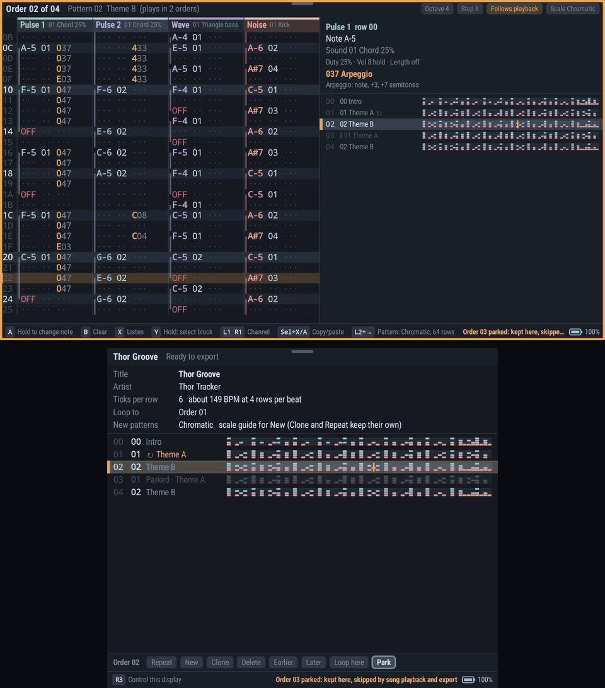

*Playback of the bundled demo song **Thor Groove**: Pattern view on the top screen, Song view on the bottom. Order 03 is parked, so playback goes straight from order 02 to order 04. All screenshots and clips come from the app running in an Android emulator at the Thor's resolutions (1920×1080 top, 1240×1080 bottom). The emulator has no audio.*

## Install

Download the latest APK from the [GitHub Releases page](https://github.com/esko997/thortracker/releases) and sideload it: open it on the device and allow installs from that source, or run `adb install -r path/to/downloaded.apk`. Android 8 or later is required; arm64-v8a and x86_64 are supported.

Each release has `thor-tracker-<version>.apk` and a `.sha256` file to check it with (`sha256sum -c thor-tracker-<version>.apk.sha256`). Releases are signed with the Thor Tracker release key (certificate SHA-256 `d12064692cbaa5c2feecf3cf5a2d3719a088e7bafe1ffa55e1f00aeecafed469`), so each one installs over the last. A build from before 0.8.4, or one you built yourself with the debug key, must be uninstalled once first. That removes the app's private data (recovery copy, button mapping, screen layout); projects saved or exported through the file picker, and exported keymaps, are kept.

The first launch opens the demo song **Thor Groove**. Later launches recover your working document. **File → New blank song** asks which sound chip the song is for (Game Boy, NES, C64 SID, OPL3 or Mega Drive) and starts a new composition; **Load demo** asks the same.

## Steam Deck

Thor Tracker also runs on the Steam Deck (and other x86_64 Linux) as a native program built from the same core: the same views, controls, menus and sound engine, one view at a time on the Deck's screen. It is newer than the Thor app; see `deck/README.md` for what it does and does not do yet.

1. In **Desktop Mode**, download `thor-tracker-<version>-x86_64.AppImage` from the [Releases page](https://github.com/esko997/thortracker/releases) (for example into `~/Applications`).
2. In a terminal (Konsole), make it executable and give it a stable name, so Steam's shortcut never has to change:
   ```sh
   cd ~/Applications
   chmod +x thor-tracker-*-x86_64.AppImage
   ln -sfn thor-tracker-<version>-x86_64.AppImage thor-tracker
   ```
3. In Steam, choose **Games → Add a Non-Steam Game to My Library…**, **Browse…**, set the file type to *All Files*, pick `thor-tracker` and **Add Selected Programs**.
4. Back in **Gaming Mode**, start it from your library (Non-Steam).

To upgrade, download the new AppImage, `chmod +x` it and run the `ln -sfn` line again with the new file name. The Steam shortcut keeps working. Your projects, settings and working song are kept outside the AppImage.

Controls are the Thor's: the D-pad moves, hold A + D-pad edits, Start plays, R2 + A/B/X/Y and R2 + ↑/→/↓ switch views, L2 + A/B undo/redo. **Select + Start** opens the menu (it also opens from a back grip if your Steam Input layout passes them to the game), and the menu has **Quit**. To type a song title, select the title field with A, then press **Steam + X** for the on-screen keyboard. Projects and exports are kept in `~/ThorTracker`; the song you are working on is saved automatically and reopens next time.

## A quick tour

### Pattern editing on both screens

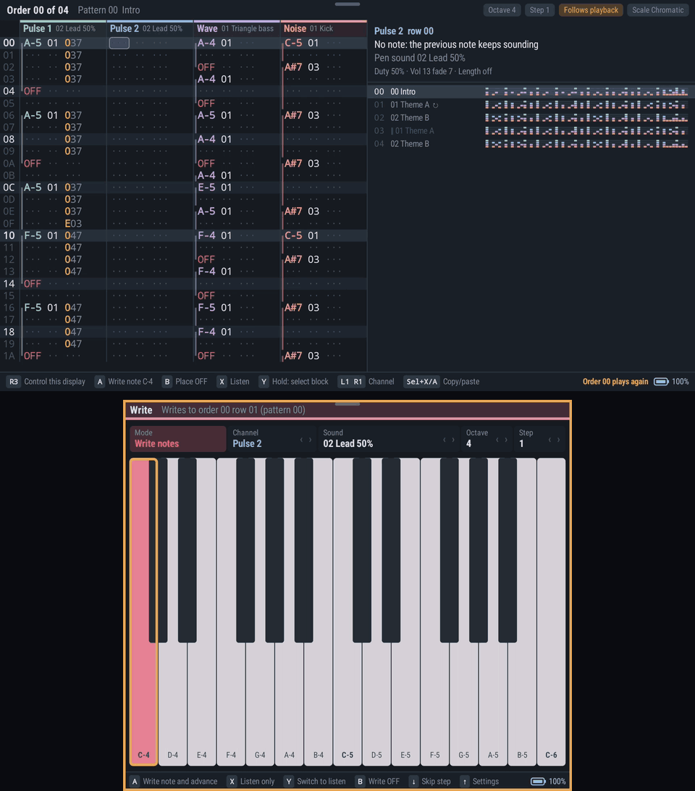

The Pattern view is a four-channel hUGE grid (Pulse 1, Pulse 2, Wave, Noise) with an inspector that explains the selected note, sound or effect. Hold A and use the D-pad to change a value, or put the Keyboard on the other screen in **Write** mode. Each press writes a note at the pattern cursor and moves down a row. Both screens edit the same song, and the order list beside the grid shows where you are.

### Song view: arrangement, loop point and parked orders

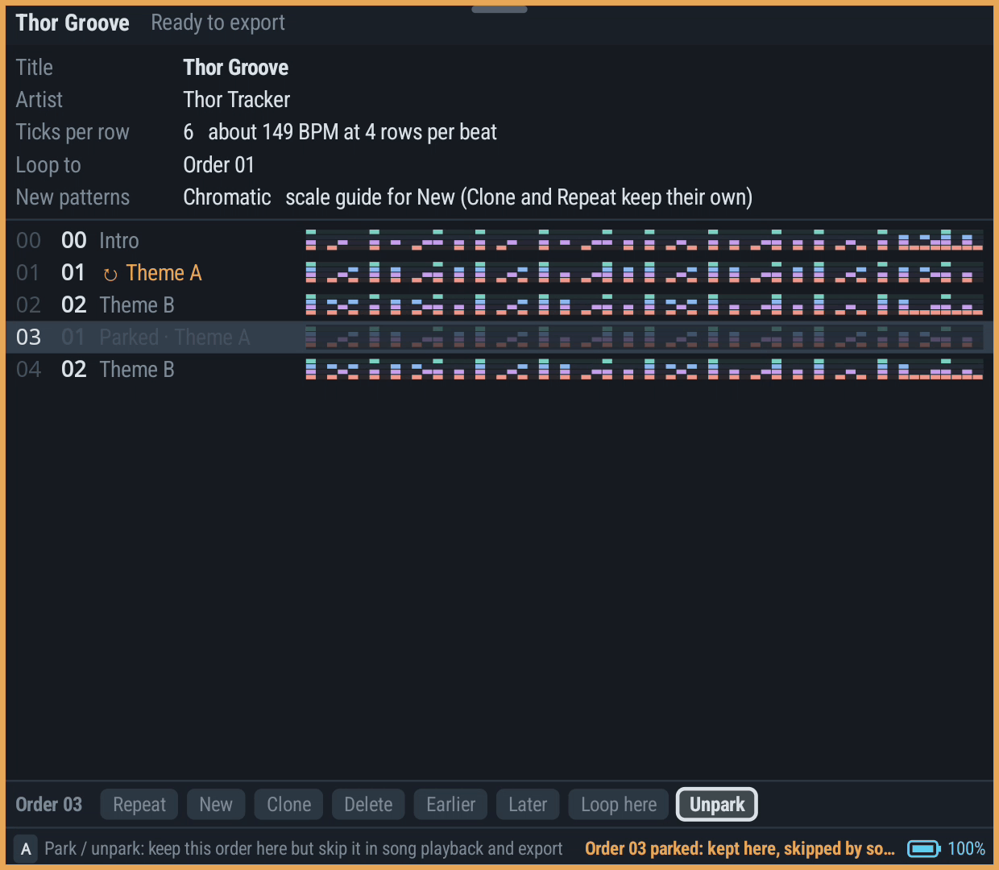

Title, tempo, loop point and the order list with a density strip for each pattern. Order commands repeat, add, clone, delete, move, set the loop point and **park** an order: a parked order keeps its place but playback and export skip it.

### Instrument and Wave: sound design

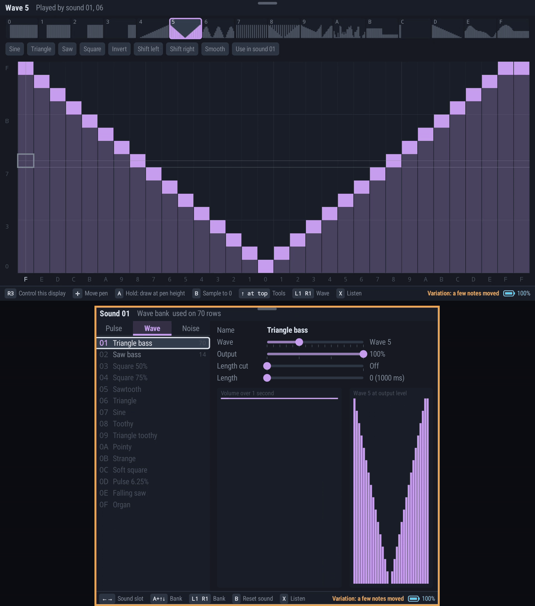

Fifteen instruments in each of the pulse, wave and noise banks, each with live sliders and a preview of its envelope or waveform, plus sixteen 32-sample wave tables you draw directly or start from a preset shape.

### NES instruments: envelopes

An NES song has five channels (Pulse 1, Pulse 2, Triangle, Noise and DPCM) and one bank of 64 instruments shared by all of them. On DPCM an instrument is a set of note → sample mappings (sample, rate, loop), so one instrument can be a whole drum kit; the song carries its samples (imported `.wav` or `.dmc` files, or the built-in starter kit), and song data and samples share the NES's 29690 bytes ($8C00-$FFF9). Each instrument is also four FamiStudio envelopes (volume, arpeggio, pitch and duty), one value per frame, edited with the controller: ↑/↓ choose a row (slot, name, the channel **Listen** plays on, envelope, length, loop, release, pitch mode, then the steps), ←/→ move along the steps, **hold A + ↑/↓** changes a step's value and **hold A + ←/→** carries it to the next step (adding steps at the end). **B** deletes a step, **L1/R1** switch envelope. The loop region and release point are drawn on the steps; a release (volume only) needs a loop. Tabs a channel ignores are greyed for the Listen channel (Triangle has no volume or duty; on Noise, duty picks long or short noise). NES songs have no Wave view; **R2 + →** says so.

### NES DPCM samples

The fifth NES channel, **DPCM**, plays delta-modulation samples. A note on it plays the sample its instrument maps to that key, as in FamiStudio's DPCM instruments; envelopes do not apply there and only `Fxx`, `Gxx`, `Sxx` and `Zxx` (DMC output level) do. The instrument view's last page (**L1/R1** past Duty) edits the mappings with the controller: **Key** (←/→ a semitone, **hold A + ←/→** the next mapped key, **A + ↑/↓** an octave), **Sample**, **Pitch** (DMC rate 0-F, F = 33.1 kHz), **Loop** and **Level** (the initial `$4011` level, the sample's own unless set). Below, the sound's mapped keys sit beside the song's samples with their sizes, the shared 16 KB of sample memory, and the selected sample's waveform, name and initial level; **A** maps the selected sample to the key, **B** deletes it. **Add** offers the built-in starter kit (kick, snare, hat, two toms, bass; synthesized in code, so free to use) on General MIDI drum keys in the shown octave, or a `.wav` or `.dmc` file: the Android document picker, or the Deck's file browser in `~/ThorTracker`. A `.wav` is converted on the device at the rate you choose; each rate shows the resulting size against the free sample memory. X listens to the shown key. In the Pattern view, **hold A + ←/→** on a DPCM note steps through the mapped keys and the inspector (or the status line on narrow screens) names the sample; the Keyboard view labels mapped keys with their samples.

### C64 SID instruments: envelope and programs

A C64 song (**Menu → Files → New blank song → C64 SID**) has three voices, all tonal, one filter for the whole chip and one bank of 63 GoatTracker instruments shared by the voices. The instrument view has six pages (**L1/R1**): **Envelope** (attack, decay, sustain, release with the envelope drawn, and **Preset**: **hold A + ←/→** starts the sound from a saw lead, PWM pad, filter bass, noise snare, wave-arpeggio kick, hi-hat, triangle bass or arpeggio chord); **Wave**, **Pulse** and **Filter**, the sound's programs, edited row by row (↑/↓ a row, ←/→ a column, **hold A + ←/→** changes it; the first column is what the step is: a waveform with gate/sync/ring/test bits, a silent row, a wait, a command or a jump; a pitch is relative to the note, an absolute note for drums, or kept; **A** on a bit switches it and past the last row adds one; **B** deletes a row and **Select + Y** duplicates it, jumps keeping their targets; pulse and filter programs show their width or cutoff over two seconds); **Vibrato·HR** (hard restart, gate timer, first-frame waveform and the instrument vibrato, drawn); and **Tables**, the song-wide wave, pulse, filter and speed tables the player reads, built from the programs (read-only: **A** on a row opens its program). Holding **A** on any sound setting plays the sound on the **Listen** voice and every change restarts it. The Filter page and the Pattern view (a **FILTER** tag on the voice and a line in the inspector) show which voice owns the filter where the song is heard: the last one to start a filter program (or `Axx`; `B00` turns it off). The Song view adds the chip model (8580 or 6581), multispeed (1-16 player calls per frame) and the hard-restart envelope. Effects are GoatTracker's 1-F (Help → Effects); in the Pattern view **B** on an OFF enters **ON** (key on). **Load demo → C64 SID** opens "Raster Run".

### Mega Drive instruments: FM voices and PSG sounds

A Mega Drive song (**Menu → Files → New blank song → Mega Drive**) has ten channels — FM 1-6 (the YM2612), PSG 1-3 and Noise (the SN76489) — each with up to four effect columns; lanes scroll sideways when they do not all fit. One bank of 64 slots holds both kinds of sound: **FM voices** play on FM 1-6, **PSG sounds** on PSG 1-3 and Noise (new notes on each lane start with the first sound of its kind). The instrument view's **Type** row switches a slot between the two. An FM voice has three pages (**L1/R1**): **Sound** — curated controls (**Preset**, the eight YM2612 **Algorithms** drawn as operator diagrams, **Ratios** with detune, brightness, level, feedback, attack, decay, sustain, sustain rate, release, tone decay, key scaling, vibrato and tremolo depths, **SSG-EG** shapes drawn on the envelope), each **hold A + ←/→**; **Expert** — every operator register (DT, MUL, TL, KS, AR, AM, D1R, D2R, SL, RR, SSG-EG) as a grid; **Drum** — a pitch sweep for FM drums. A PSG sound has the NES envelope editor's **Volume**, **Arpeggio** and **Pitch** pages and a **Noise·Drum** page (white or periodic noise at a fixed rate or pitched by the note, and the sweep). The song's region (NTSC/PAL) and LFO rate are on the Song view. **Load demo → Mega Drive** opens "Neon Causeway".

### Sketch: chords and generated phrases

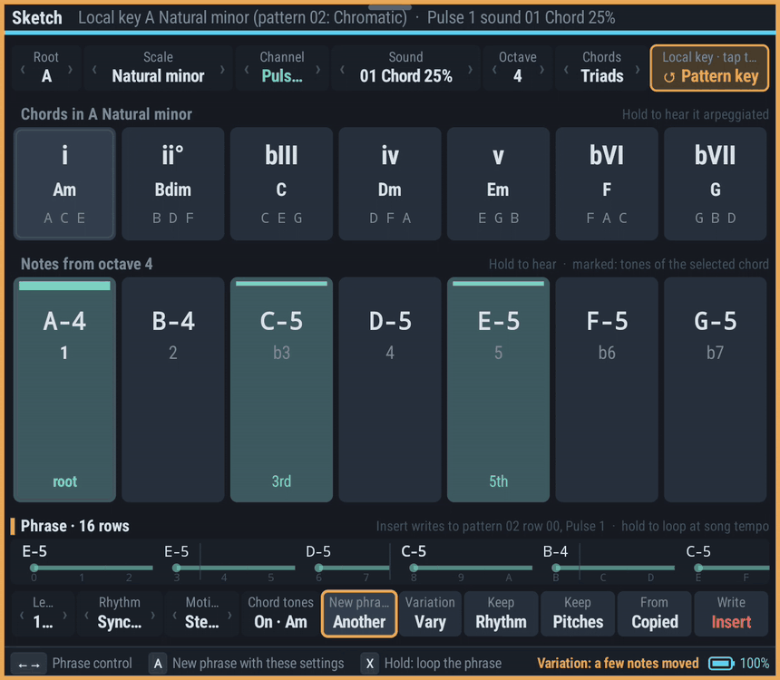

A tonal sketchpad for the current key. Hear chords and scale notes, generate short phrases from rhythm, motion and chord-tone settings (**Another**, **Vary**), then **Insert** one into the pattern as a single undo step.

### Keyboard view

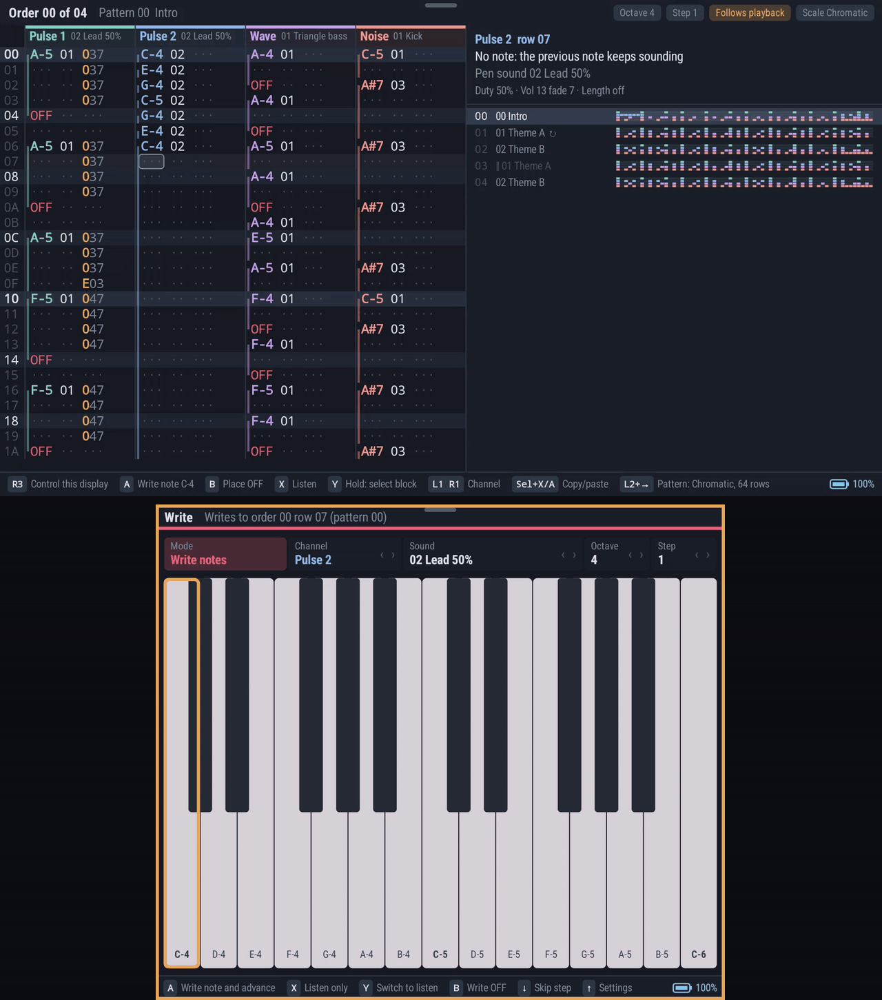

Two octaves of keys. **Listen** mode plays the selected instrument without writing anything. **Write** mode enters notes at the pattern cursor with the chosen step.

### View chords: R2 + A / B / X / Y

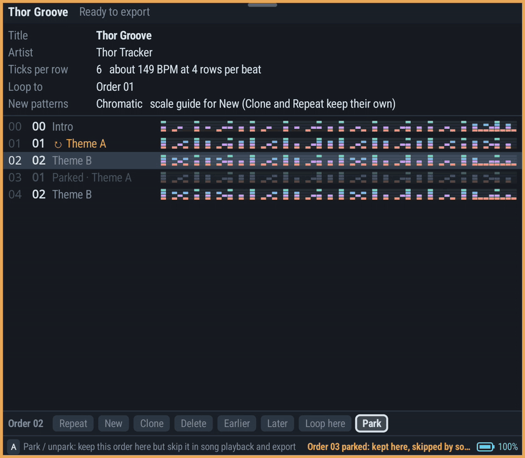

Hold R2 and press A, B, X or Y to show Song, Instrument, Sketch or Keyboard on the focused display. Press the same chord again to go back. R3 moves controller focus between the screens, and the focused screen has an amber border.

## How playback works

Projects use a versioned `.thor` document; export produces hUGETracker `.uge` v6 files. Playback runs the actual pinned hUGEDriver 6.1.3 inside binjgb, through Android AAudio. There is no runtime compiler or separate approximate sequencer. The editor keeps the song in memory; new snapshots are prepared away from the audio callback and applied between driver ticks without restarting the song.

## Build from source

Requires JDK 17, Android SDK platform 35, build tools, NDK `27.0.12077973`, and CMake `3.22.1`. The Gradle wrapper uses Gradle 8.9.

```sh
./tools/build.sh
# APK: app/build/outputs/apk/debug/app-debug.apk
adb -s YOUR_DEVICE install -r app/build/outputs/apk/debug/app-debug.apk
```

`tools/build.sh` uses the host JDK when available, otherwise the workstation's `ubuntu` Distrobox. It serializes Gradle with the shared workstation build lock, limits Gradle to two workers, and runs Kotlin compilation inside a single-use Gradle process rather than leaving compiler daemons resident across worktrees. Explicit command-line flags can override these defaults. Avoid running an Android emulator alongside large builds; use the reserved test handhelds where possible. A conventional environment can instead run `./gradlew :core:jvmTest testDebugUnitTest assembleDebug` with `ANDROID_HOME` set. Both arm64-v8a and x86_64 are included; Android 8 or later is required.

Android's Ninja build uses a two-slot compiler pool per ABI as well: Gradle's worker limit alone does not bound native compiler parallelism. Desktop native sources already compile sequentially, and AppImage compression uses two workers.

The platform-independent code (document model, hUGE rules, lowering and `.uge` export, editor, keymap, panes and transport, and every view's drawing and touch handling) is the Kotlin Multiplatform module `core/`, built for the JVM (used by the Android app in `app/`) and for Kotlin/Native `linuxX64`. Views draw through a small `Surface` interface (rectangles, lines, circles, polylines, text); the app implements it over Android's `Canvas` in `CanvasSurface`, and `TrackerView` is a thin `View` around the shared `PaneView`. Its unit tests run with `:core:jvmTest`; `testDebugUnitTest` runs only the app's Android-specific tests. `:core:linuxX64Test` builds the Linux target and runs `CrossPlatformGoldenTest` there (it also runs on the JVM): number text, built-in tuning notes and bends, and the example `.uge` export must match the JVM results. The first run downloads the Kotlin/Native toolchain to `~/.konan`.

Every push and pull request runs the GitHub Actions `build` workflow (`.github/workflows/build.yml`): core and app unit tests, the core's Linux build, debug and release builds, the sample export compared byte-for-byte with `examples/thor-groove.uge`, and the native hUGEDriver host test. Each run attaches its debug APK. A push to `main` whose `versionName` (in `app/build.gradle.kts`) has no release yet publishes one: the workflow signs the APK with the release key held in repository secrets and publishes `v<versionName>`, with notes taken from that version's section of `docs/VERIFICATION.md`. To release, bump `versionCode`/`versionName` and add that section.

`tools/release.sh` builds the same signed APK locally into `dist/thor-tracker-<version>.apk` with its `.sha256`. It reads the key from `~/.local/share/thortracker/signing/` (or `$THORTRACKER_SIGNING_DIR`) and refuses any other signer or a debuggable build.

Generate a sample project and export:

```sh
./tools/build.sh exportSamples
# app/build/samples/thor-groove.thor
# app/build/samples/thor-groove.uge
```

The verified delivery is `dist/thor-tracker-debug.apk`. `examples/` contains **Thor Groove** and **Controller Study**, each as `.thor` and `.uge`; the latter was entered through the running Thor UI and controller event path. See [verification results and remaining physical checks](docs/VERIFICATION.md) before treating measured engine latency as acoustic latency.

## Views and displays

Each display has one full-size view: **Pattern**, **Song**, **Instrument**, **Wave**, **Keyboard**, **Sketch**, or **Help**. There is no designated “top-screen view” or “bottom-screen view.” Both displays can show the same kind of view and edit the same document. On a single-screen device, switch between views with the view button.

- **View button:** choose a view on that display. Choosing one pins it.
- **Pinned / Context button:** open behavior and layout options.
- **Pin:** prevent automatic changes of view kind.
- **Follow selected item:** follow the other view's published selection.
- **Lock to this item:** retain the current channel, instrument, or wave rather than following selection. Changing the kind of editor releases its old subject lock; swapping views preserves it.
- **Swap:** exchange complete view states, including cursor and scrolling.
- **Focus / R3:** choose which display receives controller input. Touch does not silently move controller focus. The focused view has an amber border and title marker.
- **Follow playhead:** optional in the pattern view; editing can stay at its cursor while playback continues elsewhere.

Preset layouts are Pattern + Keyboard and Pattern + Instrument. View layout, behavior and controller bindings persist between launches. Undo/redo belongs to the document, not the display.

The toolbar is hidden over the full-height editor rather than reserving a row. **Select+Start** reveals it and gives it controller focus: Left/Right choose, A activates, and B/Back returns to the editor. It stays visible while controller-focused. Tap or pull the small top-centre handle for touch use; that reveal hides after six idle seconds. Neither transition moves the grid. On the narrower display, **Swap**, **Undo/redo** and **File** remain available through **Menu**.

The right end of each display's hint bar shows the battery: grey normally, cyan while plugged in or charging, red at 15% or below on battery.

App menus, confirmations, rename fields and errors are in-app overlays on their originating display. Up/Down choose, A activates, B/Back returns one level, and L1/R1 page long menus. Android's document picker and keyboard remain system-owned.

Short cell and key afterglows, channel activity lamps, and focus/view transitions provide feedback without moving the grid or obscuring text. Animations settle completely when idle and honor Android's animator-duration setting, including disabled animations.

## Controller reference

Every control is rebindable in **Menu → Controls**: one row per control, grouped by area, with its current binding on the right. Choose a row, then press the new button, or hold **Select, L2, R2 or L3** and press a button for a chord. Held controls (D-pad, Edit, Clear, Listen, Select block) take a single button. Some controls only act in certain views; their rows name those views, e.g. "Delete row / order (Pattern, Song)". Two controls can share a binding when no view has both, so one chord can mean different things per view (by default **L2+→** opens the pattern panel in Pattern and raises the listening octave in Instrument, Wave, Keyboard and Sketch). Assigning a binding another control in an overlapping view uses asks first and leaves that control unbound; the D-pad, Edit and Clear can never be left without a button. Menu and Back are fixed, so the screen is always reachable. The hint bar, held-modifier chord hints, popups and Help show your bindings for the focused view.

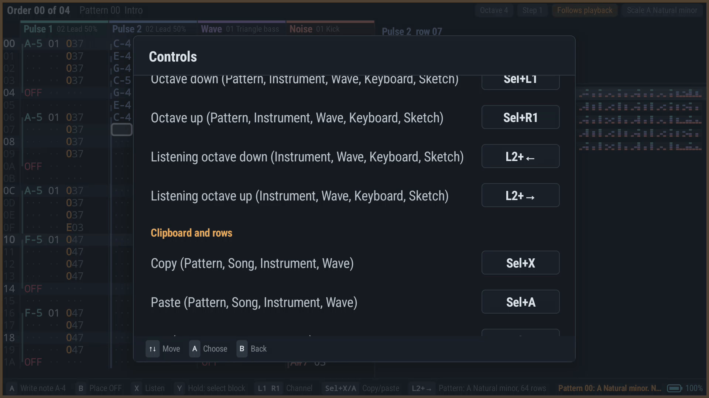

Bindings survive app updates. Uninstalling or clearing app data removes them, so use **Export keymap…** to save a `thor-tracker-keymap.json` anywhere (e.g. Download) and **Import keymap…** to restore it, or to copy it to another handheld. The file is readable JSON (`"UNDO": "L2+A"`). Remaps from earlier versions are converted automatically. A keymap from an earlier version gains each newer control's default, unless that file already uses the same button for something in the same view; then the new control starts unbound. A keymap you never changed takes the current defaults, including moved ones (0.8 moved Redo from R2+A to L2+B for the R2 view chords); a changed one keeps its Redo on R2+A and leaves Show Song unbound. 0.8.1 writes keymap version 4 (adds Loop pattern on L2+Y); 0.8.6 writes version 5, giving Pattern, Wave and Help their R2 + ↑ / → / ↓ chords (an older keymap gains them unless it already uses those chords). Earlier versions do not import newer keymap files. The table below lists the defaults.

| Input | Action |
| --- | --- |
| D-pad | Move through fields, rows or tools |
| Hold A + D-pad | Change the selected value; horizontal fine, vertical coarse |
| Tap A | Enter the last note/value, or activate a command |
| Tap B | Clear the selected field; on an empty pattern note, place OFF |
| Hold B + D-pad | Move or jump without clearing on release |
| Hold X | Audition without writing |
| Hold Y + D-pad | Mark a pattern block |
| Right stick ↑ ↑ / ↓ ↓ | Pattern (controller-focused, pattern panel closed): two quick flicks the same way, letting the stick return to centre between them, move the cursor to the pattern's first / last row (its last played row for a shortened pattern). One flick, holding the stick, or flicks interrupted by a button press, a popup, the toolbar or a focus change do nothing; the D-pad and left stick are unchanged. Not rebindable |
| L1 / R1 | Change channel, instrument bank, wave or help page; NES Instrument view: envelope or DPCM page; C64 Instrument view: envelope, program, vibrato or tables page |
| L2 / R2 alone | No action; chord modifiers only |
| L2 + A / L2 + B | Undo / redo |
| R2 + A / B / X / Y | Show Song / Instrument / Sketch / Keyboard on the focused display; the same chord again returns to the previous view |
| R2 + ↑ / → / ↓ | Show Pattern / Wave / Help on the focused display, likewise (Wave: Game Boy songs only) |
| L2 + X | Swap complete views, including their cursors and scrolling |
| Select + X / A / B | Copy / paste / cut |
| Select + Y | Duplicate (C64 Instrument view, on a program row: a copy of the row below it) |
| Select + L1 / R1 | Lower / raise the octave (Pattern entry; listening note elsewhere) |
| L2 + Left / Right | Instrument, Wave, Keyboard, Sketch: lower / raise the listening octave; while X is held the sound restarts at the new octave |
| Select + Up / Down | Pattern: insert / delete a row in the channel or selection. Song: insert / delete an order |
| L2 + Right | Pattern: open/close the current pattern's root/scale/length panel |
| Start | Play from row 00 of the current pattern's order, or stop |
| L2 + Start | Play from the current cursor, or stop |
| L2 + Y | Loop the current pattern on / off (header shows **Looping**). Playing, the loop keeps the current row if that pattern is playing, otherwise starts it at row 00; turning it off plays on through the song. While on, Start / L2 + Start loop whichever pattern they play. The loop follows its pattern when orders are inserted, deleted or moved. Editor playback only; the song's own loop and export are unchanged |
| Select + Start | Reveal/focus the toolbar, or return to the editor |
| R3 | Switch controller focus between displays |
| Menu / Back | Application menu; Back closes a popup or focused toolbar first |

A held adjustment or wave-drawing gesture is one undo step. Overlapping gestures on the two displays share a step that commits after both end. Undo during a held controller adjustment ends that step; further changes start a new step. Undo during a touch drag ends its edits until the finger lifts. Touch drags keep their original instrument or wave, and selection/playhead following waits until the gesture ends. Opening a menu or leaving the app ends active gestures and releases audition notes. **Menu → Play from song start** explicitly starts at order 0, row 0; it is not a toggle.

Hold the modifier **before** pressing its chord button. While Select, L2, R2 or L3 is held, the focused display's hint bar shows only that modifier's chords that act in the focused view; holding two shows that no chord applies. With a modifier held, a button without a chord in that view does its ordinary job. An A press that precedes L2/R2 remains an ordinary edit; note entry is not delayed waiting for a possible chord. Consumed chords suppress repeats and releases, even if the trigger is released first. Undo/redo and screen swap also work over app popups without choosing their highlighted item. Bare L3 is also unbound.

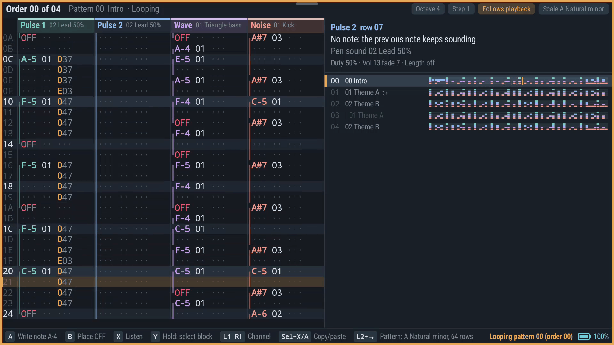

### Enter a phrase

1. Choose Pattern. Navigate to a note field, hold A and use the D-pad to select a pitch. The adjacent sound field selects an instrument.
2. Tap A on subsequent empty rows to repeat the last note. **Menu → Entry step** sets the row advance.
3. Alternatively, put Keyboard on the other display, select **Write** with Y, and enter notes there. **Listen** mode auditions without changing the pattern.
4. Hold Y and move to mark a phrase; Select+X copies it, Select+A pastes it. L2+A undoes a mistake.
5. Press Start to hear the phrase, edit while it plays, and stop/start or seek without saving or exporting.

**Menu → Song details / tempo** opens the Song view with **Ticks per row** selected. Hold A+Left/Right to change it; a lower value is faster. The view also edits title, artist, arrangement, loop point and **New patterns**, the scale guide every pattern made with New starts in (A+Left/Right scale, A+Up/Down root, B Chromatic; Clone and Repeat keep the source pattern's scale, and existing patterns are unchanged), with repeat/new/clone/delete/move commands. Inserting, deleting, moving or cloning orders keeps the loop point and every stored `Bxx` jump on the same order entry (`B00`, "next order", is relative and unchanged); a jump aimed at a deleted order lands on the order that takes its place. Deleting an order never deletes its pattern. Instrument edits affect later note triggers. The Wave view edits the 32 four-bit samples directly; held drawing and touch drags are grouped for undo.

**Parking orders.** In the Song view, the **Park** command on an order keeps it in place, with its pattern and everything in it, but song playback and `.uge` export skip it. Parked rows are dimmed and marked "Parked"; the Pattern view's order list marks them `‖` and its header says "Parked". **Unpark** puts the order back in the song. Starting playback on a parked order loops it on its own until you stop. Repeat, New and Clone next to a parked order are parked too. A loop point or `Bxx` jump aimed at a parked order goes to the next played order after it, or the loop point if none follows. Insert, delete, move and undo keep the parking with its order. The last playing order can't be parked or deleted.

The keyboard's base octave is limited to 7. Keys above B-8 are dark and unavailable rather than silently clamped to another pitch.

### Pattern scales

Tap **Scale** in the Pattern header or press **L2+Right**. Up/Down chooses Root, Scale, Length or Notes; Left/Right changes it; B resets that field and A/Done (or L2+Right again) closes. On **Notes**, A (or a tap on the button) runs **Fit notes to scale**: every played Pulse/Wave note outside the scale moves to the nearest scale note, an exact tie going down, as one undo step. Instruments and effects stay; Noise, hidden rows past the pattern length and OFF are untouched. It does nothing for Chromatic, and in a tuned song it points to **Menu → Tuning → Fit notes** instead. The root strip and arrows are also touchable.

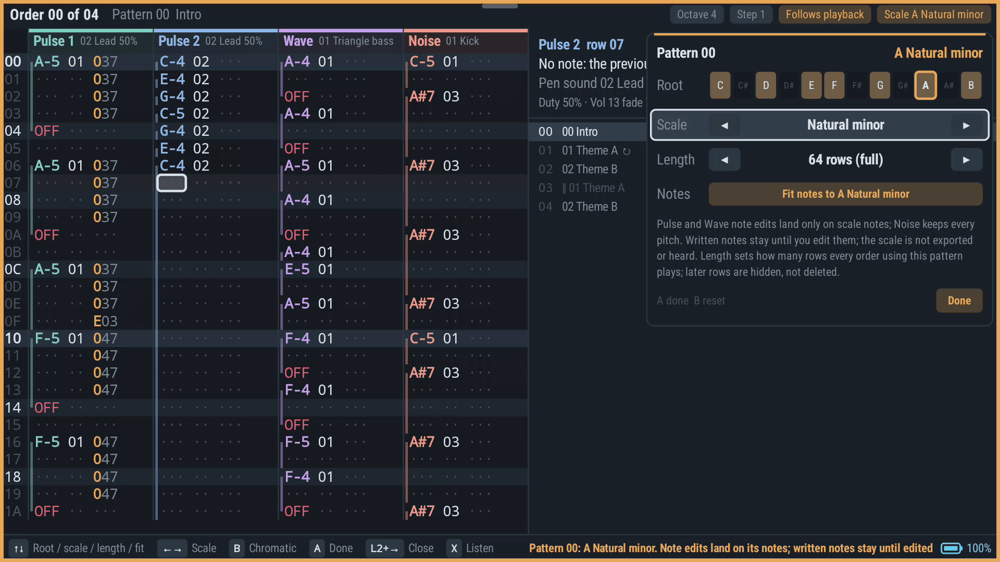

Moved notes are rewritten, and each one is marked in the grid with an amber field and a ▴/▾ tick showing which way it went; the inspector reads e.g. "Note G#5 · fitted from A-5". Fitting again after choosing another scale keeps the marks relative to the notes before the first Fit, so chained Fits show their total drift; a note that lands back on its original pitch loses its mark. A mark stays while its cell holds exactly what the Fit wrote: editing that cell (note, sound or effect) removes just its mark, other marks stay, and undoing the Fit removes them all. Inserting or deleting rows clears the pattern's marks, since the notes no longer sit where they were fitted. Marks are not saved with the project. **Menu → Tuning → Fit notes** marks its moves the same way, including a note whose `40y` bend alone changed (the inspector shows e.g. "fitted from E-5+7").

Chromatic is the default. Every other scale constrains Pulse/Wave D-pad note entry to the chosen root's scale: Major, Natural/Harmonic/Melodic minor, Dorian, Phrygian, Lydian, Mixolydian, Locrian, Major/Minor pentatonic, Blues, Whole tone, Phrygian dominant, Double harmonic, Hungarian minor, Hirajoshi and Miyako-bushi (In). Horizontal edits visit successive scale notes; vertical edits move an octave, snapping an existing out-of-scale pitch in the edit direction. Changing the guide never transposes written notes. Noise and the piano keyboard remain chromatic; effect parameters remain raw hUGE values.

The guide belongs to the pattern, so repeated orders share it. It is undoable, saved in the project and preserved by pattern cloning/whole-pattern paste. Block paste still copies cells only. Scale metadata itself changes neither preview bytes nor `.uge` output.

### Microtuning (song tuning from a Scala `.scl` file)

**Menu → Tuning → Built-in tunings…** offers 19-TET, 22-EDO, 24-TET (quarter tones) and 5-limit just intonation; **Load .scl file…** reads any other [Scala](https://www.huygens-fokker.org/scala/scl_format.html) scale (cents or ratios, any period). The bundled files live in `app/src/main/assets/tunings/`. The same menu chooses which note sounds 1/1 (default C-5), the **accuracy limit** (5¢ default, 10¢ or 20¢), fits existing notes, or removes the tuning.

The stock GB driver has no microtuning, so each tuned degree is written as the nearest note plus `40y`, a fixed upward bend of 0–15 driver steps; degrees that coincide with a normal note need no effect. Preview and `.uge` export are ordinary hUGE data.

- **Entry stays in tuning.** In a tuned song, hold A + Left/Right on a Pulse/Wave note steps through reachable degrees only; Up/Down moves a whole period. The Keyboard view plays and writes the nearest reachable degree. Noise is never tuned.
- **Reachable means within the accuracy limit**, measured against the driver's own 12-note grid (so plain notes stay plain and a 12-equal `.scl` needs no bends). That grid is itself up to about 25¢ off true 12-TET in the highest octaves, so the inspector's `±x¢` is relative to the driver, and absolute error can be larger there. Bends are tiny in low octaves: with 24-TET at 5¢, octave 5 has all 24 quarter tones, octave 6 has 23, octave 3 only the 12 ordinary notes. The status line after loading reports how many degrees are reachable.
- **The bend needs the row's effect slot.** If another effect is there, the editor refuses to bend that note rather than overwrite it, and Help → Song check warns about tuned notes that will play untuned.
- **Held notes keep their bend** on later rows; a new note sounds for its first tick (~17 ms) at the plain note before the bend applies — a driver limit verified in the native test.
- **Fit notes to tuning** (this pattern or the whole song) snaps existing Pulse/Wave notes to the nearest reachable degree in one undo step; notes whose effect slot is taken are left and counted. Applying or changing a tuning never moves notes by itself.
- The inspector shows each tuned note's degree and error (e.g. `7/24 +1.2¢`). Pattern scale guides and Sketch remain 12-note references in tuned songs.

### Pattern length and polyrhythms

The same panel's **Length** row sets how many rows the pattern plays, 1–64. Press Down to reach it; Left/Right changes it by 1, L1/R1 by 8, B returns to 64, and the ◀ ▶ arrows are touchable. Every order that uses the pattern plays that many rows and then moves to the next order. Rows past the length are hidden, not deleted: lengthening the pattern brings them back, and insert/delete row only shifts the played rows.

Lengths apply to all four channels together; the GB driver has no per-channel position. For polyrhythms, combine pattern lengths in the arrangement (for example 48 then 20), or write different phrase lengths in one pattern whose length is their common multiple. The Song view's order list labels short patterns with their length and draws their density strips proportionally shorter.

For preview and export, hidden rows are blank and the last played row receives `D01` in the first free effect slot (unless it already has `Dxx` or `Bxx`). A song check error asks you to free one effect slot if that row uses all four. Whole-pattern copy/paste and pattern cloning keep the length. `Dxx` breaks that would land on a hidden row of the next pattern are reported.

### Sketch: explore a key, try phrases

Press **R2+X**, or reveal the toolbar, choose the current **View** button, then **Sketch**. If you opened the toolbar with Select+Start, press B/Back after choosing the view to return controller focus to the editor. Sketch can be pinned on either display, swapped with L2+X, or opened independently on both.

- **Up/Down** chooses settings, chords, notes or phrase; **Left/Right** chooses within that row.
- On settings, **hold A + D-pad** to change root, scale, tonal channel, sound, octave or **Chords** (Triads or Circle). Touch the left/right half of a setting to decrease/increase it.
- **Hold A or X** on a chord to hear a repeating root-position arpeggio; on a note to sustain it. Release to stop. Touch and hold a pad, or slide between pads, for the same preview.
- **L1/R1** chooses Pulse 1, Pulse 2 or Wave. Noise is intentionally excluded from this tonal reference.
- **Y** or **Pattern key** returns to the pattern's root/scale. Until you change it, Sketch follows that guide; after a local change, the pattern's guide and all written notes remain untouched.

Seven-note scales show their stacked-third triads; stacks that are not major, minor, diminished or augmented (e.g. double harmonic's V) are left out. Other scales (pentatonics, blues, whole tone, Japanese scales) show only standard triads made entirely of their notes. Chromatic offers twelve note pads and asks you to choose a scale for a chord shortlist. Notes show pitch and interval degree; the selected chord marks its root, third and fifth. Degrees and roman numerals use major-scale-relative intervals (`b3`, `#4`, `bIII`, etc.); pitch names use the tracker's sharp spelling.

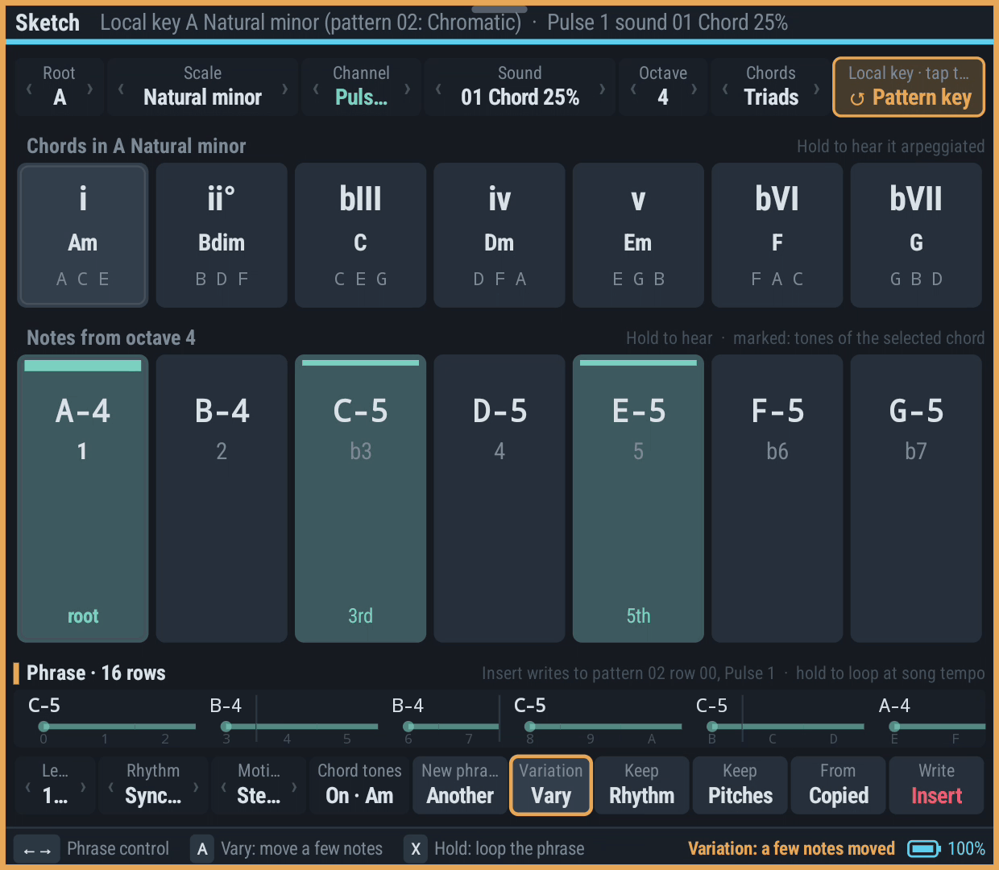

**Circle of fifths.** Set **Chords** to *Circle* and the chords row shows the twelve major keys clockwise by fifths (C at the top), their relative minors on the inner ring. Sketch's current key is filled; its IV and V neighbours on the same ring are marked. **Left/Right** moves the cursor by fifths, **B** switches between the major key and its relative minor, **hold A or X** hears that key's tonic triad, and **tap A** makes it Sketch's local key (Major or Natural minor). Touch works the same: hold a key to hear it, lift without sliding to choose it. A scale sits where its tonic's third puts it (D Dorian with D minor); Chromatic and scales without a major or minor third have no place. Y still returns to the pattern key.

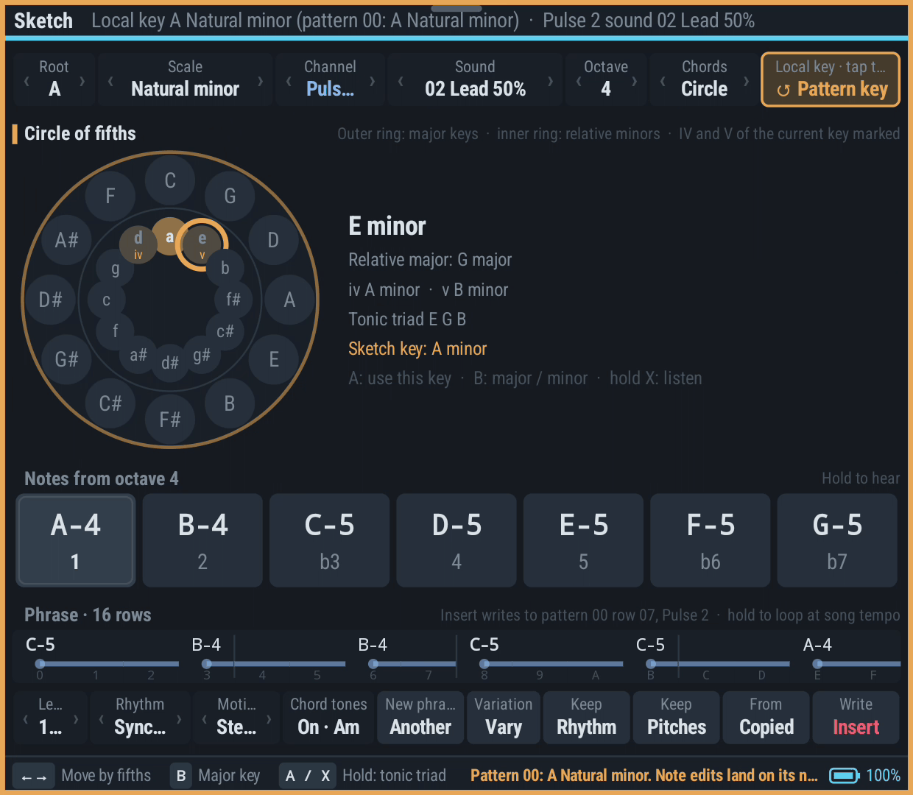

**Phrase.** The bottom row shows a short phrase, one column per row: a note name where a note starts, a held line while it sounds on, row numbers below. Left/Right walks the controls:

- **Length** (4–16 rows), **Rhythm** (Sparse, Even, Syncopated), **Motion** (Steps, Leaps, Rising, Falling) and **Chord tones** (strong rows land on the selected chord's tones): **hold A + Left/Right** changes them and regenerates the phrase from the same seed; tap A steps Rhythm/Motion or toggles Chord tones.
- **Another** draws a new phrase with these settings. **Vary** changes the current one: with **Keep rhythm** on, new pitches on the same rows; with **Keep pitches** on, the same notes on new rows; with neither, one to three notes move a scale step and maybe one note shifts a row. The two Keep toggles exclude each other.
- **From copied** turns the first channel of copied pattern cells (Select+X in the Pattern view) into the phrase.
- **Insert** writes the phrase at the pattern cursor (the shared selection) on Sketch's channel with Sketch's sound, as one undo step, then moves the cursor past it. Rows without a new note have their note and sound cleared so the previous note sounds on; effects stay. The phrase is cut at the pattern's end.
- **Hold X** anywhere on the row (or hold A on the phrase strip) loops the phrase, one row per step at the song's ticks per row. Touch and hold the strip for the same.

Generated notes come only from the key (any semitone for Chromatic), within about an octave and a half from the Sketch octave's root, and always start on row 0. The phrase keeps its notes when you change key or octave; Another and Vary use the current ones.

Apart from Insert, Sketch never writes notes, consumes undo history or changes project/export bytes. Local key, circle, phrase and cursor settings belong to the device workspace and survive reopening. The preview uses the selected song instrument through hUGEDriver and temporarily borrows that channel while the other channels continue. Chord notes repeat every 180 ms as a listening reference; voicings near the top of the GB range shift down together rather than clipping notes. Menus, view swaps, focus/lifecycle changes and release cancel held previews.

In a tuned song Sketch stays a 12-note reference (its header says so); Insert moves each note to the nearest reachable tuned pitch and skips, and counts, notes whose bend would need a row's occupied effect slot.

### Arpeggio and OFF

The effect-type picker distinguishes **no effect** from selecting **0 (arpeggio)**. Choosing 0 displays `000` and its explanation without changing the sound. Move to the value field and set `xy` to produce `0xy`; for example `047` alternates the note, +4 and +7 semitones. `000` itself remains no effect.

**OFF** immediately silences the channel, with no release tail; it uses that row's effect slot as `E00`. For stutter/retrigger, repeat a note with a nonzero instrument on successive rows, adjusting ticks per row if finer spacing is needed. The supported hUGE effect set has no dedicated retrigger command; that is a driver/editor limitation, not a prohibition in the GBC sound hardware.

## Sound and export rules

The first backend is explicitly **GB/hUGE**: two pulse channels, one wave channel and one noise channel; up to 64 rows per pattern; one effect per channel per row. There are 15 instrument slots in each pulse/wave/noise bank and 16 wave tables. Instrument 0 means **legato**: it does not retrigger or reload an instrument. A legato note after a cut can therefore remain silent.

- Pattern edits are heard from the next row; updates do not restart transport.
- Instrument changes apply on the next note that loads that instrument. A sustained note keeps its existing envelope/settings.
- Wave edits reload on the next wave-channel note with an instrument.
- The base tempo can change while playing.
- Audition temporarily borrows the selected channel; the other song channels continue. The borrowed song channel resumes at its next note after audition release.
- Seeking reconstructs driver state by silently running earlier rows. Extremely long or unreachable positions use a fresh state at the requested order's beginning; see the audio document for the exact bound.

**Help → Check** lists export errors and warnings. The app will not silently export unsupported driver routines or broken noise pitch effects. An unfinished, export-invalid song can still be saved as a project. A problem in a pattern no order plays (for example a `Bxx` to an order that no longer exists) is only a warning until an order uses that pattern again. If a live edit cannot be lowered, playback keeps the last playable version and a message stays on screen ("Playing the last playable version, not your latest edits: …") until the problem is fixed.

The Game Boy's own export is `.uge`; every system can also export a `.wav` recording (below). GB-specific editing semantics live in the backend; future backends can define different channels, instruments and editors without pretending that GB songs convert losslessly to other chips.

- [UGE export format, effects and limits](docs/UGE_EXPORT.md)
- [Actual-driver playback, update semantics and native verification](docs/AUDIO_ENGINE.md)
- [Agreed scope and implementation plan](PLAN.md)

## Export to WAV

**Menu → Files → Export .wav…** records the song as a 48 kHz 16-bit stereo `.wav`, on every sound system. The song is rendered offline by the same native player and chip emulation you hear while editing, so the file sounds exactly like playback from the song start, a lot faster than real time. A progress popup shows how far it is and can cancel the export; Back (or Hide) closes the popup while the export carries on, and Files → Export .wav shows it again. First choose the length:

- **Once through, then fade out** (the default): from the song start to the loop point (the first row the song plays a second time, wherever the order list or a jump sends it back, including a row that jumps to itself), then a 5-second fade-out while the song plays on into its loop.
- **Once + 1, 2 or 3 loops, then fade out**: as many extra passes of the loop before the fade.
- **Once through, no fade**: ends at the loop boundary. The file includes any intro; seamless looping is not guaranteed because chip phase and envelopes can differ between the beginning and end.

The fade-out is the looping song getting quieter, not a command releasing all notes: the engine interface has no song-wide "stop with release". When the faded song is silent (it ends by looping an empty pattern), the file keeps one second of silence after the last sound rather than the silent loop. The song part stops at 10 minutes if no loop point has been reached yet, or if the requested loop passes would run longer, then fades; the export reports that limit instead of calling the file complete.

The file is written to disk while it renders, so memory use stays small whatever the length. On Android it renders first; then **WAV ready** offers **Save .wav…** (the document picker) or **Discard**, so nothing appears in your storage until the file is complete. On the Steam Deck the file browser asks first (in `~/ThorTracker`), and the file appears there when it is complete. A cancelled or failed export leaves no partial file behind.

## About, diagnostics and bug reports

**Menu → Help**, page **About** (←/→ to the last page) shows the version, each sound system's driver with its version and source pins, and the licence. Press **A** there for:

- **Report a bug…** opens the [bug report form](https://github.com/esko997/thortracker/issues/new/choose) in the browser on Android; the Steam Deck shows the address to open.
- **Copy diagnostics** makes a plain-text report for the issue: version, device and system version, display sizes, the current song's sound system and driver, audio statistics (sample rate, burst/buffer size, underruns, slowest audio callback, driver faults), the keymap version and the last 20 status and error messages. Android copies it to the clipboard; the Steam Deck writes `~/ThorTracker/diagnostics.txt`. It contains no song data.

Thor Tracker has no network access and no telemetry: nothing leaves the device unless you paste it somewhere yourself. To report a bug, open the form, fill in the version, device, sound system and the steps that show the problem, and paste the diagnostics. Attaching the `.thor` project (zipped) helps when the problem is in a song.

## Saving and recovery

**File → Save / Save as / Open / Export .uge** uses Android's document picker and user-selected locations; no broad storage permission is requested.

- Working changes are automatically written to an app-private, atomically replaced recovery file after a short debounce and when the activity pauses.
- Replacing a document retains one previous-project recovery backup. A later replacement overwrites that single slot: use named project files for permanent versions.
- Unreadable recovery files are quarantined intact rather than replaced in place. The app reports the failure and retained location.
- Opening a project validates its version and structure before replacing the working document.
- 0.9.0 saves project format 9: the song names its sound system (`backend`: `gb-huge` for the Game Boy, `nes-famistudio` for the NES), keeps the chip's instruments in its `sound` object, and stores notes in scientific pitch (0 = C0, A4 = 57 = 440 Hz), so a note number is the same pitch on every system; names stay each tracker's own (hUGETracker's C-3 is C2). Earlier releases cannot open format 9 files. Format 1-7 projects (all Game Boy songs) still open and upgrade, as do development builds' format 8 files; their `.uge` export is byte-identical. 0.8.2 saved format 7 (per-pattern scale and length, extended scale list, song tuning, the song's scale for new patterns and parked orders); format 1-6 projects read as Chromatic, 64-row, untuned patterns with nothing parked where those fields are absent.
- NES songs with the DPCM channel save NES data version 2 (`backendVersion` 2): a fifth pattern track (DPCM), the song's DPCM samples (`sound.samples`: name, DMC bytes, initial value) and each instrument's note → sample mappings (`dpcm`). NES data version 1 songs (0.9.0) open with an empty DPCM track and keep the whole song budget while they have no samples; releases before DPCM cannot open version 2 files. Game Boy files keep `backendVersion` 1 and are unchanged.
- C64 SID songs save backend `c64-sid`, SID data version 1 (`backendVersion` 1), in project format 9: three pattern tracks; `sound` holds the 63 instruments (ADSR nibbles, `restart` hard/gateOff/legato, gate timer, first wave, `vibrato`, and `wave`/`pulse`/`filter` programs as `[left, right]` GoatTracker table rows plus `at`, the table row the program is placed at so its rows stay put across edits), the `chip` (`8580` or `6581`), `multispeed` (1-16) and the hard-restart envelope. GoatTracker's song-wide tables are not stored: the instruments' programs and the effects' speeds build them when the song plays or exports. Key on is note -3 (SID only). Releases before the SID cannot open these files; Game Boy and NES files are unchanged.
- OPL3 songs save backend `opl3-fm`, OPL3 data version 1 (`backendVersion` 1), in project format 9: nine pattern tracks whose cells may carry up to four effect columns — a cell is `[note, instrument, effect, param]` followed by `effect, param` for each further column it uses (trailing empty columns are not written, so one-column cells look exactly as before); `sound` holds the 64 instrument slots (`null` = empty; otherwise `name`, `fourOp`, `algorithm`, `feedback`, four `operators` with the chip's register fields `mult tl ar dr sl rr wave ksl am vib sustain ksr`, and the drum `sweep` start/end/speed), the chord-shape table `chords` (`name`, 1-4 `intervals`), `multispeed` (1-8) and the `deepTremolo`/`deepVibrato` depths. Releases before the OPL3 cannot open these files; Game Boy, NES and SID files are unchanged byte for byte.
- Mega Drive songs save backend `ym2612-fm`, Mega Drive data version 1 (`backendVersion` 1), in project format 9: ten pattern tracks (FM 1-6, PSG 1-3, Noise) whose cells may carry up to four effect columns as OPL3 cells do; `sound` holds the 64 instrument slots (`null` = empty; otherwise `"type":"fm"` with `name`, `algorithm`, `feedback`, `ams`, `fms`, four `operators` with the YM2612's register fields `dt mul tl ks ar am d1r d2r sl rr ssgEg` and the drum `sweep`, or `"type":"psg"` with `name`, the `volume`/`arpeggio`/`pitch` envelopes (`values`, `loop`, `release`, as NES envelopes), `pitchRelative`, the Noise channel's `noise` mode and the `sweep`), `pal` (the region) and `lfo` (register $22 at the song start: 0 or 8-15). Releases before the Mega Drive cannot open these files; Game Boy, NES, SID and OPL3 files are unchanged byte for byte.
- Recovery writes use a separate queue from document-provider I/O, so a stalled external save cannot block recovery of newer edits. Both run off the UI thread.
- Saving captures the version selected for that operation. If editing continues, the app reports that newer edits remain unsaved. Completing an older save cannot attach its destination to a different document.
- Android document providers control the durability and atomicity of writes to their own destinations; the app-private recovery copy remains separate.

Undo/redo is session history, not part of the serialized project format. App-private recovery is not a substitute for external backups; uninstalling or clearing app storage removes it.

## Verification commands

```sh
./tools/build.sh :core:jvmTest :core:linuxX64Test testDebugUnitTest assembleDebug assembleDebugAndroidTest exportSamples
./tools/audio/run_native_host_test.sh
adb -s YOUR_TEST_DEVICE install -r app/build/outputs/apk/debug/app-debug.apk
adb -s YOUR_TEST_DEVICE install -r app/build/outputs/apk/androidTest/debug/app-debug-androidTest.apk
adb -s YOUR_TEST_DEVICE shell am instrument -w org.thortracker.test/androidx.test.runner.AndroidJUnitRunner
```

Only run device checks on a device reserved for the test; the controller workflow test edits the app's working document. Host playback checks produce a WAV and driver trace under `evidence/audio/`. The sample `.uge` has also been converted with gbc-puzzler's pinned `uge2source`, built into an isolated copy of the game and exercised by its actual-ROM sound smoke; the original game worktree is not modified.

## License

Thor Tracker is free software: you can redistribute it and/or modify it under the terms of the GNU General Public License as published by the Free Software Foundation, either version 3 of the License, or (at your option) any later version. It is distributed in the hope that it will be useful, but WITHOUT ANY WARRANTY; without even the implied warranty of MERCHANTABILITY or FITNESS FOR A PARTICULAR PURPOSE. See [LICENSE](LICENSE).

The bundled third-party components keep their own licenses, all compatible with the GPL (see Dependencies).

## Dependencies

binjgb is MIT licensed; its full notice is in `app/src/main/cpp/third_party/binjgb/LICENSE` and bundled in the APK's `assets/NOTICE.txt`. hUGEDriver 6.1.3 is public domain and pinned under `third_party/`. The Steam Deck build adds SDL3 (zlib license), stb_truetype (public domain / MIT) and the Noto fonts (SIL Open Font License, `deck/fonts/OFL.txt`); its AppImage carries the same `NOTICE.txt`. See the audio document for exact source revisions and the one-time player-image regeneration procedure.

The NES system (0.9.0) adds the FamiStudio sound engine 4.5.3 (its own all-permissive notice; its note tables and the test song are MIT), pinned under `third_party/famistudio-4.5.3/` and pre-assembled into `app/src/main/cpp/generated/nes_player_image.h`; the `m6502.h` 6502 emulator from floooh/chips (zlib license); and blip_buf 1.1.0 (LGPL-2.1-or-later), both under `app/src/main/cpp/third_party/`. The 2A03 APU emulation is Thor Tracker's own code. All notices are in `NOTICE.txt`.

The C64 SID engine (in progress: a native engine without editor support yet) adds the GoatTracker 2.77 playroutine by Lasse Öörni (its own notice: not under the GPL, free for any use), pinned under `third_party/goattracker-2.77/` and pre-assembled into `app/src/main/cpp/generated/sid_player_image.h`, and reSID 1.0 by Dag Lem (GPL-2.0-or-later, github.com/daglem/reSID commit `02c456ab`) under `app/src/main/cpp/third_party/resid-1.0/`, built as C++17 (the app and the Deck link the C++ runtime). GoatTracker's packer and assembler are used offline only (`tools/audio/fetch_goattracker.sh`). Notices are in `NOTICE.txt`.

The OPL3 (YMF262) FM engine (in progress: a native engine without editor support yet) is Thor Tracker's own player in C on Nuked-OPL3 1.8 by Nuke.YKT (LGPL-2.1-or-later, github.com/nukeykt/Nuked-OPL3 commit `765ec962`) under `app/src/main/cpp/third_party/nuked-opl3/`, resampled with the same blip_buf; it exports VGM. The notice is in `NOTICE.txt`.

The Mega Drive (YM2612) engine streams Thor Tracker's own player through SGDK's XGM Z80 sound driver (MIT, Stephane Dallongeville; `third_party/sgdk-xgm/`, SGDK commit `9a78a441`, assembled into `app/src/main/cpp/generated/xgm_driver_image.h` by `tools/audio/prepare_ym.py`, byte-identical to SGDK's own build) on floooh's `z80.h` (zlib, the `m6502.h` pin), with the YM2612 emulated by ymfm (BSD-3-Clause, Aaron Giles, github.com/aaronsgiles/ymfm commit `81aec25c`, `app/src/main/cpp/third_party/ymfm/`) and Thor Tracker's own SN76489; its XGM/XGC export ports SGDK xgmtool's conversion (MIT). It exports VGM, XGM and XGC. The notices are in `NOTICE.txt`.
