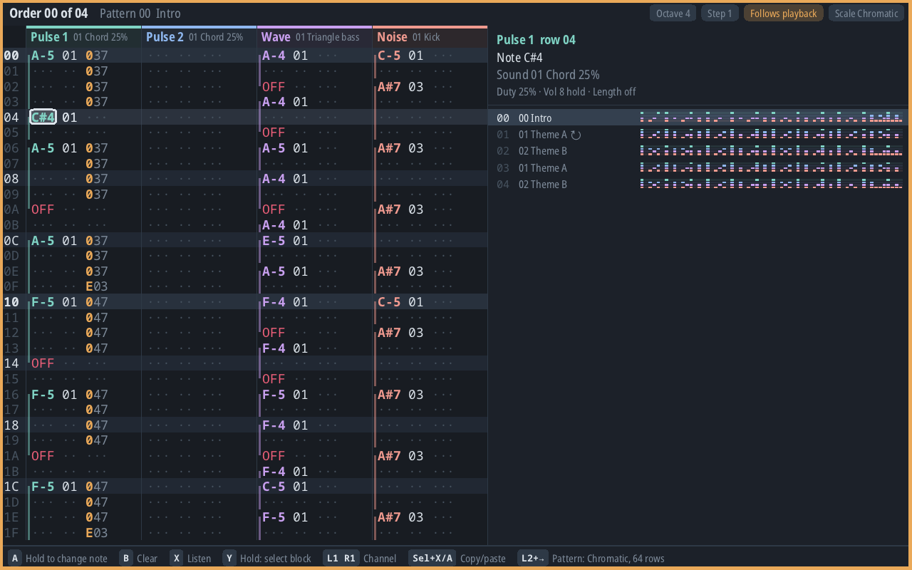

# Thor Tracker on Steam Deck



A Kotlin/Native + SDL3 frontend for Steam Deck / desktop Linux. It shares the Android app's core and audio engine:

- `:core`: Kotlin Multiplatform (`jvm` for Android, `linuxX64` for Deck, `linuxArm64` for Brick). It holds the song model, validation, exports, editing rules, workspace, transport, keymap and painters.
- `src/nativeMain/` contains the shared native application, menus, file browser, recovery, tuning services and export/audio bridges. Each target compiles those files against its concrete SDL ABI: [`Platform.kt`](src/linuxX64Main/kotlin/org/thortracker/deck/Platform.kt) handles SDL3 events/windows, and the [Brick adapter](../brick/src/linuxArm64Main/kotlin/org/thortracker/deck/Platform.kt) handles vendor SDL2.
- `native/deck_audio.c` retains the complete shared chip-engine path, live updates and auditioning. `native/audio_output.c` supplies the SDL3 stream; the Brick's callback adapter preserves whole-tick tails across SDL2 device blocks.
- `SdlSurface.kt` implements the shared `Surface` over `native/deck_draw.c`: SDL triangle geometry and bundled Noto fonts (`fonts/`, OFL), rasterised by `stb_truetype` into a glyph atlas. The native host uses one pane; R2 chords switch its view.

## Menus and files

The Deck uses the shared button routing (`HostInput`), popups and menus (`AppMenus`): the same main menu, Files, Views, Tuning, Controls (rebinding, keymap export/import) and Help as the Thor, plus **Quit**. Popups are drawn with the shared `Surface` (`DrawnPopup`); the platform side is `DeckShell.kt`:

- **Open the menu** with a back grip (L4/R4/L5/R5, if Steam Input passes them through) or **Select+Start** (the Thor's toolbar chord; the Deck has no toolbar). B goes back. While rebinding a button, Menu cancels.
- **Files** live in `~/ThorTracker`. Open, Save as, the selected system's exports and keymap files use an in-app folder browser that works with the D-pad, so no system dialog is needed in Gaming Mode. Saving names the file after the song title and asks before replacing a file.
- **Recovery:** the working song is written to `~/.local/share/thortracker/working.thor` a second after each change and on Quit, and reopens on the next start. "Load demo", "New blank song" and Open keep the replaced song as `previous.thor` for "Recover previous project". The keymap is saved beside it.
- **Tuning library:** 500 licensed or independently generated entries ship in `tunings/` beside the executable. Categories, search, details and source credits use the shared controller menus; L1/R1 page long details. Optional local `.thorscales` packs import through the file browser and live in `~/.local/share/thortracker/tuning-packs`. Replacement and removal require confirmation; removing a collection keeps the song's selected tuning and attribution. Catalogue loading and pack I/O run on a lazy worker, which is drained on exit.
- **Colour theme:** Menu → Colour theme offers Slate, Paper and Contrast. The stable theme ID is stored in `~/.local/share/thortracker/theme`, separately from the musical document. It updates panes, drawn popups and native shell controls immediately.

## Earlier SteamOS verification (historical)

- The early Game Boy-only port was a 12 MB native binary with no Java runtime, using system SDL3 3.2.18 (Wayland, PipeWire) on SteamOS 3.8.28. Current verification and platform limits are recorded in [`docs/VERIFICATION.md`](../docs/VERIFICATION.md); those historical size/frame-rate measurements are not measurements of the current all-engine build.
- The Steam Deck Controller is detected. Scripted input through the same routing as the gamepad moved the cursor, edited a note (A+Right), undid it (L2+A) and started playback (Start). Playback ran at the right tempo while edits reached the engine live, at a steady 89-90 fps (90 Hz panel, vsync) with no slow frames.
- `.thor` files load through the shared `ProjectCodec` on Linux.
- All seven shared views render on the Deck at 89-90 fps with the bundled fonts, reached by the R2 view chords; the scale panel, playhead and hint bar match the Thor layout.
- `:core:linuxX64Test` runs `CrossPlatformGoldenTest` natively, with values produced on the JVM. Number text matches `String.format` exactly over 216 cases. The example project's and demo's `.uge` exports are byte-identical (length + 64-bit hash). Every degree of the four built-in tunings lands on the same note and `40y` bend. Cents computed from ratios differ in the last bits of `log2` (JVM vs native libm, up to ~1e-13 cents on just-5-limit). That is far below the 5/10/20 ¢ limits, so cents are compared within 1e-9.

Those early checks did not cover physical buttons, Gaming Mode, suspend/resume, back paddles or trackpads. Current release evidence is in the verification record; do not read this historical list as a new 1.0 hardware test.

## Packaging

`tools/build-sdl3.sh` builds SDL3 3.2.18 from its release tarball into `deps/` (CI does this); `tools/package-appimage.sh <version>` puts the release executable, `fonts/`, `tunings/` and that `libSDL3.so.0` (in `lib/`, found through the executable's `$ORIGIN/lib` rpath) into `dist/thor-tracker-<version>-x86_64.AppImage`. CI's `deck` job builds it on every push, starts the AppImage offscreen and opens the menu, and uploads it; releases attach it. The executable needs only glibc 2.19 or later; the bundled SDL3 is built on Ubuntu 24.04 (glibc 2.39; SteamOS has 2.41).

## Build and run

Kotlin/Native linking runs on CI, not the development workstation. The `deck` job builds the
AppImage on each branch push; download its `thor-tracker-appimage` artifact for local runtime
checks. The CI build commands are:

```sh
deck/tools/build-sdl3.sh
./gradlew --no-daemon --console=plain :deck:linkReleaseExecutableLinuxX64
deck/tools/package-appimage.sh <version>
```

The executable accepts `[song.thor]`, `seconds=N`, `script=96+22,20,108` and
`size=1280x800@1.5` diagnostic arguments. Script steps use Android key codes, one per 150 ms;
`rx=V` and `ry=V` set right-stick axes. Fonts and tunings are copied beside the executable
and must be deployed with it.

To install a release on the Deck, see the main README's "Steam Deck" section. Gamepad: as on the Thor (D-pad moves, hold A + D-pad edits, B clears, L2+A / L2+B undo/redo, Start plays/stops, L2+Y loops, R2+A/B/X/Y and R2+↑/→/↓ switch views, two quick right-stick flicks up/down jump Pattern to the pattern's first/last row); Select+Start or a back grip opens the menu, which has Quit. Keyboard: arrows, Z/X/A/S = A/B/X/Y, Space = Start, Tab = Select, F1 = menu, Esc = back.

## Platform-specific limits

- The controller-first workflow and in-app file browser work without a desktop file picker. Steam's keyboard (**Steam + X**) or letter-by-letter Song editing can enter titles.
- Android's touch controller dock is not a promise of the same touch-only interface on Linux.
- SDL geometry is not anti-aliased; some circles and rounded corners have stepped edges.
- Suspend/resume, trackpads and back-grip mappings depend on the device/Steam Input setup. Keep those checks separate from headless AppImage playback verification.
