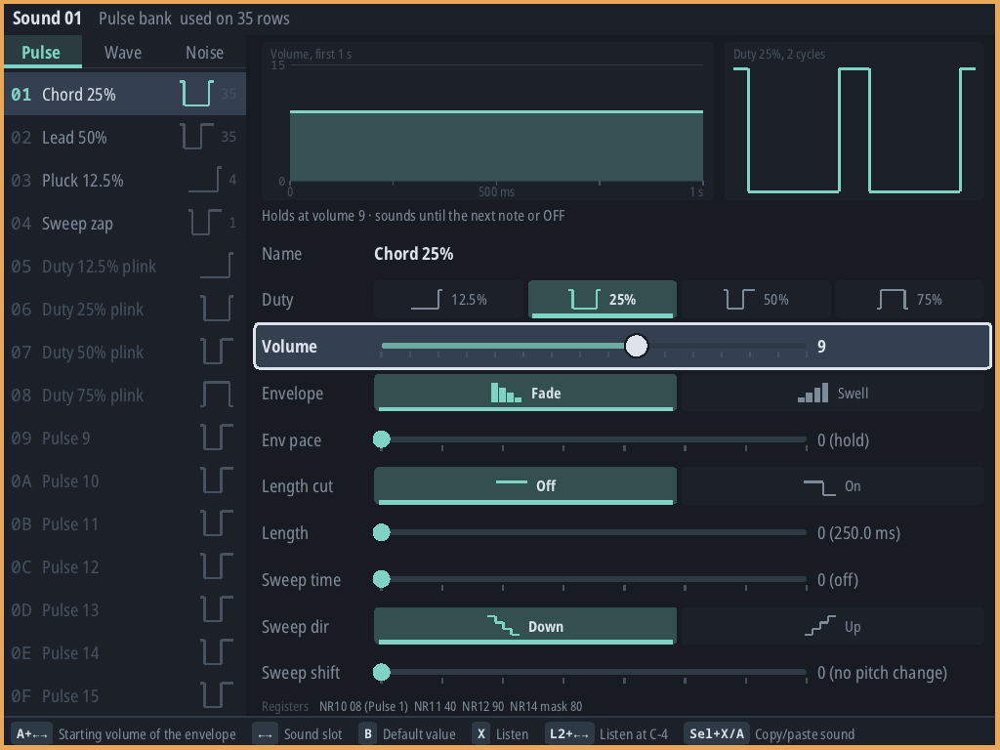
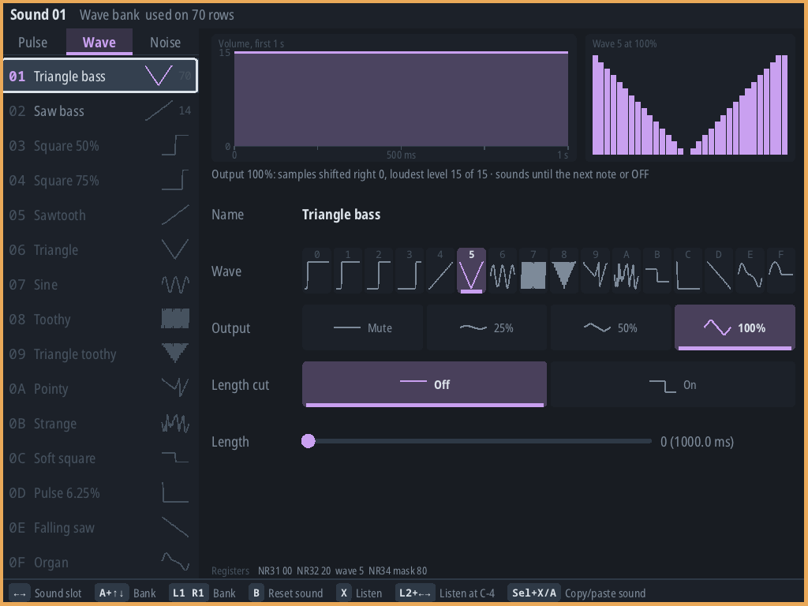
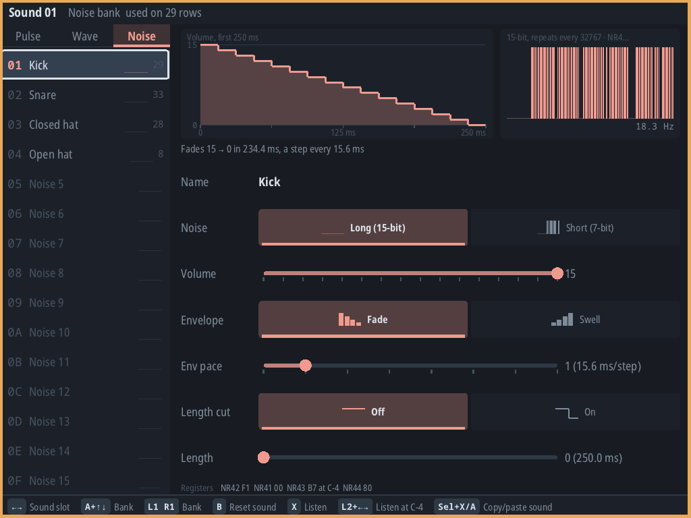

# Instrument panels: Game Boy pilot and design proposal

Status: **Game Boy pilot implemented and exercised on Pocket DMG in the 0.42.0 candidate.
Other panels remain proposals for review.**
The research below was written against stable workspace `2a09d35`. Its wireframes are design sketches,
not screenshots. The first implementation covers the Game Boy's pulse, wave and noise controls
without a universal synthesis model or broad prerequisite refactor.
The implementation notes below supersede the speculative rollout details for Pilot A.

`PLAN.md` (Korg DS-10 / original synthesis entry) already sets the direction this document explores:
friendly panels for existing chips whose musical controls map to that chip's actual instrument
parameters, an advanced page that keeps precise hardware access, and no universal instrument model
that hides quantization or shared-resource effects. `PLAN.md`'s architecture rules also say
"Backend-specific views are allowed. No universal FM/wavetable/sampler editor is required" and forbid a
speculative plugin system. This proposal stays inside those rules.

Scope boundaries for this pass: swing, mixer, pattern mute and shaders stay deferred. The Galaxy Fold8
touch preview is still being tested and is not merged; nothing here depends on its dock. The DMG is a
test surface, not a design target. Design targets are the Brick (compact, controller only), the Thor
(two touch displays plus controller) and the Fold8 (touch first).

## Game Boy implementation

The panel replaces the old Game Boy instrument layout; it does not add a second editor or change the
song format. `SoundParams` remains the source of exact values and editing rules. The familiar field
order, held-Edit fine/coarse changes, Listen, Clear and gesture-grouped Undo remain available.

- Pulse and noise show nominal envelope and length behavior; pulse 1 also shows sweep and its overflow
  cutoff. Wave shows the selected song-wide waveform and output level. These are hardware-rule
  illustrations, not measurements of the current audio callback or analog output.
- Duty, envelope direction and other short choices use segmented controls; numeric ranges use rails;
  the wave bank shows all sixteen wave thumbnails. Register bytes and numeric values remain visible.
- Compact layouts use a 5×3 instrument bank and, when fields overflow, 48 dp Up/Down controls. Dense
  rows and wave thumbnails are not large touch targets: the controller/dock remains the precise
  editing route at compact sizes. Fold8 folded/unfolded sizes used in automated renders are synthetic
  editor viewports, not measurements or physical phone ergonomics evidence.
- Held Edit now re-auditions actual changes, including Clear; unchanged values do not retrigger.
  Touch drags pin their instrument/parameter, group Undo, and stop writing if Undo ends the gesture.
- `system/panel/PanelWidgets.kt` shares only proven rails, segmented-cell geometry and gesture
  ownership. Chip-specific timelines, values and constraints stay in `system/gb/`. No other instrument
  painter was migrated as a prerequisite.
- Palette roles and pane zoom apply throughout. Usage and lowered-register display data are cached;
  drawing does not repeatedly allocate a usage table or lower the same instrument.

Audio verification uncovered an existing binjgb envelope error: increasing envelopes stopped at 14
instead of reaching hardware volume 15. The native fix and real hUGEDriver/binjgb PCM regression are
documented in [Audio Engine](AUDIO_ENGINE.md). Song and hardware-export bytes are unchanged.

The next review is this complete Game Boy panel, not automatic expansion to SCC or FM. Those
proposals, a standalone Listen latch, and one-shot character macros remain unimplemented.

### Review captures

These three captures come from the actual CI-built AppImage, rendered offscreen at 1024×768@1.5;
they are not photographs or captures from a physical Brick:







[Actual Pocket DMG capture](media/gameboy-panel-dmg.png) ·
[Synthetic compact Paper layout at 150%](media/gameboy-panel-compact-paper.png).
The compact example deliberately shows field navigation rather than pretending every waveform
thumbnail is a large touch target.

## Recommendation in brief

Build panels **incrementally, one system at a time, out of a small set of shared interaction
primitives**, keeping each chip's synthesis model, edit functions, row/cursor model, Expert pages and
export path exactly where they are today.

- Share: value rails, choices, switches, the step-sequence lane (today's `EnvelopePlot`), the
  wavetable grid, the slot bank, page tabs, touch-gesture ownership, Undo grouping, the "≈ inexact"
  reading convention, re-audition rules and theme/zoom metrics.
- Do not share: what a sound *is*. Operators, envelopes, programs, wave references, sample maps,
  linked channels and their invariants stay in each system's `*Sound.kt` / `*Edits.kt` / `*Curated.kt`.
- Pilot three panels, each standing for a different synthesis family and each reviewed on hardware
  before the next starts: **Game Boy** (raw register sound, smallest), **SCC/SCC+** (software envelopes
  over song-wide wavetables with a shared-RAM hazard), **OPM/YM2151** (4-operator FM with curated
  macros over an exact register grid).
- Do **not** promise that the remaining editors (43 system variants, 17 instrument editors) abstract
  cheaply. Several pages (DPCM key maps, SID programs and tables, POKEY channel linking, the TIA pitch
  guide, sample pages, NES's mixed-chip bank) will need bespoke work or should stay in their current
  form.

## What exists today

### Size and shape

- `SoundSystems.ALL` lists **43** system variants (`system/SoundSystem.kt:437-443`): Game Boy; NES with
  VRC6, VRC7, eight N163 counts, 5B, FDS, MMC5 and EPSM; SID; OPL3; Mega Drive; four SMS layouts; four AY
  computers; SCC and SCC+; PC Engine; OPM; YM2203 and YM2608; POKEY; TIA NTSC/PAL; VIC-20 and TED;
  WonderSwan and Color; Virtual Boy; SAM Coupé and CMS.
- Those variants share **17 instrument editors** (`SystemView` objects plus painters). Instrument
  views and painters (including `NesViews.kt`, `GbViews.kt` and `SoundPainter.kt`) total about
  **19,500 lines**; the five wave editors (Game Boy, PC Engine, SCC, Virtual Boy, WonderSwan) about
  **2,200 lines**; the curated/parameter metadata (`*Curated.kt`, `SoundParams.kt`, `EnvelopePlot.kt`,
  `FmControls.kt`) about **1,270 lines**. Counts are `wc -l` over the current files.
- Every editor follows the same shape: a slot bank on the left (with "used on N rows"), a header, a
  row list per view (a `Row` enum with page-dependent row lists in 16 editors; field indices over
  `SoundParams` in the Game Boy's), page tabs, and per-row
  `direction` / `adjust` / `editRelease` / `clear` / `command` / `hints` handlers.

### Reuse inventory

Paths are relative to `core/src/commonMain/kotlin/org/thortracker/`.

| Piece | Where | Used by | Observation / proposed action |
| --- | --- | --- | --- |
| `SystemView` hooks | `system/SystemView.kt:17-48` | all 17 editors and 5 wave views | Keep unchanged. Panels are painters plus row handlers behind the existing hooks. |
| `Painter` base | `ui/PaneView.kt:427-455` | every view | Keep. Touch is `down/move/up/cancel`; `header()` is shared. |
| `FmInstrumentPainter` | `system/fm/FmInstrumentPainter.kt:125-537` | 13 painters: AY, CBM, NES, OPL3, OPM, OPN, PCE, POKEY, SMS, TIA, VSU, WS, Mega Drive | Misnamed: it already shares bank, name cursor, setting rows, `cursorColor`, tabs, usage counts and `downShared`, alongside FM drawings. Reuse it initially; extract a generic portion only when a pilot actually needs it. |
| Duplicated bank/tabs/usage/`cursorColor` | `scc/SccInstrumentPainter.kt`, `saa/SaaInstrumentPainter.kt`, `sid/SidInstrumentPainter.kt`, `gb/SoundPainter.kt` | 4 painters | Candidates for later consolidation, not a prerequisite to trying one panel. |
| `EnvelopePlot` | `system/nes/EnvelopePlot.kt:17-152` | 12 painters: AY, CBM, NES, OPN, PCE, POKEY, SAA, SCC, SMS, TIA, WS, Mega Drive | Already a shared step-sequence editor (bars, loop, release, append position, `stepAt`/`valueAt`). Reuse it in place first; its package name does not block reuse. |
| Wave editors | `gb/WavePainter.kt`, `pce/PceWave*.kt`, `scc/SccWave*.kt`, `vsu/VsuWave*.kt`, `ws/WsWave*.kt` | 5 systems | Similar thumbnail/tool/grid/stroke structure, but sample count, depth, tools and allocation differ. Extract only the geometry and interaction a second pilot demonstrably shares; keep tool semantics per system. |
| `SoundParam` | `gb/SoundParams.kt:7-18` | Game Boy | The only descriptor-style control today: label, range, coarse step, help, get/set, format. Generalize as the rail descriptor. |
| Curated lenses | `opl3/Opl3Curated.kt`, `ym2612/YmCurated.kt`, `opm/OpmCurated.kt` (~990 lines) | OPL3, Mega Drive, OPN, OPM, EPSM FM | All three carry the same written rule (`Opl3Curated.kt:6-17`): *the registers are the instrument; every control is a view of them*, list controls report the nearest entry with `exact = false` (shown "≈"), macros read a representative operator and write exactly the fields they own. Generalize the contract, never the math. |
| `FmControls` | `system/fm/FmControls.kt` | FM editors and non-FM ones (SCC uses `presetStep`, `mostUsedChannel`) | Generic helpers in an FM package. Move with the base split. |
| Presets | `*/…Presets.kt` (14+ objects) | every editor with presets | Whole-instrument values, recognised by equality ignoring the name (`SccInstrumentView.presetIndex`), shown "custom" once edited. Keep this convention. |
| Undo grouping | `editor/EditorSession.kt:134-209` | everything | `beginGesture` / `endGesture` / `isGestureOpen` / `apply`. One controller Edit hold = one group (`ViewController.kt:314`); undo/redo during a drag closes it (`isGestureOpen` false). |
| Touch drag pinning | `gb/SoundPainter.kt:288-349`, `scc/SccInstrumentPainter.kt:268-318` and 16 other painters | 18 painters | The proven pattern: pin slot/target at `down`, one `GestureToken`, abandon if the token was closed, end on `up` or `cancel`. Wrap once. |
| Audition | `editor/ViewController.kt:264-274`, `EditorSession.audition` | all editors | 13 editors (AY, CBM, OPL3, OPM, OPN, PCE, POKEY, SID, SMS, TIA, VSU, WS, Mega Drive) re-audition on every change while Edit (on a sound row) or Listen is held (`OpmInstrumentView.kt:305-311` `heard()`). Game Boy, NES, SCC and SAA do not. |
| Shared chip state | `SoundSystem.sharedState` (12 overrides) | AY, CBM, NES 5B/EPSM, OPM, PCE, POKEY, SAA, SCC, SID, TIA, VSU, WS | Read-only "who owns the shared resource here". Panels can show it; they must not hide it. |
| Thumbnails and summaries | `SoundSystem.instrumentSummary` / `instrumentShape` (`SoundSystem.kt:383-390`) | Pattern, Keyboard, conversion | Reuse as the compact fallback when a panel's hero graphic does not fit. |
| Theme and metrics | `ui/Theme.kt` (`Palette` Slate/Paper/Contrast, `Ink`), `ui/Surface.kt`, `PaneZoom` (`editor/ViewState.kt:10-22`) | everything | Colours are semantic roles; zoom scales `ink.unit` (content) but not `dp` targets (`Theme.kt:110-116`). |

### Constraints the code already imposes

- **One rendering path.** Painters draw through `Surface` (`ui/Surface.kt:24-36`): rectangles, rounded
  rectangles, lines, circles, polylines and two text faces (`Face.MONO`, `Face.SANS`). Android implements
  it in `app/.../ui/CanvasSurface.kt`; the Deck through `deck/.../SdlSurface.kt` (SDL triangle geometry,
  stb_truetype), and the Brick target compiles the same `deck/src/nativeMain` sources against the
  vendor SDL2 (root `build.gradle.kts:46`). No bitmaps, filled polygons, arcs, gradients or extra fonts exist. Panel art
  must be built from these primitives in palette roles, or a new primitive must be added to both hosts
  and every `RecordingSurface` test fake as a separate, reviewed change.
- **Per-system invariants live in the edit functions.** `setSccInstrument` repairs envelopes
  (`scc/SccEdits.kt:136-139`); `setSidInstrument` re-places the shared tables so unchanged programs keep
  their rows (`sid/SidEdits.kt:23-34`); PC Engine and WonderSwan tone sounds allocate a wave when the
  song has none (`PceEdits.kt:166`, `WsEdits.kt:149`). Any panel that writes data outside these functions
  would bypass them. A schema that "sets fields" generically cannot keep them.
- **Instruments are raw data and exports read raw data.** Curated controls write register fields, so
  export parity holds by construction today. A panel must not add stored "macro positions": that would
  change `soundSerializer` / `backendVersion` and the lowering contract.
- **Live playback.** Edits apply live at tick boundaries; for instruments "a sustained note keeps the
  registers it was triggered with … the next note uses the edit" (`docs/AUDIO_ENGINE.md:286-300`; wave
  and table specifics differ per chip). Audition runs on a spare machine reset per call and borrows the
  song's channel by muting it (`AUDIO_ENGINE.md:330-337`); Android seals queued edits before an
  audition so it hears the preceding song (`AUDIO_ENGINE.md:273-284`). Each re-audition restarts the
  attack.
- **Touch.** Touch never takes controller focus (`ui/PaneView.kt:17-22`). The Android bridge has no
  pointer-ID tracking (`docs/TOUCH_PROPOSAL.md:176`), so "hold Listen with one finger, drag with the
  other" is not available inside one pane. Touch targets should be 48 dp on touch-first layouts
  (`TOUCH_PROPOSAL.md:85`).
- **Two panes, one document.** Each pane has its own `ViewState` (page in `envelope`, cursor in
  `instField`/`envStep`, `listenChannel`), so the Thor can already show the same sound's panel on one
  display and its Expert page on the other with no new code. Overlapping gestures from two panes merge
  into one Undo step (`EditorSession.kt:93-94`).

## Shared interaction versus chip synthesis

| Shared (one implementation) | Chip-specific (stays per system) |
| --- | --- |
| Rail: bounded integer with fine/coarse steps, musical text, optional raw text, `exact` flag | Which fields exist, ranges, and their meaning |
| Choice: list with wrap, nearest entry and `exact` flag | Lists (algorithms, ratio sets, waveforms, duties, AUDC modes) |
| Switch: two states, tap toggles | Bit semantics and side effects |
| Step lane over `NesEnvelope` (loop, release, append, draw) | Envelope kinds, ranges, minimum lengths, relative/absolute modes |
| Wave grid (N samples × depth, draw stroke) | Sample count/depth, tools, allocation and sharing rules |
| Resource reference (pick a song-wide wave/table/sample, show its users, jump to its editor) | What is shared, by whom, and what editing it affects |
| Slot bank, page tabs, name cursor, hints | Bank layout (typed GB banks, NES mixed chips, YM part types) |
| Controller adjust / clear / tap, touch drag ownership, Undo grouping | Edit functions and their invariants (`edit*Instrument`) |
| Re-audition rule (on change while Listen or Edit held on an audible control) | Which channel can play the sound (noise on FM 8, 4-op on OPL3 1-6, SCC 4/5) |
| `≈` convention, palette roles, zoom fallbacks | Curated lens math (`*Curated.with…`/`controls`) |
| Read-only graphs: dB envelope sketch, staircase, routing diagram | Timing models (OPN/OPM EG clocks, SID ADSR table, GB pace/64 s) |

## Options

### A. Incremental shared primitives (recommended)

A handful of internal types in `core` and per-system panels that use them. No new document data, no
change to `SystemView`, `SoundSystem`, serializers, lowering or exports. Each panel replaces its system's
current Sound-page layout once approved, keeping the same `Row` order so controller navigation, hints,
help sections and existing editor tests remain meaningful.

Costs: each system still needs its own panel layout and hero graphic; some duplication of layout code
remains on purpose. Benefits: every invariant stays in the function that owns it; review happens per
system; the first pilot does not require migrating unrelated editors.

### B. Universal instrument schema (not recommended)

A declarative description of every instrument (fields, ranges, envelopes, routing, resources) driving
one generic panel renderer and editor for all 43 variants.

It would have to express SID table relocation, SCC 4/5 shared wave RAM, PC Engine/WonderSwan wave
allocation on write, N163 RAM layout, POKEY channel linking, Mega Drive FM 3 special mode, OPN parts,
NES's bank mixing 2A03/VRC6/VRC7/N163/FDS/5B/MMC5/EPSM sounds, DPCM key maps, sample pages and the
YM2608 rhythm ROM. Either the schema grows its own expression language (a second, untested
implementation of each system's rules) or it writes fields directly and bypasses the invariants listed
above. It would also invite storing macro state, breaking export parity and `backendVersion`, and it
is the "universal instrument model" `PLAN.md` rules out. The generic renderer would produce identical
panels for unlike chips, which defeats the purpose of distinctive panels.

### C. Status quo with polish

Keep row lists and add more drawings. Cheapest, but does not give touch-first value editing (only the
Game Boy editor and step/wave drawing accept touch values today; FM rows only select on touch,
`FmInstrumentPainter.kt:522-537`) and leaves the four duplicate painter bases.

## Extension contract sketch

Illustrative Kotlin, not final API. Everything is `internal` to `core`, like `Painter`.

```kotlin
package org.thortracker.system.panel

/** One editable aspect of instrument [I]. Pure: reads and returns instruments, never touches the session. */
internal sealed class Control<I>(
    val id: String,          // stable: touch pinning, tests, hit lists
    val label: String,       // sentence case, as rows are labelled today
    val help: String,
    val audible: Boolean,    // held Edit / Listen re-auditions after a change
)

/** A bounded integer: one register field, or a curated macro that writes a fixed set of fields. */
internal class Rail<I>(
    id: String, label: String, help: String, audible: Boolean = true,
    val range: IntRange,
    val coarse: Int,                                  // Edit+↑↓ step; Edit+←→ is 1
    val read: (I) -> Int,
    val exact: (I) -> Boolean = { true },             // false: operators disagree, shown "≈"
    val write: (I, Int) -> I,                         // only the fields this control owns
    val text: (I, Int) -> String,                     // musical reading: "31 ms per step"
    val raw: ((I) -> String)? = null,                 // register reading: "AR 1C" (null = text is already raw)
) : Control<I>(id, label, help, audible)

internal class Choice<I>(
    id: String, label: String, help: String, audible: Boolean = true,
    val options: (I) -> List<String>,                 // may depend on the sound (2-op vs 4-op lists)
    val read: (I) -> Reading,
    val write: (I, Int) -> I,
    val wraps: Boolean = true,
) : Control<I>(id, label, help, audible)

internal class Switch<I>(
    id: String, label: String, help: String, audible: Boolean = true,
    val read: (I) -> Boolean,
    val write: (I, Boolean) -> I,
) : Control<I>(id, label, help, audible)

internal data class Reading(val index: Int, val exact: Boolean)

/** How a panel reaches its system's document. Every write goes through the system's own edit function. */
internal class PanelTarget<I : Any>(
    val shown: (Song, Int) -> I,                                   // the sound, or what an empty slot's first edit starts from
    val default: (Int) -> I,                                       // Clear resets a control to this slot default's value
    val edit: (EditorSession, Int, String, (I) -> I) -> Boolean,   // e.g. EditorSession::editSccInstrument
)

/** Controller and touch behaviour for controls, written once. */
internal class PanelInput<I : Any>(private val target: PanelTarget<I>) {
    /** Edit + direction inside the Edit hold's gesture: fine dx, coarse dy; returns whether the sound changed. */
    fun step(v: ViewController, slot: Int, c: Control<I>, dx: Int, dy: Int): Boolean
    fun clear(v: ViewController, slot: Int, c: Control<I>): Boolean
    fun tap(v: ViewController, slot: Int, c: Control<I>): Boolean          // switches toggle, choices advance
    /** Touch: pins (slot, control) at down; one GestureToken per drag; stops writing once undo/redo closed it. */
    fun dragStart(session: EditorSession, slot: Int, c: Rail<I>, t: Float): Drag
    fun dragTo(session: EditorSession, d: Drag, t: Float): Boolean
    fun dragEnd(session: EditorSession, d: Drag)
}

/** Hit regions registered while drawing; preallocated Rects, no per-frame allocation. */
internal class PanelHits { fun clear(); fun add(l: Float, t: Float, r: Float, b: Float, id: String); fun at(x: Float, y: Float): String? }
```

Drawing helpers are free functions over `Ink`/`Surface` (rail, choice strip, switch, `≈` badge,
resource chip), alongside the moved `EnvelopePlot` and a new `WaveGrid`. The re-audition decision stays
in each `SystemView` (it knows its audible rows and Listen channel rules); `PanelInput` only reports
whether a change happened.

Deliberately absent: a layout engine, a schema, reflection, serialization of panel descriptions,
per-control persistence, plugin loading, and any generic `set field` path.

### Contract rules

1. **Raw data is the instrument.** A control is a lens over stored fields. Reading may be lossy and must
   say so (`exact = false`, drawn as "≈" plus text, never colour alone); writing is deterministic and
   touches only the fields the control owns. Nothing the panel shows is stored outside the instrument.
2. **Every write goes through `PanelTarget.edit`**, which is the system's existing `edit*Instrument`.
   Panels never call `session.apply` with hand-built song copies.
3. **Undo.** Controller: one step per Edit hold (existing). Touch drag: one step per drag, labelled
   `"Set <control>"`. Tap and Clear: one step each. Selection, page and Listen changes are not edits.
   Undo/Redo during a drag ends the drag without further writes. Two panes editing at once share one
   step (existing behaviour; do not fight it).
4. **Audition.** Holding Listen sounds the subject on its Listen channel; a change to an audible control
   while Listen or Edit is held re-auditions, only when the edit function reported a change. Panels do
   not claim that a sustained, playing note changes; the next note or the audition is how a change is
   heard.
5. **Exact access.** Every stored field that affects sound is reachable without leaving the editor,
   normally one page away, showing register values. A panel never makes a field unreachable.
6. **Shared resources are disclosed where they are edited.** A control that refers to a song-wide wave,
   table, LFO, hardware envelope or linked channel shows who else depends on it and links to its editor.
   It never copies a shared resource implicitly.
7. **Same cursor model.** Touch on a control moves `instField` (and `envStep` for operators/steps) to
   that control, so controller and touch always agree on what is selected.

## Presets, macros and conversion

- **Presets** are whole-instrument values written in one Undo step, recognised by equality ignoring the
  name, and shown "custom" once edited. They are content, not references, so exports never see them.
- **Macros** (curated lenses) follow rule 1. The existing FM ones already do; the pilot only wraps them.
- **Non-invertible "character" controls** (one knob that moves unrelated fields with no way to read it
  back) are not allowed as persistent controls in the pilots. If wanted later, they should be one-shot,
  undoable *Apply* actions, like presets.
- **Cross-system conversion** remains the explicit, reported document operation in `conversion/`
  (`ConversionVoices.kt` substitutes named audible presets). Panels never convert sounds.

## Visual direction

### Token plan

The workspace palettes are fixed semantic roles shared by every view; panels must not add their own
colours or the Paper and Contrast themes stop working. Colour roles (Slate values shown for reference):

| Role | Palette field | Slate |
| --- | --- | --- |
| Ground | `BG` | `#181C22` |
| Panel bed | `LANE` | `#1C2129` |
| Ink | `TEXT` | `#DCE3EA` |
| Quiet | `DIM` / `FAINT` | `#7D8A99` / `#46525F` |
| Sound accent | `channel(listenChannel)` | `#7FD3C4` for channel 1 |
| States | `WRITE` (editing), `LISTEN` (sounding), `PLAYHEAD` (shared-resource notes), `ERROR` | `#F0607A`, `#5FD0F0`, `#EAA959`, `#FF7A6B` |

Type: `Face.MONO` for values, register text and hex; `Face.SANS` for labels and readings; sentence case;
no new fonts. Layout: each panel has one hero graphic drawn from that chip's synthesis model, and
everything else is a quiet column of rails. Left alignment throughout; values align on one column as
the current editors do.

### Review against generic defaults

The first plan was a rack of rotary knobs on rounded cards with console-coloured faceplates. Revised,
because:

- Identical rounded cards with one radius and drop shadows are the generic "card kit" and waste rows on
  a 1024×768 Brick.
- Rotary knobs are hard to drag precisely by touch and add nothing for a D-pad; linear rails match the
  existing Game Boy touch slider (`SoundPainter.kt:324-328`) and read at small sizes.
- Console case colours, logos, badge shapes and typography are the clearest way to copy trade dress.

What replaces them: boldness spent once per panel, on a hero that only that chip could have (the Game
Boy's envelope staircase and length cut on one time axis, the SCC's wave sequence as a reel, the OPM's
operator routing with each operator's envelope inside its node). Charm comes from the sound itself made
visible, not from imitation hardware.

### Originality and trade dress

- Draw every motif in code from the synthesis data; no imported artwork.
- Chip and console names appear as plain text labels (as today), never as logos or lettering styles.
- Do not reproduce console case colour schemes, controller or cartridge silhouettes, manufacturer
  typefaces, or the UI art of FamiStudio, Furnace, DefleMask, GoatTracker, BRIXEQ (no declared licence)
  or hardware synthesizers. Functional conventions (ADSR curves, operator diagrams, waveform plots) are
  fine; distinctive decoration is not.
- This is a design rule, not legal advice.

### Readability, theme and zoom

- Verify each panel in Slate, Paper and Contrast; `≈`, shared-resource and empty-slot states must use a
  glyph or text as well as colour.
- `ink.unit` scales with `PaneZoom` (75-150 %); touch targets do not. When the hero no longer fits (for
  example 150 % on 1024×768), fall back to `instrumentSummary` text, as `drawAlgorithm` already skips
  drawing when its boxes become too small (`FmInstrumentPainter.kt:282`).
- Always `ink.fit()` text: Android and stb_truetype measure differently.
- Reuse `Rect`s and point arrays across frames (the Brick has about 1 GB RAM and no swap); cache usage
  counts by song identity as the painters do today.

## Form factors

| Form | Example | Input | Panel behaviour |
| --- | --- | --- | --- |
| Compact | Brick 1024×768 (also Deck 1280×800, Konkr 960×720) | controller | One pane. Current row density (≈1.4 `unit`); hero in the upper third. |
| Dual | Thor 1920×1080 top, 1240×1080 bottom | controller and touch on both | Panel on one display; Pattern, Wave or Expert on the other, following the selection. |
| Touch-first | Fold8 preview | touch, optional controller | Rails at least 48 dp tall; slots in a horizontal strip; visible Listen latch; Raw page tab. |

Layout chooses by measured pane size and whether touch is the primary input, never by device name.
When a controller is connected and the preview dock hides, panel touch keeps working; panels do not
depend on the dock.

## Pilot panels

### Pilot A: Game Boy sounds

Why first: the smallest editor (`GbViews.kt` 350 lines, `SoundPainter.kt` 350), already descriptor-driven
(`SoundParams`) and already touch-editable. It proves the control contract, touch/Undo behaviour and a
read-only hero with little risk. It is also the default system.

Model mapping (all exact, all raw; from `SoundParams.kt:21-70`):

| Bank | Controls |
| --- | --- |
| Pulse | Duty (choice of 4, drawn as pulse glyphs), Volume 0-15, Envelope fade/swell, Env pace 0-7 (ms/step), Length cut, Length 0-63 (ms), Sweep time/direction/shift (pulse 1 only) |
| Wave | Wave 0-F (resource reference to the song's waves), Output mute/25/50/100 %, Length cut, Length 0-255 |
| Noise | Width long/short, Volume, Envelope, Env pace, Length cut, Length 0-63 |

Hero: a **time ribbon**. The volume staircase computed from volume/direction/pace on a time axis, a
vertical stop where the length timer cuts, and (pulse) the sweep's pitch bend as a second line. Wave
sounds show the referenced wave's thumbnail and "used by N sounds"; Edit on it publishes the wave so a
following Wave view on the other display shows it (the existing `GbSoundView.publish` behaviour).

Compact (Brick):

```text
+-----------------------------------------------------------------------------+
| Sound 03  Pulse lead          used on 41 rows                               |
+-----------+-----------------------------------------------------------------+
| Pulse     |  time ribbon (0 .. 1 s)                                         |
| Wave      |  vol  |''''''''|___                                             |
| Noise     |       |        '''''|____               cut at 172 ms |         |
|-----------|  bend ----------\_______  sweep down 3/2                        |
| 01 Lead   |-----------------------------------------------------------------|
| 02 Bass   |  Duty        [_|''''] [_||'''] [_|||''] [_||||'] 25 %           |
|>03 Arp    |  Volume      ==============o  15                                |
| 04 .      |  Envelope    fade | swell                                       |
| 05 .      |  Env pace    ====o-------  2   31 ms per step                   |
|           |  Length cut  off | on      Length ===o---- 20   172 ms         |
|           |  Sweep       time 3   down   shift 2                            |
+-----------+-----------------------------------------------------------------+
| A+lr value  A+ud x4  B default  X listen on Pulse 1  L1/R1 bank             |
+-----------------------------------------------------------------------------+
```

Dual (Thor): the panel on the bottom display (touch rails at full width), Pattern on the top display;
when a wave sound is selected, a Wave view on the top display follows it.

Touch-first (Fold8):

```text
+--------------------------------------+
| < 01 Lead | 02 Bass | 03 Arp | 04 > |   slot strip, 48 dp
| Pulse   Wave   Noise        [Listen] |   tabs; latch shows LISTEN colour
| time ribbon (fixed 96 dp)            |
| Duty     4 glyph buttons, 48 dp      |
| Volume   [=========o====]  15        |
| Envelope [ fade | swell ]            |
| Env pace [===o---------]   2         |
| ...                                  |
| Raw: NR10 00  NR11 80  NR12 F2 ...   |   optional register line (question 4)
+--------------------------------------+
```

Behaviour change to review: the Game Boy editor would gain held-Edit re-audition like the 13 editors that
already have it.

### Pilot B: SCC / SCC+

Why: the cleanest representative of the envelope family that uses `EnvelopePlot` (12 painters), with a
song-wide wavetable and a real shared-resource hazard: on the SCC (K051649) channels 4 and 5 share one
wave RAM; on the SCC+ they do not (`SccInstrumentView.channelNote`, help text "SCC and SCC+ wave RAM").

Model (`scc/SccSound.kt:58-69`): name; volume (0-15, loop, release), arpeggio (-64..63), pitch (-64..63,
relative/absolute) and wave (wave numbers 1-64) envelopes; restart. Waves are 64 song-wide 32-sample
signed tables; presets play "the starter waves 01 onwards of the song, so edited starter waves change
them too". All controls exact; preset is a whole replacement.

Hero: a **wave reel**. The wave envelope drawn as a strip of wave thumbnails in step order on a tick axis,
the loop bracketed, the cursor step enlarged; when Listen is on SCC 4 or 5 of an SCC (not SCC+), a
"4/5 share one wave RAM" mark sits on the reel. Below it, the volume, arpeggio and pitch envelopes as
three lanes on the same tick axis: the selected lane is a full `EnvelopePlot` (draw by touch, step by
controller), the others compact read-only strips. This replaces page tabs with visible lanes, but the
`Row.PAGE` row stays and chooses the expanded lane, so controller navigation is unchanged.

Resource reference: choosing a wave for a step shows the song's waves as thumbnails with
"used by N sounds"; a separate action publishes the wave for the Wave view (the existing `publish`).
Editing waves stays in the Wave view.

Compact (Brick):

```text
+-----------------------------------------------------------------------------+
| Sound 07  Glass bell     SCC (K051649)   used on 18 rows                    |
+-----------+-----------------------------------------------------------------+
| 01 Lead   | Preset   Glass bell (3/12)      Restart  on   Listen  SCC 4     |
| 02 Bass   | wave reel (ticks)     [loop from 3 ............]                |
|>07 Glass  |  [01 ~][01 ~][05 /|][05 /|][09 ##][09 ##]   4/5 share one RAM  |
| 08 .      |-----------------------------------------------------------------|
|           | Volume   | | | | | | | . . .  loop 5  release 7   (expanded)    |
|           |          | | | | | |                                            |
|           | Arp      0 +7 +12 0 ...       (compact)                         |
|           | Pitch    empty: not used      absolute                          |
+-----------+-----------------------------------------------------------------+
| A+ud value  A+lr draw along  L1/R1 lane  X listen on SCC 4  B delete step   |
+-----------------------------------------------------------------------------+
```

Dual (Thor): panel on one display, the Wave view following the reel's cursor step on the other (this
already works through `publish` and `ViewKind.WAVE` context).

Touch-first: reel as a horizontally scrollable strip; the expanded lane fills the width at 48 dp per
value row band; a Lane chooser replaces L1/R1.

Behaviour change to review: like the Game Boy editor, the SCC editor does not re-audition on held Edit
today; the pilot would add it.

### Pilot C: OPM (YM2151)

Why: the clearest 4-operator FM editor (painter 268 lines, three pages: Sound, Expert, Drum), already
built on a curated lens with `exact` flags (`opm/OpmCurated.kt:7-20`) beside an exact Expert grid. What it
proves transfers directly to OPL3, Mega Drive, OPN and EPSM FM, which share `FmInstrumentPainter`'s
drawings and the same curated rule.

Model (`opm/OpmSound.kt:15-106`): algorithm 0-7, feedback 0-7, PMS 0-7, AMS 0-3, four operators (DT1, MUL,
TL 0-127, KS, AR, AM, D1R, DT2, D2R, D1L, RR), noise on operator 4 with frequency 0-31 (FM 8 only), drum
sweep. Curated controls (`OpmCurated.Controls`): algorithm, ratio set (`≈` when inexact), brightness,
level, attack, decay, tone decay, sustain, sustain rate, release (`envelopeExact`), feedback, key scaling
(`≈`), vibrato/tremolo depth.

Hero: an **operator routing diagram** at hero size (the existing `drawAlgorithm`, extended rather than
replaced), each operator node showing its ratio and a tiny envelope line from its own AR/D1R/D1L/D2R/RR,
carriers on the output bus, the feedback loop on operator 1. Touching a node focuses that operator
(`envStep`); the eight algorithms appear as small glyphs in a choice strip. Macros are rails underneath,
each with "≈" when operators disagree, and a register reading on focus ("Attack 28 · AR 1C 1C 1F 1C").
Depth of vibrato/tremolo is labelled as also depending on the song's one shared LFO (`OpmSharedState`).
A noise sound moves Listen to FM 8, as the editor already requires.

Compact (Brick):

```text
+-----------------------------------------------------------------------------+
| Sound 12  Brass stab     used on 33 rows                                    |
+-----------+-----------------------------------------------------------------+
| 10 Pad    |  routing (algorithm 4: two pairs)          out                  |
| 11 Bass   |   [1 x1 /\_]--->[2 x1 /''\_] ------------->|                    |
|>12 Brass  |   [3 x2 /\__]-->[4 x1 /'''\] ------------->|                    |
| 13 .      |  algorithms  0 1 2 3 [4] 5 6 7                                  |
|           |-----------------------------------------------------------------|
|           |  Ratios      2:1:2:1                                            |
|           |  Brightness  ========o---  92                                   |
|           |  Level       ==========o-  118                                  |
|           |  Attack      ~ ======o---- 28    operators differ               |
|           |  Release     ====o-------  7                                    |
|           |  Feedback    ===o----      3                                    |
+-----------+-----------------------------------------------------------------+
| A+lr value  A+ud x8  B default  X listen on FM 2  L1/R1 page (Expert)       |
+-----------------------------------------------------------------------------+
```

Dual (Thor): panel on one display, the Expert register grid of the same sound on the other (each pane
keeps its own page, so this works today).

Touch-first: the diagram becomes the operator selector; rails below scroll; the Expert grid stays a
separate page with 48 dp cells and horizontal operator paging.

### Why SID is not a pilot

SID instruments are ADSR plus wave, pulse and filter **programs** whose rows live in song-wide tables
re-placed on every edit (`SidTables.place`), with one shared filter (`SidFilterOwner`). That needs a
multi-column program-row lane (with jumps and loops), not a value lane. It is a good candidate after the
pilots, specifically to check that the contract has not grown FM- or envelope-shaped assumptions.

## Coverage beyond the pilots

Fit is a judgement from reading the editors, not a measurement.

| Editor | Variants | Reusable after pilots | Bespoke or keep as is | Fit |
| --- | --- | --- | --- | --- |
| Game Boy | 1 | Pilot A | Wave view tools | pilot |
| SCC/SCC+ | 2 | Pilot B | Wave view | pilot |
| OPM | 1 | Pilot C | Drum/noise page | pilot |
| OPL3 | 1 | Pilot C (2-op/4-op lists, waveforms) | Chords table (song-wide), drum page | high |
| Mega Drive | 1 | C for FM, B lanes for PSG | Ch3 special mode, PCM kits | medium |
| OPN (YM2203/YM2608) | 2 | C for FM, B lanes for SSG | SSG hardware envelope, rhythm ROM, ADPCM samples | medium |
| PC Engine | 1 | B (wave sequence, lanes) | sample page | high |
| WonderSwan | 2 | B | samples, Sound DMA, noise taps | high for tone |
| SAA/CMS | 2 | B lanes | hardware envelope, pan | medium |
| AY (4 computers) | 4 | B lanes | shared hardware envelope and noise owner | medium |
| SMS (4 layouts) | 4 | B lanes, C ideas for OPLL custom voice | fixed OPLL patches, drum kit | medium |
| VIC-20/TED | 2 | B lanes | shared master volume, TED samples | medium |
| Virtual Boy | 1 | A-style rails | Wave 5 sweep/modulation | medium |
| TIA | 2 | B lanes | AUDC modes, pitch guide | medium-low |
| POKEY | 1 | B lanes | channel linking, clocks, high-pass, samples | low |
| SID | 1 | A-style rails for ADSR | programs and tables, filter owner | low |
| NES family | 15 | B lanes for 2A03/VRC6/MMC5/5B; C for EPSM FM; waves for N163/FDS | one bank mixes chips; DPCM key map; VRC7 patches; N163 RAM map; FDS modulation | low as one panel; per-chip pages medium |

## Code seams and complexity

Sizes are estimates for planning, marked as such; they are not measurements.

| Phase | Files | Behaviour change | Tests to add | Device checks (parent) | Estimate |
| --- | --- | --- | --- | --- | --- |
| 0. Establish the pilot baseline | existing Game Boy painter, input and export paths; no broad base-class split | none | use throwaway before/after rendering and export comparisons, alongside existing consumer-behavior tests; do not add permanent tests that pin incidental drawing commands | actual Android surface and CI-produced Brick Pak / desktop AppImage, with their different input paths identified | small read/measure step; shared-control extraction happens inside the pilot, not as a 22-file prerequisite |
| 1. Game Boy pilot | `system/panel/` (controls, input, hits, widgets: ~3 files); `gb/SoundParams.kt` (adapt to `Rail`), `gb/SoundPainter.kt` (new layout), `gb/GbViews.kt` (re-audition, touch hooks) | held-Edit re-audition; new layout | `ViewControllerTest`-style: every control reachable and steppable by controller and touch; Undo one step per hold/drag/tap with labels; undo mid-drag aborts; `.uge` export byte-identical for equal instruments; palette/zoom layout bounds | Thor dual, Brick, Fold8 preview; DMG as test surface | small-medium: ~600-900 new or rewritten lines [inference] |
| 2. SCC pilot | `scc/SccInstrumentPainter.kt` (rewrite), small `SccInstrumentView` changes (re-audition, lane selection), `WaveGrid` thumbnails, resource-reference widget | held-Edit re-audition; layout with lanes visible together | lane drawing = one Undo step; shared-RAM mark only for SCC with Listen on 4/5; preset recognition unchanged; `SccGoldenTest` and VGM bytes unchanged | Thor dual with Wave view following; Brick; Fold8 | medium: ~500-800 lines [inference] |
| 3. OPM pilot | `opm/OpmInstrumentPainter.kt` (Sound page); new routing-with-envelope drawing next to `drawAlgorithm` (do not change the existing function's output for other systems); `Choice`/`Rail` adapters around `OpmCurated` | layout; operator focus by touch | each control writes only its owned fields (extend `OpmEditorTest`); "≈" readings match `OpmCurated.controls`; Expert edits followed by panel edits round-trip; `OpmGoldenTest` unchanged | Thor dual (panel plus Expert), Brick, Fold8 | medium: ~500-800 lines [inference] |
| 4. Touch Listen latch | needs a small `ViewController` API (start/stop a touch audition without leaving `auditioning` stale; today `startAudition` is internal and `stopAudition` private) | new control | latch cleared on slot/page change, pane swap, focus loss, backgrounding | Fold8, Thor | small, but parent-owned |

No phase changes `SoundSystem`, serializers, `backendVersion`, lowering, native engines or exports. If a
later panel needs new stored data, it becomes a separate model change with its own upgrade path and
codec tests.

## Risks

| Risk | Mitigation |
| --- | --- |
| Macro state drifting from raw data | Rule 1: no stored macro state; "≈" from the existing `exact` flags. |
| Bypassing per-system invariants | Rule 2: writes only through `edit*Instrument`; no generic setter exists to misuse. |
| Re-audition storms during touch drags (each audition resets the machine and restarts the attack) | Re-audition only on reported change; consider at most one per frame; measure control-thread cost and audible result on Thor and Fold8 before deciding. Unmeasured. |
| Touch Listen needs a second pointer the bridge does not track | Visible per-pane latch (phase 4); never hidden long-press listening. |
| Hidden shared-resource effects (SCC 4/5, song waves, SID tables, AY envelope owner) | Rule 6: disclose at the point of edit; usage counts; no implicit copies. |
| Live playback expectations | Never imply a sustained playing note changes; audition is the immediate path. |
| Theme legibility (Paper inverts luminance) | Roles only; glyph plus text for states; three-palette checks like `ColourThemeTest`. |
| Zoom overflow on 1024×768 | Hero fallbacks to `instrumentSummary`; layout bounds tests at 150 %. |
| Android/SDL text differences | `ink.fit()` everywhere; check the Brick AppImage and Android. |
| Draw-time allocation on the Brick | Reuse `Rect`s and arrays; `PanelHits` preallocated; usage cached by song identity. |
| Regressing controller-only flows and help | Keep `Row` order and hints; update `helpSections` text in the same change. |
| Scope creep to 17 editors | Review gate after each pilot; coverage table is explicitly not a commitment. |
| Trade-dress resemblance | Motifs from synthesis data only; review each panel against the originality rules. |

## Phased acceptance

Each phase is reviewed by the user on hardware before the next one starts. Verification is run once by
the integrating agent, serialized, never in parallel with other builds.

There is no broad Phase 0 migration or all-painter snapshot gate. Pilot A extracts only the controls
it actually uses; unrelated painters stay unchanged. Later pilots need their own behavioral and
hardware-export checks, not golden drawing-command tests.

**Pilot A (Game Boy)**:
- Every `SoundParams` field can be reached and changed by controller (Edit+←→ fine, Edit+↑↓ coarse,
  Clear to the slot default) and by touch (rail drag, switch tap).
- Each controller hold, touch drag and tap is exactly one Undo step; Undo during a drag stops the drag;
  two panes editing together produce one step.
- Holding Listen sounds the sound; changes while Listen or Edit is held re-audition; nothing re-auditions
  when the value did not change.
- No overlap or clipping at 75-150 % on the tested viewports in Slate, Paper and Contrast.
  Compact field-navigation buttons are 48 dp; dense value rows and wave thumbnails retain the
  controller/dock route for precise editing rather than claiming every cell is a 48 dp target.
- A project whose instruments were set through the panel is byte-identical, and exports identical
  `.uge`, to one with the same values set through the current editor.

**Pilot B (SCC/SCC+)**: everything above, plus: drawing a lane by touch is one Undo step; the reel and
lanes share one tick axis; the shared-RAM mark appears only on SCC with Listen on SCC 4/5; wave choice
shows usage and publishes for a following Wave view; preset recognition and "custom" behave as today;
golden renders and VGM exports unchanged.

**Pilot C (OPM)**: everything above, plus: every macro writes only its owned fields (verified per control
against `OpmCurated`); "≈" appears exactly when `controls()` reports inexact; touching an operator node
focuses that operator for the Expert grid; a noise sound sounds on FM 8; golden renders and VGM exports
unchanged; the Expert page on the other Thor display reflects panel edits immediately.

**After the pilots**: a written go/no-go per family from the coverage table. No promise that the other
editors are cheap.

Commands for the integrating agent once a pilot exists (memory-limited, serialized wrapper; Kotlin/Native
links stay in CI on this workstation):

```sh
./tools/build.sh :core:jvmTest                     # all shared and per-system editor tests
./tools/build.sh :core:jvmTest --tests 'org.thortracker.system.opm.*'   # one pilot's system
./tools/build.sh testDebugUnitTest assembleDebug   # Android unit tests and the APK for device checks
```

Native frontend builds and offscreen rendering can be checked through CI artifacts. That does not
replace on-device Brick acceptance; the Brick and Thor were not used for this round.

## Questions for review

1. Resolved for Game Boy: replace the old layout, keeping one editor to maintain.
2. Resolved for Game Boy: held Edit re-auditions actual changes. SCC and other systems remain proposals.
3. Touch listening: a visible per-pane Listen latch (needs a small controller API), or rely on the
   preview dock's X button?
4. Show register values beside musical values always, only on the focused control, or only on Expert
   pages?
5. Are one-shot "character" actions (undoable Apply, like presets) wanted, given that persistent
   non-invertible macros are ruled out?
6. Pilot order: A → B → C as proposed, or OPM first because FM gains most from a hero diagram?

## How this was researched

Read in the stable workspace: `system/SoundSystem.kt`, `system/SystemView.kt`, `ui/PaneView.kt`,
`ui/Surface.kt`, `ui/Theme.kt`, `editor/EditorSession.kt` (history and audition),
`editor/ViewController.kt` (system-view dispatch, held Edit gesture, audition), `editor/ViewState.kt`,
`system/fm/FmInstrumentPainter.kt`, `system/fm/FmControls.kt`, `system/nes/EnvelopePlot.kt`,
`system/gb/{GbViews,SoundParams,SoundPainter}.kt`, `system/scc/{SccInstrumentView,SccInstrumentPainter,SccSound,SccEdits}.kt`,
`system/opl3/{Opl3InstrumentView,Opl3Curated}.kt`, `system/opm/{OpmInstrumentView,OpmCurated,OpmSound}.kt`,
`system/ym2612/YmCurated.kt`, `system/sid/{SidInstrumentView,SidEdits}.kt`, the headers of every other
instrument view and painter, every `edit*Instrument`/`set*Instrument` function, every `sharedState`
override, `docs/AUDIO_ENGINE.md` (live edits and audition), `docs/TOUCH_PROPOSAL.md`, `PLAN.md`, the
README build notes, the Android `CanvasSurface` and the Deck `SdlSurface` declarations, and the preview
workspace's `PreviewDock` button list. The initial research ran no build, test, device, emulator or
rendering; implementation verification is recorded separately in [Verification](VERIFICATION.md).
