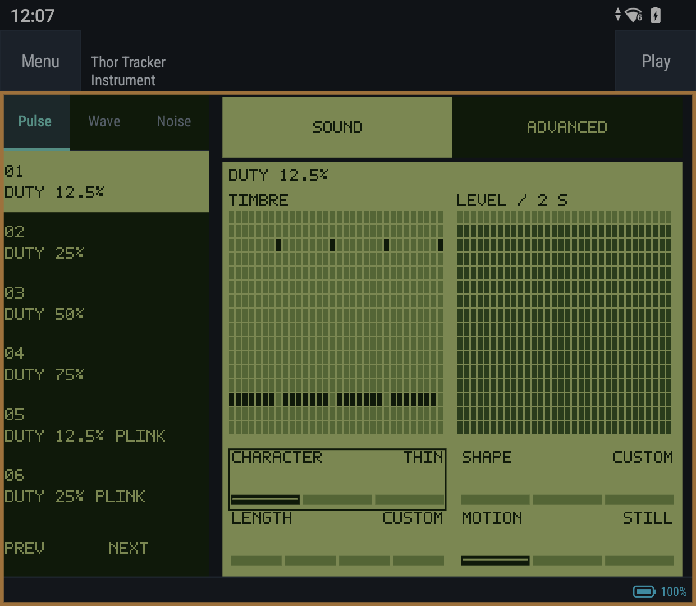
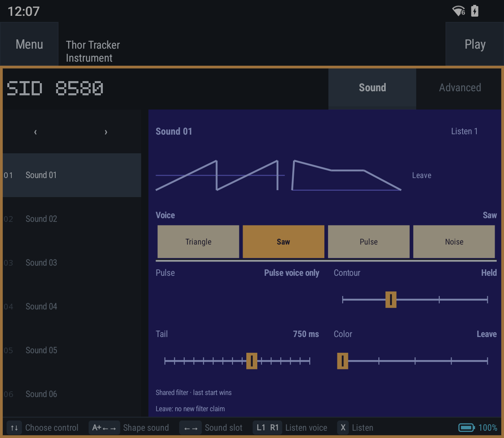
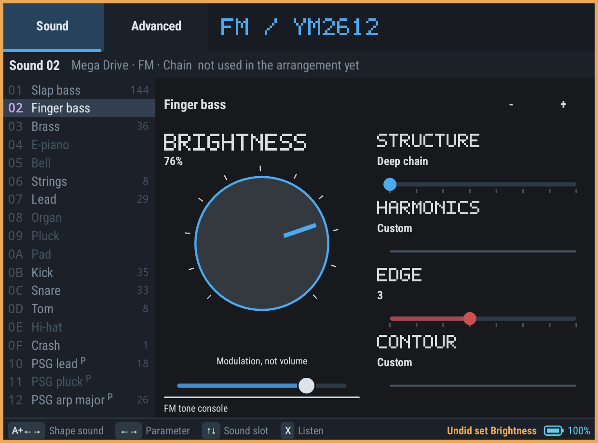

# Three musical instrument pilots

**0.43.0/code 61:** the reviewed Game Boy LCD, C64 SID and Mega Drive YM2612 Sound faces are
approved for main, including the identical instrument list and spatial controller navigation.
The next phase covers every supported chip/channel family, retaining Advanced and verifying
each family before periodic integration. Touch controls remain the approved production interface.

The APK remains **Thor Tracker**, package `org.thortracker`, with the production signing key.
It updates the normal app rather than installing another similarly named app. The older
separate Touch Preview installation and its data are not removed or imported automatically.

## Review gallery

Actual Pocket DMG native editor captures from revision 3; no recoloring or compositing.
These render the live Activity's editor without Android system bars or transient system toasts.

### Game Boy

[Wave](media/instrument-pilots/gb-wave-sound.png) ·
[Noise](media/instrument-pilots/gb-noise-sound.png) ·
[Advanced](media/instrument-pilots/gb-pulse-advanced.png)

### C64 SID

[Advanced](media/instrument-pilots/sid-mos8580-advanced.png)

### Mega Drive YM2612

[Advanced](media/instrument-pilots/ym2612-advanced.png)

Compact **360×270 dp native editor renders**, not physical phone captures:
[GB](media/instrument-pilots/gb-pulse-360x270dp.png) ·
[SID](media/instrument-pilots/sid-mos8580-360x270dp.png) ·
[YM2612](media/instrument-pilots/ym2612-360x270dp.png).

## One instrument, two faces

In **Instrument**, select a slot on the left. **Sound** offers a few musical controls on the
right; **Advanced** retains the exact chip editor. Switching faces never converts or normalizes
an instrument. A patch outside a musical control's recognized choices stays **Custom**, with
no invented slider position. Deliberate edits own only the fields listed below.

- Touch: tap Sound/Advanced; move a control horizontally. Hold X to hear edits.
- Sound controller: **Up/Down selects the instrument slot; Left/Right cycles controls;
  hold A + Left/Right to adjust.** New Sound views focus the first musical control. X listens.
  The horizontal cycle also includes Name and Sound/Advanced: A switches faces on the mode
  selector; on Name, A+Left/Right edits a letter and A+Up/Down moves the letter cursor.
  Advanced retains its existing precise-editor navigation.
- A continuous edit is one Undo. Mode/slot changes and Undo end stale pointer edits. A held
  across a mode change must be released before it can change a different control.
- The instrument list uses the same typography, geometry and hit targets in both faces;
  machine-specific artwork stays in the sound-editing area. Small Sound panes page controls
  at physical touch size rather than shrinking them. The list retains Advanced's existing
  responsive layout. Contrast uses the workspace's semantic colors.
- Mode/cursor state belongs to the pane for this session, not the musical project. There is
  no new project format, hidden macro bank, extra synthesis layer or export-only approximation.

The shared parts are mode/cursor safety, drag ownership, hit mapping, input routing, audition
and document history. Musical mappings and face composition stay chip-specific. The pixel
lettering is an original small bitmap alphabet, not a copied console font or logo.

## Game Boy — pixel LCD

Four olive/near-black shades, integer-pixel lettering, stepped selectors and real chip diagrams.
Pulse, Wave and Noise all start in Sound. L1/R1 switches banks.

| Bank | Controls | Exact ownership and limits |
| --- | --- | --- |
| Pulse | Character, Shape, Length, Motion | Duty; envelope/length gate; hardware sweep. Motion is audible on Pulse 1 only; rising sweep can reach the hardware cutoff. |
| Wave | Wave, Level, Length | Select an existing shared 32-sample wave; hardware mute/25%/50%/100% shift; 125/250/500 ms gate or Held. No shared samples are rewritten. |
| Noise | Grain, Shape, Length | Long 15-bit Air or short 7-bit Metal sequence; actual envelope and length gate. Played notes still choose the noise clock. |

Pulse/Noise Shape offers Pluck, Held and Swell. Length retains a recognized Shape; choosing
Length on a Custom Shape deliberately adopts Pluck, with a selected-control warning. Pluck
fade / Swell rise choices are approximately 188/375/750/1313 ms; Held uses approximately
63/125/250 ms or no length gate. These are different hardware mechanisms, not an emulated ADSR.

Selecting an already-current choice preserves the exact patch, including equivalent 25%/75%
pulse duty and inactive raw fields. Wave Level names describe the chip's sample shifts: actual
AC amplitude can differ from an ideal percentage because samples are only four bits. The
review square wave measures a 5:1 full/quarter RMS ratio, not a falsely promised 4:1.

## C64 SID — programmable synth deck

A blue/periwinkle signal display, beige waveform keys and amber faders on one continuous face.
The waveform, pulse movement and envelope drawing follow the stored patch. L1/R1 chooses the
voice used for audition; it does not create independent per-voice filters.

| Control | Choices | Owned fields |
| --- | --- | --- |
| Voice | Triangle, Saw, Pulse, Noise | Wave program. Selecting Pulse also seeds an empty pulse program to half width; existing pulse programs survive. |
| Pulse | Inherit, Square, Narrow, Drift, Flutter | Pulse program only; enabled for a recognized Pulse voice. |
| Contour | Pluck, Held, Swell, Organ | Attack, decay and sustain only. |
| Tail | Nominal 6 ms–24 s chip release settings | Release nibble only; actual tail depends on envelope state. |
| Color | Leave, Warm, Round, Nasal, Air | Filter program only; generated colors route all three voices. |

**There is one shared filter. The last voice to start a filter program wins.** Leave makes no
new filter claim; it does not bypass another voice's filter. Both 6581 and 8580 retain their
actual filter behavior, so the same Color is not promised to sound identical on both chips.
Complex programs read Custom. Wave-table commands that override envelope, pulse or filter
settings make the affected musical control unavailable rather than pretending it can win.
Advanced retains all tables, placement, restart, vibrato and precise programming controls.

## Mega Drive YM2612 — FM tone console

Graphite and silver with an electric-blue Brightness dial, red Edge accent and supporting
controls. Wider panes show the large tonal dial beside four smaller controls; narrow panes
page them. L1/R1 steps through Sound controls. Existing Curated/Expert, CH3 and Drum pages
remain under Advanced. PSG and PCM slots retain their existing editors, not a misleading FM face.

| Control | Musical role | Owned fields |
| --- | --- | --- |
| Brightness | Amount of modulation; percentage is control travel, not a measured spectrum | Modulator TL only, preserving relative levels until register limits. Carrier TL stays unchanged; perceived loudness can still vary with timbre. |
| Structure | Eight routing families | Algorithm plus the existing role-aware voice-level balancing. This is an explicit structural change, not a preset replacement during other edits. |
| Harmonics | Round, Hollow, Reedy, Metal, Glass | Modulator multipliers 1/2/3/5/7 only. Carrier multiplier and detune survive. |
| Edge | Feedback bite | Feedback 0–7 only. |
| Contour | Pluck, Held, Bloom, Short | Carrier attack/decay/sustain/release fields only. |

Four-sine/additive Structure has no modulators, so Brightness and Harmonics are unavailable.
Active carrier SSG envelopes make Contour unavailable; their shape is not silently discarded.
Names, sweep, CH3 offsets, AMS/FMS, song LFO and unrelated operator settings remain intact.
The labels are musical entry points, not promises of identical perceived timbre for arbitrary
carrier ratios, detuning, tuning or modulation programs.

## Verification and review boundary

The original code-59 candidate passes **1,187 shared-core and 22 Android host tests**, plus a
real Pocket DMG Activity scenario for all three GB banks, both SID models and YM2612. It covers
touch/controller edits, grouped Undo, exact native-image preservation across face switches,
audition and advancing playback. Native Android editor renders at **360×270 dp and 720×352 dp**
exercise all controls at physical touch size. Those are synthetic editor viewports, not Galaxy
Fold8 captures or physical two-thumb ergonomics evidence.

Revision 2 fixes controller name navigation beyond SID's 16-character limit. Its regression
fails before the fix and passes afterward; **1,188 core and 22 Android host tests pass**.
Compact GB/FM coverage now requires touch navigation whenever controls are hidden.
Revision 3 passes **1,206 core and 22 Android host tests**, plus a live Pocket DMG Activity
scenario covering the requested axes, held edits, grouped Undo, touch mode switching and
pixel-identical instrument lists in all six bank/model cases. All **30 permanent Android
contracts** pass in a separate clean test APK. The gallery and six 360×270 dp native renders
are refreshed; musical mappings and the earlier native-audio measurements are unchanged.

Pattern channel headers now show the most frequently assigned instrument in that channel's
active pattern rows, not the shared entry instrument. Empty assignments and hidden rows do
not count; ties prefer the lowest slot. The live Activity check verifies distinct Pulse 1/2
labels remain stable while choosing a different entry sound. This does not alter playback.

**34 native WAVs** exercise envelopes, wave shifts/gates, noise width, SID PWM/shared filter and
FM modulation/harmonics/feedback. The low GB noise fixture clocks at 146.286 Hz: its seven-bit
sequence repeats after 0.868164 s (correlation 0.99993), while the long sequence does not
(0.15643 at that lag). A short-window spectral-flatness assumption was rejected in favor of
that exact chip-period comparison. SID Warm → Air → Warm changes started by different voices
match the corresponding static-filter RMS within 1.5% on 6581 and 0.001% on 8580. FM Brightness
raises this fixture's spectral centroid from 262 to 538 Hz while leaving both carrier TLs at 16.
These are digital native-render checks, not acoustic listening or original-console CPU-budget proof.

A counterfactual check compares each SID window against both static colors: the correct color's
PCM RMS error is below one tenth of the wrong color's error in all six windows (both chip models).
The YM Edge input projects differ **only** in feedback 0 → 7; 99.905% of sampled PCM frames differ.
Their equality to the adjacent Glass/Held fixtures is expected endpoint reuse, not a harmonics
change. Feedback is not monotonically brighter for arbitrary patches: this MUL-7 fixture's
centroid decreases from 2778 to 2224 Hz. The test proves an isolated feedback change, not brightness.

Every device run cold-backs up and independently verifies restoration of the eight original
private recovery/workspace entries; its test APK and UUID-owned files are removed, and original
device settings restored. `/ThorTunez` is not touched. Builds are serialized and memory-capped;
local Kotlin/Native linking and emulators are avoided.

## Wider rollout

The reviewed direction is sufficient to proceed in chip-family batches. Carry the stable
instrument list, controller axes, mode safety, touch ownership and Undo behavior into each
face; do not force every chip into the same musical controls or recolor one universal form.

Suggested order: NES and Sega PSG voices; AY/shared-envelope and wavetable families; then
remaining FM families and the more specialized noise/percussion systems. Related voices
can share control widgets and layout machinery, but each mapping must name its owned fields
and shared-resource limits. Retain Custom patches and the exact Advanced editor throughout.
Review each batch on handheld-sized panes before continuing. No additional chip faces,
original synth, swing, mixer ceilings or shader pipeline are included in revision 3.
