# Thor Tracker

Thor Tracker is a **controller-first chiptune tracker for Android, Steam Deck and Brick Hammer / NextUI**. Write patterns, shape instruments, arrange songs and export music for classic consoles and computers. Work on one screen or pair independent editors across [dual displays](#views-and-displays), design one patch through [Sound and Advanced](#instrument-workflow), and import [Scala `.scl` tunings](#microtuning-song-tuning-from-a-scala-scl-file).

Read the **[documentation website](https://esko997.github.io/thortracker/)** for installation,
controls, sound systems, exports and troubleshooting.

## 1.0: compose on the handheld

- **Genuinely different sound systems:** Game Boy, NES and expansions, C64 SID, Yamaha FM, Sega PSG, AY/YM machines, wavetable systems and more, with their own channels, instruments, effects and export contracts. GBA/Maxmod adds eight sample voices for GBA homebrew.
- **Instrument design:** musical Sound controls for quick timbre changes, alongside Advanced's precise envelopes, tables, operators and sample mappings—all editing the same patch. [Instrument workflow](#instrument-workflow) · [gallery and chip-specific limits](INSTRUMENT_PANELS.md).
- **Independent views:** keep Pattern beside Keyboard, Instrument or Song on two displays, or switch views on one. Placement, selection-following and controller focus are separate. [Views and displays](#views-and-displays).
- **Controller-first editing, with touch:** note entry, blocks, clipboard, arrangement and audition use rebindable controls; Android also has direct touch editing and an on-screen controller dock. [First session](#a-first-session) · [controller reference](#controller-reference).
- **Scales and microtuning:** pattern-scale entry guides, Sketch and local Scala `.scl` imports, with reachable pitches determined by the selected chip and driver. [Tuning workflow and limits](#microtuning-song-tuning-from-a-scala-scl-file).
- **Keep editable work:** `.thor` projects, named saves and working-song recovery are separate from WAV recordings and backend-specific music exports. [Saving and recovery](#saving-and-recovery).
- **Free software:** GPL-3.0-or-later, with no accounts, telemetry or in-app network access.

Each song targets one sound system. Formats such as Game Boy `.uge`, NES `.nsf`,
SID `.sid` and GBA `.xm` serve different toolchains; **a VGM register log is not a
ready-to-run game driver**, and WAV is an audio recording, not hardware music code.
The [sound-system guide](https://esko997.github.io/thortracker/systems/) explains the choices.

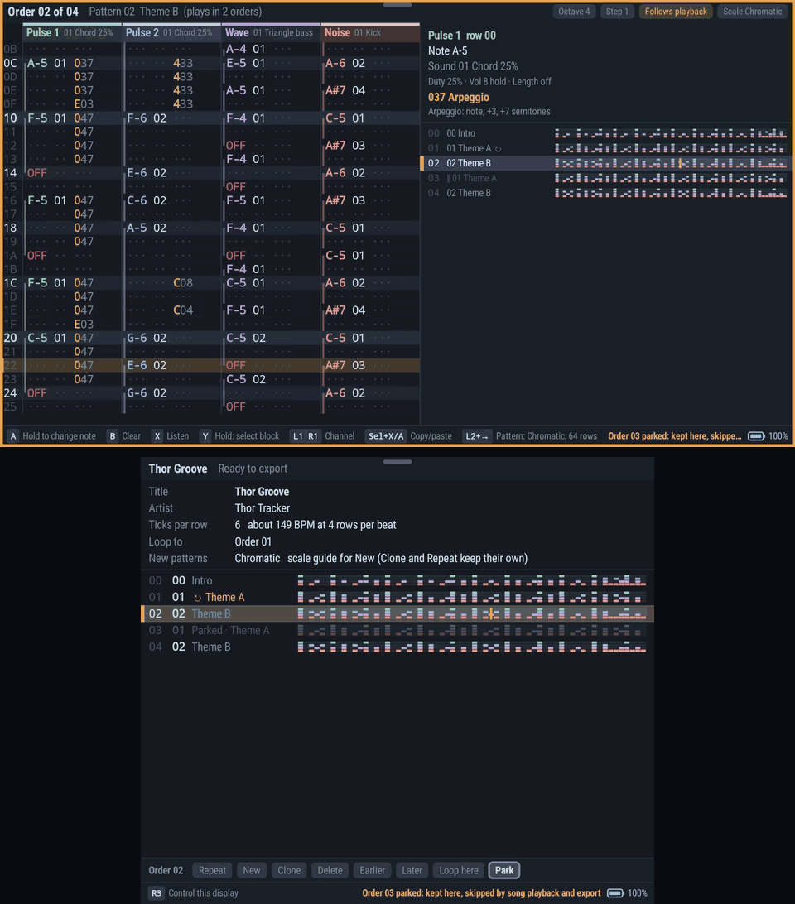

*Dual-screen playback: Pattern view above, Song arrangement below.*

## Install

Install `thor-tracker-<version>.apk` from [Releases](https://github.com/esko997/thortracker/releases).
It updates **Thor Tracker** (`org.thortracker`) in place. Android 8 or later is required;
arm64-v8a and x86_64 are supported. The old separate **Thor Tracker Touch Preview** installation
and its data are not migrated or removed; export any songs from it through its file picker.

Each release has `thor-tracker-<version>.apk` and a `.sha256` file to check it with (`sha256sum -c thor-tracker-<version>.apk.sha256`). Releases are signed with the Thor Tracker release key (certificate SHA-256 `d12064692cbaa5c2feecf3cf5a2d3719a088e7bafe1ffa55e1f00aeecafed469`), so each one installs over the last. A build from before 0.8.4, or one you built yourself with the debug key, must be uninstalled once first. That removes the app's private data (recovery copy, button mapping, screen layout); projects saved or exported through the file picker, and exported keymaps, are kept.

The first launch opens the Game Boy demo **Thor Groove**; later launches recover your working document.
**Menu → Files → New blank song** selects a sound system and its variant; **Load demo** offers the same
selection with a ready-made arrangement. Families include NES cartridge expansions, Sega PSG/FM layouts,
AY/YM computers, SCC/SCC+, WonderSwan/Color, Philips SAA1099 and GBA/Maxmod.
The [sound-system guide](https://esko997.github.io/thortracker/systems/) describes their differences.

## Converting between systems

**Menu → Files → Convert to system…** previews a conversion to any available system. It does not
change the working song until you choose **Apply conversion** and confirm the previous-project backup.
**Read complete report** pages through the lane mapping, changes, losses and blockers;
**Save report as .txt** exports the entire report. Cancel leaves the song, selection, history and
file association untouched. A preview cannot overwrite edits made after it was calculated.

Conversion preserves the arrangement, hidden rows, unused patterns and independently editable
instrument identities where the destination can represent them. Extra channels and unsupported
commands are reported; capacity overflow blocks Apply rather than truncating the song. Cross-family
sounds use audible destination presets, with replaced instruments and resources listed explicitly.
Sample-only or firmware-only voices are not filled with empty sample banks.

NES-to-expansion, WonderSwan-to-Color, OPN-to-OPNA and compatible Sega PSG promotions retain their
compatible sound data. Other conversions are musical approximations, not audio equivalence:
pitch limits, noise keys, effect-column budgets, clocks, envelopes and tuning can differ.
Retaining a tuning's metadata does not guarantee that the destination driver realizes the same
fine pitches. Review the report, listen, then save the converted document under a new name.

## Steam Deck

Thor Tracker runs natively on Steam Deck and x86_64 Linux, using the same core, views, controls, menus and sound engines as Android. The Deck shows one view at a time. See [`deck/README.md`](../deck/README.md) for native file locations and platform-specific limits.

1. In **Desktop Mode**, download `thor-tracker-<version>-x86_64.AppImage` from the [Releases page](https://github.com/esko997/thortracker/releases) (for example into `~/Applications`).
2. In a terminal (Konsole), make it executable and give it a stable name, so Steam's shortcut never has to change:
   ```sh
   cd ~/Applications
   chmod +x thor-tracker-*-x86_64.AppImage
   ln -sfn thor-tracker-<version>-x86_64.AppImage thor-tracker
   ```
3. In Steam, choose **Games → Add a Non-Steam Game to My Library…**, **Browse…**, set the file type to *All Files*, pick `thor-tracker` and **Add Selected Programs**.
4. Back in **Gaming Mode**, start it from your library (Non-Steam).

To upgrade, download the new AppImage, `chmod +x` it and run the `ln -sfn` line again with the new file name. The Steam shortcut keeps working. Your projects, settings and working song are kept outside the AppImage.

Controls are the Thor's: the D-pad moves, hold A + D-pad edits, Start plays, R2 + A/B/X/Y and R2 + ↑/→/↓ switch views (L2 + R2 + the same buttons do too, since the Deck has one display), L2 + A/B undo/redo. **Select + Start** opens the menu (it also opens from a back grip if your Steam Input layout passes them to the game), and the menu has **Quit**. To type a song title, select the title field with A, then press **Steam + X** for the on-screen keyboard. Projects and exports are kept in `~/ThorTracker`; the song you are working on is saved automatically and reopens next time.

## Brick Hammer / NextUI

The ARM64 Pak is for **Brick Hammer running NextUI (`tg5040`)**. It uses NextUI's SDL2
and audio libraries.

The package is `thor-tracker-<version>-brick-nextui.zip` with a `.sha256` sidecar. Extract it
at the SD-card root so the launcher is `Tools/tg5040/ThorTracker.pak/launch.sh`, then choose
ThorTracker from NextUI's Tools. The printed A/B/X/Y buttons retain their meanings; L2 and R2
are modifier layers, including their combined layer. **Menu** or **Select+Start** opens the
application menu; **Quit** returns through NextUI's normal Pak launcher.

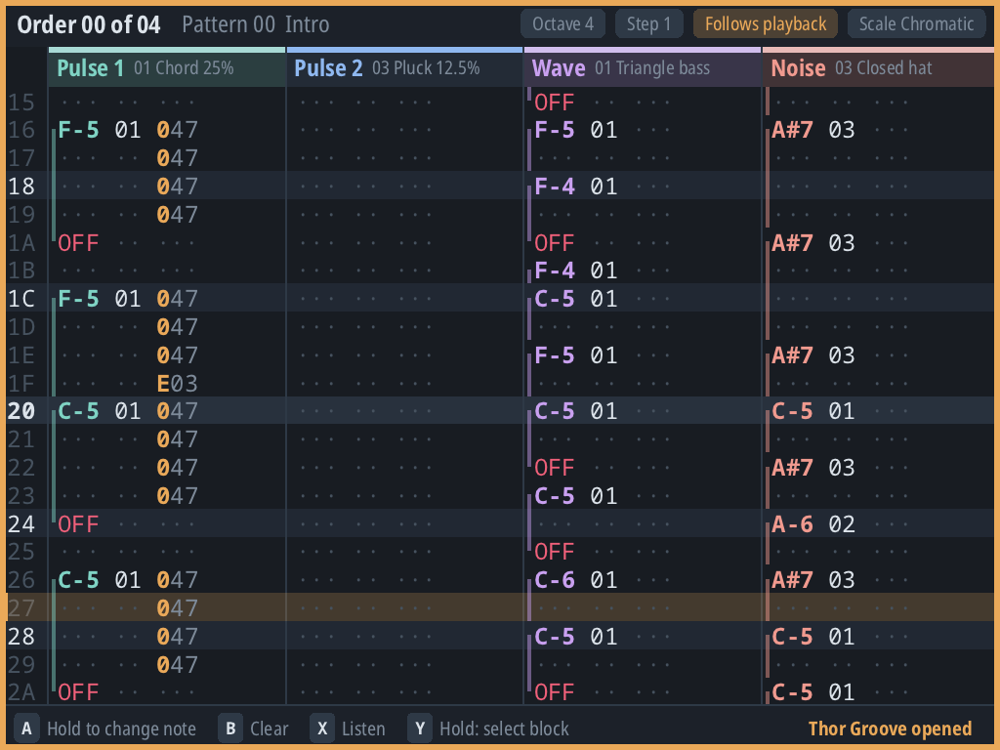

*Brick Hammer screenshot.*

Projects and exports are stored in `/mnt/SDCARD/ThorTunez`. Settings, recovery files,
tuning packs and imported firmware use `/mnt/SDCARD/ThorTunez/.thortracker`.
To update, replace the `ThorTracker.pak` application folder. Logs are written to
`ThorTracker.txt` in NextUI's log directory.

**Pak Store-format package:** releases also provide `ThorTracker.pak.zip`, whose root
contains `launch.sh`, `thortracker`, assets and `pak.json`. For a local install, extract
its contents **inside** `Tools/tg5040/ThorTracker.pak/`, not at the SD-card root.

Maintainers: bump root `pak.json`'s `version` alongside the app version. CI builds both
archive layouts and checksum sidecars; packaging refuses a metadata/runtime version
mismatch. To prepare the store ZIP from an already checksum-verified official manual ZIP
without relinking or changing its executable/`BUILD-INFO`:

```sh
python3 brick/tools/package-store.py dist/thor-tracker-1.0.0-brick-nextui.zip
# Output: dist/ThorTracker.pak.zip and dist/ThorTracker.pak.zip.sha256
```

## Colour themes

**Menu → Colour theme** selects **Slate** (the unchanged original appearance), **Paper** (light),
or **Contrast** (higher-contrast dark). The choice applies immediately to the views, menus and
platform controls, and is remembered as a workspace preference—not part of the song. It does
not change notes, instruments, Undo history or exports. Both displays use the same selection.

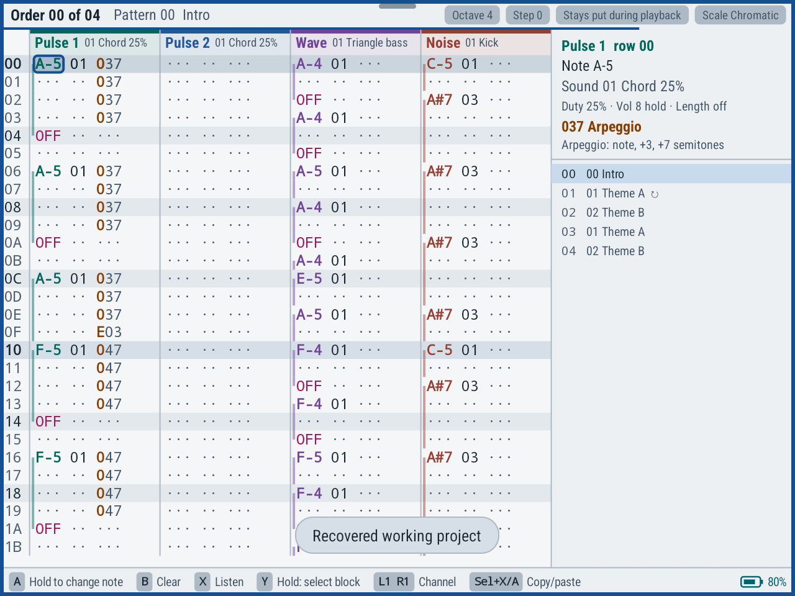
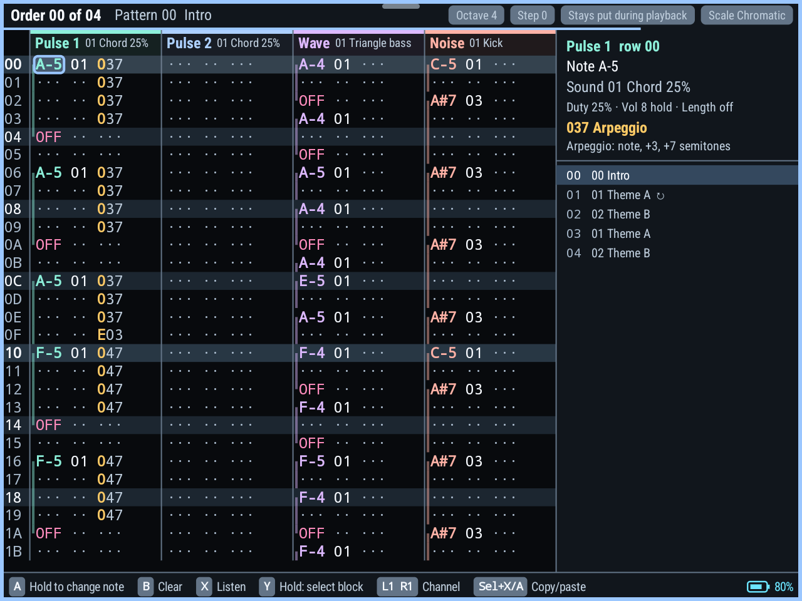

*The default Slate palette retains the original colours and layout.*

## View zoom

**Menu → Focused view zoom** changes the controller-focused view to **75%, 100%, 125% or 150%**.
Zoom in makes its text and cells larger; zoom out fits more rows and channels. **Reset to 100%**
restores the original size. Menus, shell buttons and their touch targets keep their normal physical size.

Zoom is a workspace preference, not a song edit: it changes no notes, playback, Undo history or
exports. Each Android view remembers its own setting; the setting follows the complete view when
views are swapped and survives view changes, layout presets and restarting the app. Linux handhelds
remember the single view's setting. The selected pattern field stays in view as the grid changes.

**Zoom in**, **Zoom out** and **Reset view zoom** are rebindable actions under Controls. They have
no default binding, so an existing custom keymap is not overwritten. Visual column compression
remains a separate control.

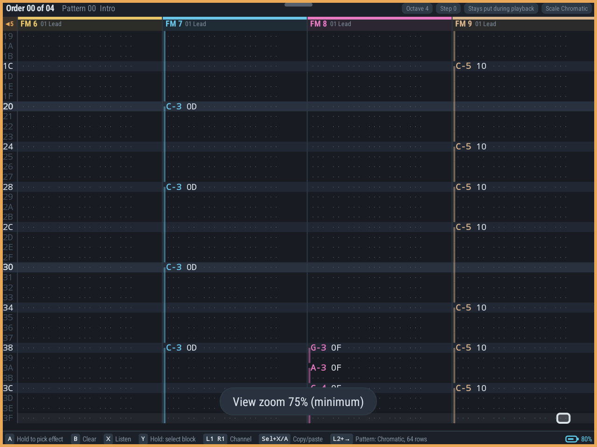
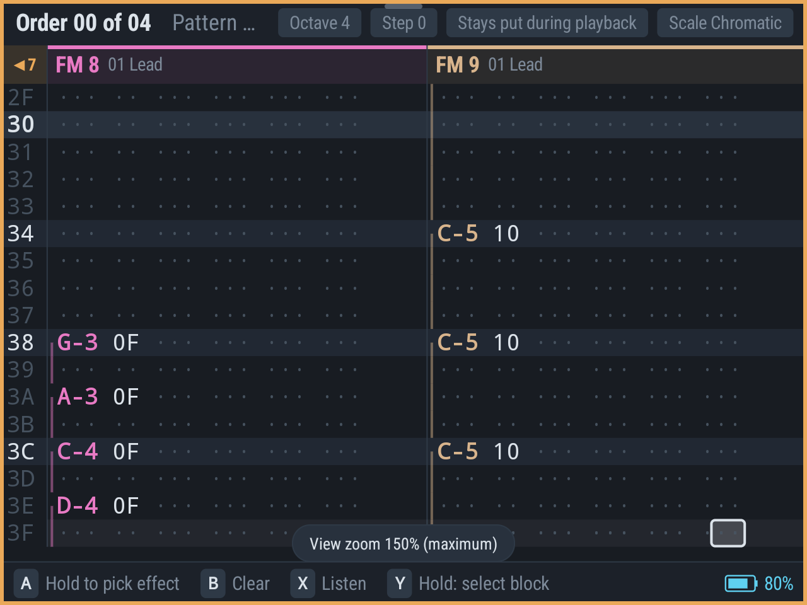

## A first session

1. **Choose a document.** Open **Menu → Files** and choose **New blank song**, **Open project**
   (`.thor`) or **Load demo**. New and Demo ask for the sound system and variant; this determines
   the channels, instruments, effects and exports. Save any working song you want to keep before replacing it.
2. **Enter and hear a phrase.** Show Pattern (**R2+Up**). Move to a note cell, hold **A + D-pad**
   to choose a pitch, and set its adjacent instrument field. **X** auditions without writing;
   **Start** plays from the current order's row 00 and stops playback. Set **Menu → Entry step**
   for repeated note entry. See [Pattern workflow](#pattern-workflow).
3. **Shape the sound.** Show Instrument (**R2+B**), select a channel-compatible slot and adjust
   its **Sound** controls while listening with **X**. Switch to **Advanced** for precise native
   parameters; neither face creates a separate patch. Return with the same view chord.
4. **Arrange.** Show Song (**R2+A**). Use **Repeat** for another reference to the same pattern,
   or **Clone** for a separately editable variation; use **New** for an empty pattern.
   Set **Loop here**, then use **Menu → Play from song start** to hear the arrangement.
   See [Song view](#song-view-arrangement-loop-point-and-parked-orders).
5. **Save, then export.** Use **Menu → Files → Save as…** to keep an editable `.thor` project.
   Open Help's **Check** page, resolve errors, then choose one of that system's **Export**
   entries or **Export .wav…** in Files. Exporting does not replace saving the project.

These are the default physical bindings; **Menu → Controls** lists your active mappings.
On Android, use the touch **Menu** drawer for views and Files, and tap cells, keys and controls
directly or use the controller dock. One screen switches between editors; two screens can keep
Pattern beside Instrument or Keyboard. See [Views and displays](#views-and-displays).

## A quick tour

### Pattern editing on both screens

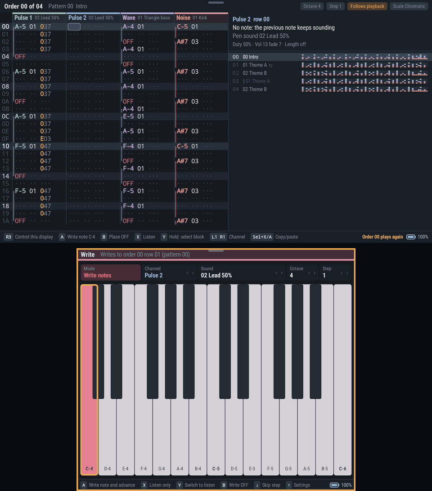

Pattern shows the selected system's channels, with note, instrument and effect fields and an
inspector explaining the selected cell. Hold A and use the D-pad to change a value, or put Keyboard
on the other screen in **Write** mode. Each entered note advances by the selected entry step.
Both screens edit the same song; the order list beside the grid locates the current pattern.

When space permits, a channel header names the instrument assigned most often in that channel's
current pattern—not the instrument selected for entering new notes. Only active pattern rows
and explicit instrument assignments count; empty channels have no instrument label, and ties
prefer the lowest slot number. Choosing a different entry sound therefore leaves other channel
headers alone.

### Song view: arrangement, loop point and parked orders

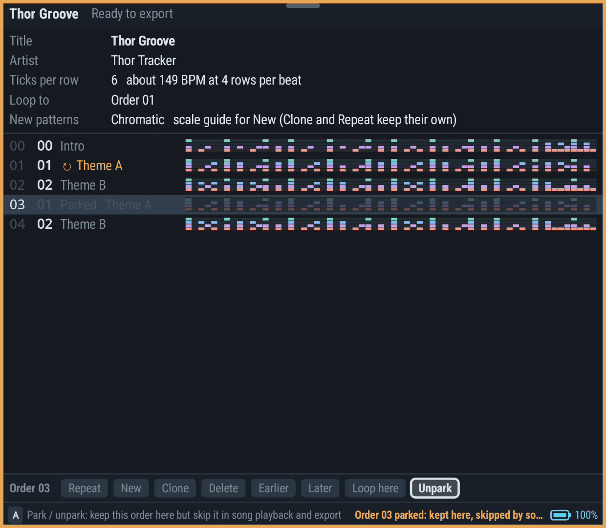

Song contains title, artist, tempo, loop point and the order list. **An order references a pattern**:
several orders can use the same pattern, and editing it changes every occurrence.

With the controller, **Up/Down** selects a header or order; on an order, **Left/Right** selects
its command and **A** activates it. Touch the corresponding command to use it directly.
On the **Pattern** field, **hold A + Left/Right** to assign an existing pattern.

| Command | Result |
| --- | --- |
| Repeat | Insert another order below using the **same** pattern; edits remain shared |
| New | Insert a new empty pattern and its order below |
| Clone | Copy the pattern into a new pattern and order below; notes can then vary independently, but instrument slots remain shared |
| Delete | Remove this order, not its pattern |
| Earlier / Later | Move this order one place |
| Loop here | Set the song's return order after its last playing order |
| Park / Unpark | Keep an order in the arrangement but exclude/include it in song playback and export |

**Select+Up** repeats below, **Select+Down** deletes the order, and **Select+Y** clones.
**Select+X / Select+A** copies/pastes a whole pattern's played rows, length and scale guide;
paste changes the destination pattern, including every order referring to it.

**Menu → Song details / tempo** opens Song with **Ticks per row** selected.
Hold **A+Left/Right** to adjust it; fewer ticks is faster. System-specific settings, such as
BPM where supported, follow the shared header fields. **New patterns** sets the scale guide
for future New patterns (**A+Left/Right** scale, **A+Up/Down** root, **B** Chromatic);
Repeat and Clone retain their source guide.

Parked orders are dimmed and labelled **Parked**; Pattern marks them `‖`.
Starting directly on a parked order loops it alone until stopped, so you can work on a section
without adding it to the song. Repeat, New and Clone beside a parked order are parked too.
The last playing order cannot be parked or deleted. A loop or jump aimed at a parked order
continues to the next playing order, or the song loop if none follows.

Moving, inserting and deleting orders preserves loop/jump targets on their original entries;
a target deleted from the list moves to its replacement. Relative jump commands retain their
backend meaning. **L2+Y** is a separate, editor-only pattern loop: it does not change the
song's loop point or exports.

### Instrument and Wave: sound design

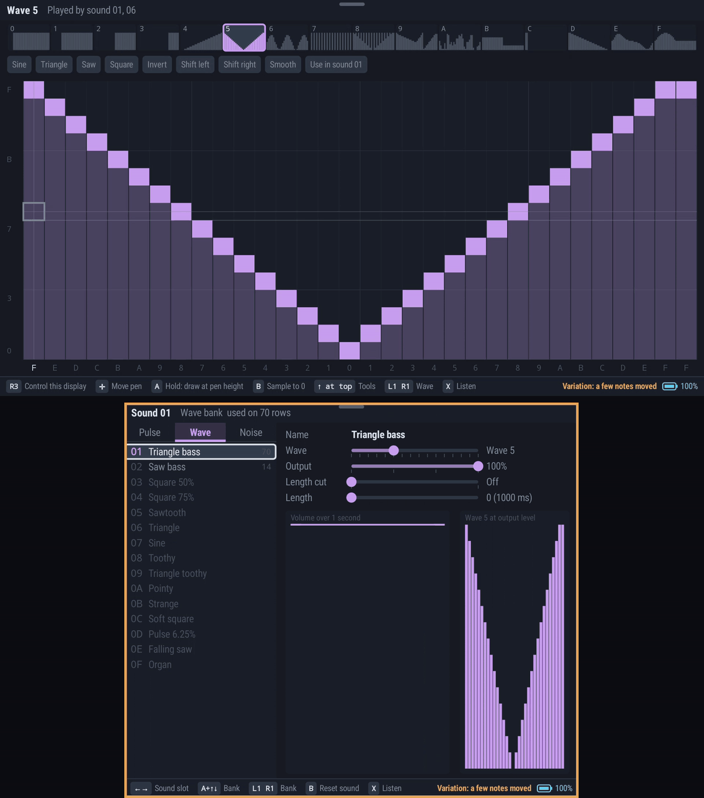

Instrument edits the selected system's native sounds through **Sound** and **Advanced**.
For example, Game Boy has pulse, wave and noise banks, with fifteen slots in each and sixteen
shared 32-sample wavetables. Other systems use their own banks, envelopes, operators and sample
maps. See [Instrument workflow](#instrument-workflow) and the [instrument guide](INSTRUMENT_PANELS.md).

### Game Boy Advance: Maxmod samples and XM

Choose **Files → New blank song → Game Boy Advance (Maxmod)**, or its **Prism Circuit** demo.
These are eight software-mixed sample voices, not eight hardware oscillators. Export `.xm`
for a Maxmod-based GBA game; WAV and the editable `.thor` project remain available.
The original Pulse, Bass, Bell, Kick, Snare and Hat samples make a blank song immediately playable.

**Sound** keeps the usual instrument list: Up/Down selects a slot, Left/Right selects a
control, A+direction edits, and X auditions. Pick a listen key, browse the sample library,
map that key and adjust volume, pan and forward looping. Touch the loop handles directly.
**Advanced** adds sample root/fine tuning, precise loop boundaries, the 96-key map,
volume/pan envelope points, sustain/loop nodes and OFF fadeout. Both faces share Undo.

**Sample tools** imports WAV, generates original sounds, trims, adjusts gain, normalizes,
fades and resamples. WAV import accepts mono/stereo integer PCM or floating-point WAV
up to 48 kHz and 16 MiB; stereo is mixed to mono and stored as signed eight-bit PCM.
Samples are shared across instrument mappings: editing one changes every instrument using it.
Root note describes the recording's pitch; changing it is not audio resampling.
Only import audio you have permission to distribute with your game.

The bounded format has **64 instruments, 128 library samples and 512 KiB embedded PCM**,
up to 199 played orders, one effect per lane per row, speed 1–31 and BPM 32–255.
Volume/pan envelopes have up to 12 points. Empty mapped keys are silent; a wholly empty
instrument cannot play. Maxmod export quantizes pan and envelope/fadeout precision and
reports converter limits, including its top-octave keymap restriction. Song tuning,
ping-pong loops, XM import and the GBA's four legacy PSG voices are not supported.
Use twelve-tone notes; scale-based note selection still works.

Effects use the verified XM subset. `F01`–`F1F` sets speed; `F20`–`FFF` sets BPM.
`Dxx` uses decimal digits for the destination row. `E4x`/`E7x` waveform selectors are
rejected because the target GBA Maxmod runtime ignores them; vibrato/tremolo use sine.
Run **Check** before export. The 512 KiB cap is an application limit, **not a guarantee
of spare GBA RAM or CPU time**: the game's mixer rate, sound effects and frame workload
still need profiling. See the [engine/export contract](AUDIO_ENGINE.md#game-boy-advance-maxmod-gba-maxmod).

### NES instruments: envelopes

An NES song has five channels (Pulse 1, Pulse 2, Triangle, Noise and DPCM) and one bank of 64 instruments shared by all of them. On DPCM an instrument is a set of note → sample mappings (sample, rate, loop), so one instrument can be a whole drum kit; the song carries its samples (imported `.wav` or `.dmc` files, or the built-in starter kit), and song data and samples share the NES's 29690 bytes ($8C00-$FFF9). Each instrument is also four FamiStudio envelopes (volume, arpeggio, pitch and duty), one value per frame, edited with the controller: ↑/↓ choose a row (slot, name, the channel **Listen** plays on, envelope, length, loop, release, pitch mode, then the steps), ←/→ move along the steps, **hold A + ↑/↓** changes a step's value and **hold A + ←/→** carries it to the next step (adding steps at the end). **B** deletes a step, **L1/R1** switch envelope. The loop region and release point are drawn on the steps; a release (volume only) needs a loop. Tabs a channel ignores are greyed for the Listen channel (Triangle has no volume or duty; on Noise, duty picks long or short noise). NES songs have no Wave view; **R2 + →** says so.

### NES DPCM samples

The fifth NES channel, **DPCM**, plays delta-modulation samples. A note on it plays the sample its instrument maps to that key, as in FamiStudio's DPCM instruments; envelopes do not apply there and only `Fxx`, `Gxx`, `Sxx` and `Zxx` (DMC output level) do. The instrument view's last page (**L1/R1** past Duty) edits the mappings with the controller: **Key** (←/→ a semitone, **hold A + ←/→** the next mapped key, **A + ↑/↓** an octave), **Sample**, **Pitch** (DMC rate 0-F, F = 33.1 kHz), **Loop** and **Level** (the initial `$4011` level, the sample's own unless set). Below, the sound's mapped keys sit beside the song's samples with their sizes, the shared 16 KB of sample memory, and the selected sample's waveform, name and initial level; **A** maps the selected sample to the key, **B** deletes it. **Add** offers the built-in starter kit (kick, snare, hat, two toms, bass; synthesized in code, so free to use) on General MIDI drum keys in the shown octave, or a `.wav` or `.dmc` file: the Android document picker, or the Deck's file browser in `~/ThorTracker`. A `.wav` is converted on the device at the rate you choose; each rate shows the resulting size against the free sample memory. X listens to the shown key. In the Pattern view, **hold A + ←/→** on a DPCM note steps through the mapped keys and the inspector (or the status line on narrow screens) names the sample; the Keyboard view labels mapped keys with their samples.

### NES + Sunsoft 5B

**New blank song → NES… → NES + Sunsoft 5B (FamiStudio)** (and **Load demo**, the demo *Copper Kite*) adds Sunsoft's 5B (a YM2149F) as FamiStudio does: **5B Square 1-3** after DPCM. 5B sounds (**Chip: 5B**) play at true pitch, C-1..B-7 (FamiStudio's text shows them an octave higher: its engine plays the 5B an octave below a pulse on the same note), and have volume, arpeggio, pitch, **Mixer** (tone+noise, noise, tone or off per frame) and **Noise** (period 0-31) envelopes, plus a **5B env** page: the chip's hardware envelope (saw, triangle or one-shot shapes; its period follows the note by an octave setting, or is manual). The three squares share one noise and one envelope generator: the highest square sounding such a sound drives them (the Pattern view tags it ENV / NOISE; the song check warns when sounds fight). **Ixx / Jyy** set the envelope period's high / low byte (together on one row for xxyy). Exports: `.nsf` (expansion byte bit 5) and FamiStudio text. Details: docs/BACKENDS.md.
### NES + VRC6

**New blank song → NES… → NES + VRC6 (FamiStudio)** (and **Load demo → NES…**, the demo *Saw Sunrise*) adds Konami's VRC6 cartridge chip, as FamiStudio does: three more channels after DPCM — **VRC6 Pulse 1**, **VRC6 Pulse 2** (eight duties, 1/16 to 8/16, and 12-bit periods that reach every note) and the **VRC6 Saw**. The 64 sounds stay one bank; on these songs the Instrument view has a **Chip** row (**hold A + ←/→**: 2A03 or VRC6; **B** back to 2A03). 2A03 sounds play on the first five channels, VRC6 sounds on the VRC6 channels; VRC6 sounds have duty steps 0-7 and a **Saw volume** row — how the saw turns volume 0-15 into its accumulator rate: Quarter ×1, Half ×2 (the default), Full ×4 (loudest; above volume 10 the accumulator overflows and the saw distorts, as on the chip). `Vxx` on the VRC6 pulses takes 00-07; the saw has no duty. `.nsf` exports name the VRC6 so NSF players emulate it; the FamiStudio text opens as a VRC6 project in FamiStudio. Plain NES songs are unchanged.

On narrow displays, Pattern keeps each lane wide enough for its note, instrument and effect, scrolling sideways rather than squeezing text into the next lane. **L1/R1** moves between channels; the header arrows show hidden channels.

### NES + VRC7

**New blank song → NES… → NES + VRC7 (FamiStudio)** (and **Load demo → NES…**, the demo *Lantern Point*) adds Konami's VRC7, the Famicom cartridge FM chip (a YM2413 relative): six more channels after DPCM, **VRC7 FM 1-6**, two-operator FM voices that reach every note C-1..B-7. On these songs the **Chip** row offers 2A03 or VRC7; VRC7 sounds play only on the FM channels and keep their volume, arpeggio and pitch envelopes (volume is the chip's 4-bit level, 3 dB a step; a pitch envelope moves the FM frequency, + raises it). In place of Duty, a VRC7 sound's fourth page is its **FM patch**: **Patch** picks one of the chip's 15 built-in sounds (Bell, Guitar, Piano, Flute, Clarinet, Rattling bell, Trumpet, Reed organ, Soft bell, Xylophone, Vibraphone, Brass, Bass guitar, Synthesizer, Chorus) or **Custom**, the chip's one programmable patch; below it every register field per operator (←/→ modulator or carrier; **hold A + ←/→** changes it): multiplier, half-sine, modulation level, feedback, attack, decay, sustain level, release, sustained, key scaling, tremolo and vibrato. Changing a field of a built-in patch makes the sound Custom, starting from that patch. The chip has **one** custom patch for all six channels: a Custom sound starting while another FM channel holds a note of a different Custom sound changes that note too, and the song check says where. **Release** and **Stop** sustain are one setting for the whole song (FamiStudio's engine keeps one): on, OFF (or a stop/cut) fades at the chip's slow sustain rate instead of the patch's release. On the FM channels OFF is a key-off: the patch's release plays and the volume envelope continues from its release point. `Vxx` has no meaning on FM; `Pxx` detunes by the same pitch it gives a 2A03 pulse on that note, to the chip's nearest frequency step. Export `.nsf` (with the VRC7 flag, for NSF players), `.txt` (FamiStudio text with `Expansions="VRC7"`) and `.wav`.

Notes use sounding pitch: A-4 is approximately 440 Hz on both the 2A03 pulses and VRC7. FamiStudio text names the VRC7 notes an octave higher than equal-pitch 2A03 notes because its two driver tables use different octave conventions.

### NES + N163

**New blank song → NES… → NES + N163… → 1-8 channels** (and **Load demo**, the demo *Wavetable Garden*, which grows with the channel count) adds Namco's 163 wavetable chip as FamiStudio does: after DPCM come **N163 1**…**N163 n**. The chip updates one channel every 15 CPU cycles in turn and keeps its channel registers in its own 128 bytes of RAM, so the channel count is part of the song: each count is its own variant with its own note table. More channels mean less RAM for waves (256 − 16 per channel 4-bit samples), a lower top note (8 channels stop at A-7; the check names notes above it) and, at 7-8 channels, the chip's switching whine, as on hardware. On these songs the Instrument view's **Chip** row offers 2A03 or N163; N163 sounds keep volume, arpeggio and pitch envelopes and have a **Wave** page instead of duty: draw 4-bit samples (0-15, 8 is silence), set the wave **size** (multiples of 4; FamiStudio tunes notes for 16 samples — 32 sounds an octave lower, 8 an octave higher, other sizes off-key), its **position** in the chip's RAM, a sequence of up to 64 waves (each held 1-15 frames, with a loop and a release point that OFF jumps to), and FamiStudio's presets (sine, triangle, saw, squares, PWM sweeps). Channels playing at once need their sounds at separate RAM positions — the engine uploads a sound's wave to its position whenever it changes, so overlapping sounds overwrite each other (identical waves at one place share safely); the check warns with the rows and RAM ranges, and the Wave page draws every sound's range. `X00` (N163 only) restarts the wave from its first sample (phase reset); `Pxx` detunes by the pitch the same `Pxx` gives a pulse; `Vxx` does nothing (no duty). `.nsf` exports name the Namco 163 (header byte `$7B` bit 4); the FamiStudio text opens as an N163 project with the same channel count. Plain NES songs are unchanged.

### NES + FDS

**New blank song → NES… → NES + FDS (FamiStudio)** (and **Load demo**, the demo *Side B*) adds the Famicom Disk System's 2C33 sound unit after DPCM: one **FDS** channel with a 64-step, 6-bit wave and frequency modulation. **Chip: FDS** instruments retain volume, arpeggio and pitch envelopes; positive pitch-envelope values raise the pitch.

- **Waves:** draw 64 samples (0-63), arrange up to 16 waves with repeats of 1-15 frames, a loop and a release point, or choose FamiStudio's presets. Master volume offers 100%, 66%, 50% and 40%; at 100% a full FDS output is about 2.4 times a 2A03 pulse.
- **Modulation:** draw 32 bend-counter targets; the graph also shows the curve produced by FamiStudio's 3-bit encoding. Speed covers the complete 0-4095 range and shows its rate in Hz, depth is 0-63, and delay counts frames after a note. Auto-mod sets the speed to the note's frequency times a fraction (numerator and denominator 1-32), so the timbre follows the pitch.

Notes are true pitch for a one-cycle wave: A-4 = 440 Hz, two cycles sound an octave higher, four two octaves higher. The upper note is G#6, limited by the driver's 12-bit frequency table. FamiStudio text uses its own note numbers, 24 above its 2A03 numbers for the same pitch. Effects include the pulse effects except duty, plus **Hxx** (mod depth 00-3F), **Ixx/Jxx** (high four bits / low byte of mod speed, preserving the other half), and **X00** (restart the wave).

Exports are NSF, FamiStudio text and WAV. A scoped driver correction supports manual speeds whose low byte is 80-FF while retaining auto-mod. FamiStudio 4.5.3 previews those exact text-exported speeds correctly, but its own assembly/NSF exporter misinterprets them; Thor Tracker's player and NSF/WAV exports use the correction.
Legato loop entries retain modulation and the correct instrument slot for live edits, including renamed copies of identical sounds.
### NES + EPSM

**New blank song → NES… → NES + EPSM (FamiStudio)** (and **Load demo → NES…**, the demo *Expansion Port*) adds the EPSM, the Famicom expansion-port module built around a Yamaha **YMF288** (OPN3-L), as FamiStudio does: fifteen more channels after DPCM — **SSG 1-3** (AY-style squares with noise and a hardware envelope), **FM 1-6** (4-operator FM, stereo) and six rhythm drums, **Kick**, **Snare**, **Cymbal**, **Hi-hat**, **Tom** and **Rim**. EPSM sounds (**Chip: EPSM**) play on all of them: on FM the sound's FM patch (pages **FM**, the curated editor with the Mega Drive presets, and **FM Expert**, every register), on SSG its **Mixer** (tone + noise, noise, tone or neither per frame), **Noise** (period 0-31) and **SSG env** (the hardware envelope: saw, triangle or one-shot shapes, its period following the note by an octave setting or manual) pages, and on the drums its **Rhythm** page (level and left/right pan); volume, arpeggio and pitch envelopes shape FM and SSG notes. SSG and FM notes play at true pitch, C-1..B-7 (FamiStudio's text shows them an octave higher, sounding the same); a drum has one fixed sound, so any note just triggers it. The chip's one LFO (FM vibrato/tremolo with each sound's PMS/AMS) is a Song-view setting, and the SSG squares share one noise and one envelope generator: the highest square sounding such a sound drives them. `Ixx`/`Jyy` set the SSG envelope period. `.nsf` exports name the EPSM so NSF players emulate it; the FamiStudio text opens as an EPSM project, except that its format cannot hold a manual SSG envelope period other than 4000, so a song with one is refused there (`.nsf` and WAV keep it).

**The rhythm drums need the YM2608 rhythm ROM**, Yamaha's 8 KB of drum samples. Thor Tracker does not include it and never puts it in songs or exports. If you have a copy (MAME names it `ym2608_adpcm_rom.bin`, Mesen2 `ymf288_adpcm_rom.bin`), choose **YM2608 rhythm ROM…** (main menu while an EPSM or PC-98 OPNA song is open, or the **Rhythm** page's **Rhythm ROM** row) and pick the file (`.bin` or `.rom`): it must be exactly 8192 bytes with SHA-256 `53afd0fa9c62eda3e2be939e23f3adf48a2af8ad37bb1640261726c5d5adeba8`. One import serves both systems. It is then kept in the app's private storage (Thor: `files/firmware/ym2608_adpcm_rom.bin`; Steam Deck: `~/.local/share/thortracker/firmware/ym2608_adpcm_rom.bin`, the same file earlier EPSM imports used) and loaded at every start (a stored copy that no longer verifies is reported and not loaded); the menu row and the Rhythm page show whether it is installed. Without it, FM/SSG songs (like the demo) play normally, and a song with rhythm notes, or auditioning a drum, says how to import it instead of playing.

The EPSM mixer reserves headroom for simultaneous FM, SSG and rhythm peaks while preserving their relative levels.
It can play substantially quieter than other systems; output is not loudness-normalized.
The raw-range gain policy and its hardware-verification limits are in [AUDIO_ENGINE.md](AUDIO_ENGINE.md).

### NES + MMC5

**New blank song → NES… → NES + MMC5 (FamiStudio)** (and **Load demo → NES…**, the demo *Tandem Skies*) adds the two extra pulse channels of Nintendo's MMC5 cartridge chip, as FamiStudio does: **MMC5 Pulse 1** and **MMC5 Pulse 2** after DPCM. They play the same 2A03 sounds as the console's pulses (FamiStudio has no separate MMC5 instrument), with the same four duties (`Vxx` 00-03), effects and notes down to A-1. Hardware differences: no sweep unit, and a pitch that crosses a period-high boundary (vibrato, slides, fine pitch on low notes) restarts the pulse's waveform with a small click, because FamiStudio's smooth-vibrato workaround exists only for the 2A03's pulses. A third lane, **MMC5 PCM**, plays samples on the MMC5's 8-bit DAC. FamiStudio 4.5.3's engine does not drive that DAC ("extra DPCM not supported"), so this lane is Thor Tracker's own software sample player writing the DAC on the emulated CPU's timebase — not a hardware feature of the chip, which has no sample clock of its own, and not code a real NES would run for free. A sound's **PCM page** maps keys to PCM samples (sample, pitch −48..+24 semitones, loop, a chromatic *Spread* for pitched instruments), next to its DPCM page; **Add** imports a `.wav` as unsigned 8-bit mono (rates up to 48 kHz kept, higher ones converted and the import says so; the lowest level becomes 1 because the DAC ignores `$00`; up to 64 samples in 256 KiB, a file that does not fit is refused, never cut). On the lane `Cxx` sets the volume, `Gxx` delays, `Sxx` cuts, OFF stops and `Fxx` sets the song speed; other effects are refused. It plays in the app, auditions, seeks, live edits and WAV exports; `.nsf` and FamiStudio text cannot hold it and refuse a song whose PCM lane plays (a silent lane exports the seven channels as before). `.nsf` exports name the MMC5 so NSF players emulate it; the FamiStudio text opens as an MMC5 project in FamiStudio. The NES + MMC5 and NES + N163 builds now budget their whole mixer range, so they play quieter than plain NES songs; the calculated worst-case output remains below full scale (0.979). Plain NES and VRC6 songs are unchanged.
### C64 SID instruments: envelope and programs

A C64 song (**Menu → Files → New blank song → C64 SID**) has three voices, all tonal, one filter for the whole chip and one bank of 63 GoatTracker instruments shared by the voices. The instrument view has six pages (**L1/R1**): **Envelope** (attack, decay, sustain, release with the envelope drawn, and **Preset**: **hold A + ←/→** starts the sound from a saw lead, PWM pad, filter bass, noise snare, wave-arpeggio kick, hi-hat, triangle bass or arpeggio chord); **Wave**, **Pulse** and **Filter**, the sound's programs, edited row by row (↑/↓ a row, ←/→ a column, **hold A + ←/→** changes it; the first column is what the step is: a waveform with gate/sync/ring/test bits, a silent row, a wait, a command or a jump; a pitch is relative to the note, an absolute note for drums, or kept; **A** on a bit switches it and past the last row adds one; **B** deletes a row and **Select + Y** duplicates it, jumps keeping their targets; pulse and filter programs show their width or cutoff over two seconds); **Vibrato·HR** (hard restart, gate timer, first-frame waveform and the instrument vibrato, drawn); and **Tables**, the song-wide wave, pulse, filter and speed tables the player reads, built from the programs (read-only: **A** on a row opens its program). Holding **A** on any sound setting plays the sound on the **Listen** voice and every change restarts it. The Filter page and the Pattern view (a **FILTER** tag on the voice and a line in the inspector) show which voice owns the filter where the song is heard: the last one to start a filter program (or `Axx`; `B00` turns it off). The Song view adds the chip model (8580 or 6581), multispeed (1-16 player calls per frame) and the hard-restart envelope. Effects are GoatTracker's 1-F (Help → Effects); in the Pattern view **B** on an OFF enters **ON** (key on). **Load demo → C64 SID** opens "Raster Run".

### Mega Drive instruments: FM, PSG and PCM

A Mega Drive song (**Menu → Files → New blank song → Mega Drive**) has thirteen lanes:
FM 1-6 (YM2612), PSG 1-3 and Noise (SN76489), and PCM 1-3 mixed by SGDK's XGM2
driver. Each lane has up to four effect columns. The 64 instrument slots hold
**FM voices**, **PSG sounds** or **PCM kits**; the **Type** row changes the slot's kind.
New notes select a sound of the lane's kind.

FM pages (**L1/R1**) offer **Sound** (curated algorithms, ratios, envelopes, brightness,
feedback, LFO depths and SSG-EG), **Expert** (every operator register), **Drum** (pitch
sweep), and **Ch3** (four independent operator pitch offsets). **Song → FM 3 mode**
enables the latter: each operator follows the note plus its offset, in semitones and
1/64-semitone steps, up to ±4 octaves. Other FM lanes ignore these offsets.
Normal mode keeps the original common pitch. Timer-A CSM mode is not available:
XGM2 uses that timer for PCM playback.

PSG sounds retain the NES-style **Volume**, **Arpeggio**, **Pitch** and **Noise·Drum**
pages. Pitched noise shares PSG 3's period. Song settings also select NTSC/PAL and
the FM LFO rate. **Load demo → Mega Drive** still opens **Neon Causeway**.

PCM kits map notes to samples. On their **Add** row, import a WAV; choose the
**Key**, **Sample** and **Pitch**, or use **Spread** to map the same sample over
nearby keys. Stereo is downmixed, samples become signed 8-bit, and input above
48 kHz is resampled; the import reports these conversions. Up to 64 source samples
share 256 KiB. Pitched and level-adjusted sounds compile into at most 123 distinct
variants sharing a 1 MiB driver bank; identical waveforms share storage.
Kit **Level** is fixed at 0-15 (15 unchanged, 2 dB quieter per step, 0 silent).
The driver plays one-shots, not sample loops. PCM lanes support `B`, `D`, `F`,
`G`, `L`, `S` and OFF, not per-row volume or pitch effects.
**FM 6 is inaudible while the DAC is playing PCM**; all three PCM lanes share its
stereo routing. Muting a PCM lane stops its sample; unmuting waits for the next note.

Exports are **VGM**, **WAV**, **XGM2 (.xgm)** and **packed XGM2 (.xgc)**.
The two XGM files require an XGM2-capable consumer; they are not compatible with
the old XGM1 driver or `XGM_startPlay`. VGM records the actual driver's writes,
including PCM DAC output.

### Master System, Game Gear and the FM Sound Unit

**New blank song → Sega 8-bit…** offers four layouts: **Master System** (three SN76489 squares and noise), **Game Gear** (the same four channels with left/right stereo routing), **Master System + FM Unit** (four PSG channels plus nine YM2413 FM voices), and **FM Unit, rhythm mode** (four PSG channels, six FM voices and five hardware drums). Each has a version of the demo **Harbour Lights**. Playback runs the unmodified Banjo driver on an emulated Z80 at the NTSC frame rate, about 59.92 Hz.

Up to four effect columns are available per channel. The instrument slots hold PSG sounds, FM voices or drum kits, with separate bank views over the same numbering. PSG sounds have volume, arpeggio and pitch/noise envelopes; FM voices offer the fifteen built-in patches or a custom two-operator patch with volume/arpeggio envelopes. The YM2413 has only **one shared custom patch**: simultaneous custom sounds cannot have independent operator settings. The editor warns about this hardware limit.

Rhythm kits can follow note pitches or use three fixed pitches; snare/hi-hat and tom/cymbal share their hardware pitch registers. Pitched noise also shares Square 3's period. These are chip constraints, not extra independent oscillators. PSG notes reach A-2..B-8; FM notes reach C-0..B-7. Banjo has no fine-pitch command, so imported tunings play at their nearest notes.

**Files → Export .asm / .s** writes Banjo song sources for WLA-DX or SDAS (devkitSMS/GBDK), including the required initialization and chip-call stubs. **Export .vgm** records the actual driver's register writes, including Game Gear stereo and FM rhythm mode. **Export .wav** uses the same native playback engine.

### AY-3-8910 / YM2149 sounds: ZX Spectrum 128, MSX, Atari ST, Amstrad CPC

An AY song (**Menu → Files → New blank song → AY-3-8910 / YM2149…**) is for one stock computer: the **ZX Spectrum 128** (AY-3-8912 at 1.7734 MHz, 50 Hz frames), the **MSX** (AY-3-8910 at 1.7898 MHz, 60 Hz), the **Atari ST** (YM2149F at 2.0053 MHz, 50 Hz) or the **Amstrad CPC** (AY-3-8912 at 1 MHz, 50 Hz). Notes are true pitch on each machine's clock; the ST's YM2149 has a 32-step envelope and its own volume curve, the AY 16 steps. Output follows each machine's stock wiring: mono on the ZX Spectrum 128, MSX and Atari ST; on the CPC its stereo socket (channel A left, C right, B on both). Three channels (A, B, C), up to four effect columns each, one bank of 64 sounds. A sound is five FamiStudio-style envelopes — **Volume**, **Arpeggio**, **Pitch**, **Mixer** (tone and noise gates per tick) and **Noise** (the noise period per tick) — plus the chip's **hardware envelope** (one of its eight shapes, its period following the note an octave offset away or set by hand, optionally with the tone locked to it: the buzzer and sync-buzzer sounds) and a drum pitch sweep. The **Sound** page gathers the curated choices; the **Envelope** page is the expert view of the R13 shape and the 16-bit period. The chip has **one noise generator and one envelope generator for all three channels**: the latest note that asks for one takes it, other channels using it then play its setting, and the Pattern lanes and the song check show who owns them. Effects add the hardware envelope shape (`Exx`), manual period (`Hxx`/`Ixx`), auto period octave (`Jxx`), mixer (`Vxx`) and noise period (`Wxx`). Export: VGM and WAV. **Load demo → AY-3-8910 / YM2149…** opens "Copper Lane" on the chosen machine.

### PC Engine: wavetables, noise and D/A samples

A PC Engine song (**Menu → Files → New blank song → PC Engine (HuC6280)**; **Load demo** plays *Turbo Lanterns*) has the HuC6280's six channels, **PSG 1-6**, each with up to four effect columns, notes A-0..B-7 (A-4 ≈ 440.4 Hz: the chip's 12-bit periods are within 4 cents up to C-6 and drift to 19 cents at B-7). One bank of 64 sounds holds three kinds (the instrument view's **Kind** row): **Tone** plays one of the song's 32-step, 5-bit **waves**; **Noise** plays the noise generator, which only PSG 5 and PSG 6 have (the note picks one of its 32 rates, note mod 32); **Sample** streams 5-bit frames through the channel's direct D/A output from the CPU timer, as PC Engine drivers do, pitched from its **root note**, one-shot or looping. Every kind has **Volume** and **Arpeggio** envelopes, tone and sample sounds a **Pitch** envelope too (L1/R1 pages, with loop and release points); a tone sound also has a **Wave seq** page that switches waves per tick. The **Wave** view edits the song's waves (up to 64): draw the 32 steps, pick a built-in shape, invert, shift, smooth, add, duplicate or delete (sounds, wave sequences and `Wxx` effects follow the renumbering). A sample sound's **Sample** page adds the built-in drum kit (kick, snare, hat, tom; synthesised, no third-party audio) or imports a `.wav` file, both made on the device as 5-bit frames at the song's D/A rate. Copying a sample sound takes its sample along: pasting it into another song adds the sample there (or uses the same frames if that song already has them). The Song view lists the chip's shared settings: **Multispeed**, **Master left/right**, **LFO frequency**, **LFO control** (PSG 2's wave bends PSG 1's pitch, as on the chip; PSG 2 still sounds unless its volume is `C00`) and the **DDA rate** (6991 Hz ÷ (R + 1)); effects `X`, `L`, `M` and `T` change them mid-song, `8xy` pans a channel. Songs export as VGM and WAV.

### MSX SCC and SCC+: wavetables and envelopes

An MSX SCC song (**Menu → Files → New blank song → MSX SCC… → Konami SCC** or **Konami SCC+**) has five channels, SCC 1-5, each playing a 32-sample wavetable with up to four effect columns. **Konami SCC** is the K051649 of Konami's MSX megaROM cartridges: **SCC 4 and SCC 5 share one wave RAM**, so whichever of the two last started a note or changed wave while still keyed (including a release tail) decides the wave both play. Once keyed off, only an explicit `Wxx` can claim it. The song check warns where different waves overlap, even within a row; lane headers show the shared wave, with `+` when stepping envelopes make ownership uncertain. **Konami SCC+** is the K052539 of the Sound Cartridge, where every channel has its own wave. The **Wave** view draws the song's 64 waves (32 signed samples each) with the pen and tools (sine, triangle, saw, square, pulse, noise, invert, shift, smooth, normalise, Use in sound). The **Instrument** view holds 64 slots (empty until a preset or edit fills them); a sound is four envelopes edited step by step like the NES's — volume (loop and release), arpeggio, pitch (absolute or relative sweeps) and **wave** (which waves the note plays, tick by tick) — plus **Restart** (each note starts its wave at sample 0). Effects: `0xy` `1xx` `2xx` `3xx` `4xy` `Axy` `Bxx` `Cxx` (00-0F) `Dxx` `Fxx` `Gxx` `Pxx` `Sxx`, `Wxx` (play wave xx) and `Txx` (the chip's test register). Songs export as `.vgm` and `.wav`. Demos: **Cartridge Dusk** (SCC) and **Prism Lane** (SCC+). See [verification evidence](VERIFICATION.md) for native, handheld and desktop checks; no original-hardware or human listening comparison is claimed.

### OPM (YM2151) instruments and the chip's shared LFO, noise and CSM

An OPM song (**Menu → Files → New blank song → OPM FM (YM2151)**; **Load demo** has *Sharp Corners*) plays a Yamaha **YM2151**, the X68000's sound chip, at the X68000's **4 MHz** clock: eight 4-operator FM channels **FM 1-8**, stereo, each with up to four effect columns, notes D#0 to D-8 at true pitch (A-4 = 440 Hz; the 4 MHz clock plays the chip's key codes 192 cents sharp, which the player corrects). It runs Thor Tracker's own player on ymfm's YM2151, 60 ticks per second times the song's multispeed, and exports **VGM** (and WAV, as every system). One bank of 64 sounds; the instrument view has three pages (**L1/R1**): **Sound** — curated controls (**Preset**, the eight **Algorithms** drawn as operator diagrams, **Ratios** with fine detune DT1 and the OPM's coarse detune **DT2** for bell and metal tones, brightness, level, feedback, attack, decay, sustain, sustain rate, release, tone decay, key scaling, vibrato (PMS) and tremolo (AMS) sensitivities); **Expert** — algorithm, feedback, PMS, AMS and every operator register (DT1, MUL, TL, KS, AR, AM, D1R, DT2, D2R, D1L, RR) as a grid; **Drum** — drum presets, the pitch sweep and **Noise**. There are no chords (every channel is one chip channel).

Some of the YM2151 exists once for the whole chip, so it is song data, not instrument data. The Song view lists it after the shared rows, and effects change it while the song plays: the **LFO** (frequency `Lxx`, waveform saw/square/triangle/noise `Wxx`, amplitude depth AMD `Txx`, pitch depth PMD `Vxx`; each sound only says how much of it it takes, with PMS/AMS, or `Hxy` per channel), the **noise generator** (it exists only on FM 8's fourth operator: a sound with **Noise** on plays on FM 8 alone, `Nxx` changes its frequency there) and **CSM** (`Xxx` on/off; timer A, `Qxx`, keys on every channel's operators 62500 / (1024 − NA) times per second, retriggering released voices into a buzzing, formant-like tone). The Pattern inspector shows the state of all three at the cursor.

### PC-88/98: OPN (YM2203) and OPNA (YM2608)

**New blank song → PC-88/98…** (and **Load demo → PC-88/98…**) offers NEC's computer sound chips at their PC-88/98 clocks, played by Thor Tracker's own player on ymfm and exported as **VGM** (or WAV).

- **PC-88/98 OPN (YM2203)** — demo *Night Express*: **FM 1-3** (4-operator FM, mono) and **SSG 1-3** (AY-style squares sharing one noise generator and one hardware envelope generator).
- **PC-88/98 OPNA (YM2608)** — demo *Paper Lanterns*: **FM 1-6** in stereo with the LFO, **SSG 1-3**, the six rhythm drums **Kick, Snare, Cymbal, Hi-hat, Tom, Rim** (they need the YM2608 rhythm ROM, see NES + EPSM above; everything else plays without it) and **ADPCM**, which plays your own samples from the chip's 256 KB of sample memory.

One list of 64 sounds holds every kind (the **Type** row switches a slot between FM, SSG, Rhythm and ADPCM; a lane plays sounds of its own kind). FM voices use the Mega Drive's curated **Sound** page and presets, an **Expert** page and a **Ch3** page: in the Song view's **FM 3 mode** *special*, FM 3's four operators each play the note plus their own offset (a chord or detuned stack from one channel); in *CSM*, the chip's timer A re-strikes FM 3's operators at the **CSM rate** while a note holds. SSG sounds have volume, arpeggio, pitch, mixer (tone/noise) and noise envelopes plus the **Hw env** page (the shared envelope generator's shape and period). ADPCM sounds pick a sample, its **root** note, level, pan and loop; **Add sample…** imports a `.wav` (at its rate or a lower one, with the size against the free memory) or generates one of Thor Tracker's own starter samples, and **Tools…** trims, normalises, changes gain, reverses, fades, resamples, replaces or deletes. The Song view sets the **tick rate** (timer B, about 47-578 ticks per second), and on the OPNA the **LFO** and **rhythm level**. Effects follow the Mega Drive's letters, plus `Hxx`/`Jxx` (SSG envelope shape/period for a note), `Nxx` (noise period), `Rxx` (rhythm level) and `Txx` (CSM rate).

### Atari 2600: the TIA's two channels, at the pitches the chip really plays

Both variants have **four effect columns per channel** and two voices.
Columns run left to right; the last setting wins for a shared target. Global F/B/D run at
row start, and the last G controls delay (`G00` cancels an earlier G). The project/image schema is
unchanged; older players reject third/fourth-column content rather than dropping it. WAV export
does not establish a 6507 cartridge CPU budget.
An Atari 2600 song (**Menu → Files → New blank song → Atari 2600…**, then **NTSC** or **PAL**; **Load demo** plays *Cartridge Dawn*) has the TIA's two channels, **TIA 1** and **TIA 2**, each with up to four effect columns, notes C-0..B-9, one tick per TV frame (59.92 per second on NTSC, 49.86 on PAL; speeds count frames). Each sound has a **Waveform**, one of the chip's sixteen AUDC values: pure squares at div 2 (high) and div 6 (the melodic middle), the 18/13 div 31 tone (the bass), div 93 (very low), the 4-bit and 5-bit polynomial buzzes, white noise (8) and a constant level (0 and B). The chip divides that waveform's clock by 1-32 (AUDF), so each waveform has only 32 pitches, and Thor Tracker is honest about it: a **tonal** sound plays each note at the divider nearest to it, at that divider's true frequency (A-4 on div 6 is 436.1 Hz on NTSC, 432.1 Hz on PAL), and notes outside a waveform's span play its nearest end (the song check warns about them). The **Waveform** row shows the span (div 6: E-3..D#8), and the **Pitch guide** page lists all 32 dividers with their frequency, nearest note and error in cents — **A** plays the one under the cursor. The pattern inspector and lane tags show the key-on registers each channel reaches at the cursor (e.g. `C·11`: AUDC C, AUDF 11). A **raw** sound (the **Pitch mode** row; noise and drums) uses the note as the divider instead: C-0 is AUDF 31 and each semitone up is one step brighter, repeating every 32 semitones. Sounds have **Volume** (AUDV 0-15), **Arpeggio**, **Pitch** and **Waveform seq** envelopes (per frame, loop and release points; a waveform sequence makes kicks that start as noise and fall to a tone); slides, vibrato and portamento move in 1/64 semitones and are heard as the dividers step, as on the real console; `Wxx` switches a sounding note's waveform. Nothing restarts the chip's waveform counters, so repeated notes need not start alike. The TIA has no sample playback (a constant waveform's volume steps give clicks at the frame rate), and there is no VGM for it: songs export as **.wav**. NTSC and PAL are separate variants because the console's clock sets every pitch and the frame rate; a PAL song plays about 16 cents lower at the same AUDF.

### VIC-20 and C16 / Plus/4 sounds: one master volume

A **VIC-20 (VIC)** song has four lanes — Bass, Alto, Soprano (three squares an octave apart) and Noise — and a **C16 / Plus/4 (TED)** song three: Voice 1, Voice 2 (square or noise) and DAC; two effect columns each. Neither chip has a volume per voice: there is **one master volume** (0-15 on the VIC, 0-8 on the TED), set by `Vxx`, slid by `Axy`, and shaped by a sound's **Master vol** envelope — a note of a sound with one takes the master volume for every voice while it sounds (the lane tag shows `VOL`). A sound's other pages are **Arpeggio**, **Pitch** (absolute or relative) and **Wave** (per tick: off, square, or on the TED's Voice 2 noise; the VIC's Noise lane makes any sound noise and the note picks the noise rate). The TED's DAC lane plays **samples** through the chip's D/A mode (nine levels, at the song's DAC rate `Txx`, a `.wav` import or the built-in starter kit); while one sounds both voices are silent, as on the hardware (lane tag `D/A`). The Song view's **Machine** row chooses PAL or NTSC (the clock and the frame rate: notes stay the same pitch, each lane's note range follows the machine). The VIC's 7-bit periods are coarse: its lanes cover about three octaves each, up to 46 cents out of tune at the top, which is how a VIC-20 sounds. Export: the project and WAV (VGM has no VIC or TED chip). Demos: **Kernal Lights** (VIC-20) and **Plus Four Parade** (C16 / Plus/4). Thor Tracker's own player runs on code adapted from VICE (VIC) and plus4emu (TED); see `docs/AUDIO_ENGINE.md`.

### WonderSwan and WonderSwan Color: wavetables, sweep, noise, voice samples, Hyper Voice and Sound DMA

Output preserves hardware wrap and reserves headroom before resampling without a compensating
boost. Hyper Voice cannot be represented by VGM; use WAV.

A WonderSwan song (**Menu → Files → New blank song → WonderSwan…**, then **WonderSwan** or **WonderSwan Color**; **Load demo** plays *Paper Crane Run* or *Lantern Tide*) is played by Thor Tracker's own player on a port of the ares emulator's WonderSwan sound unit, 75.47 ticks per second. The original model has four lanes, **CH1-CH4**; the Color adds a fifth, **Hyper Voice**. Every lane has up to four effect columns; notes run G-1..B-7 (A-4 ≈ 440.4 Hz: the chip's 11-bit periods are within 6.4 cents up to C-6 and drift to 23.3 cents at worst, F#-7). One bank of 64 sounds holds three kinds (the instrument view's **Kind** row): **Tone** plays one of the song's 32-step, 4-bit **waves** on CH1-CH4 (`Wxx` switches a note's wave), with a **sweep** that only CH3 has in hardware (`Uxx`/`Vxx` override it); **Noise** plays channel 4's LFSR on CH4 only, clocked at 32 times the note's frequency, in one of eight **tap modes** (`Nxx`; the short sequences buzz at a pitch), optionally restarted at each note; **Sample** plays 8-bit frames on CH2's voice output (off, 50 % or 100 % per side) or the Color's Hyper Voice (headphones only, mono or stereo, four levels). Samples are **fed** by the CPU from the voice timer (12000 / T Hz, the Song view or `Txx`; pitched from a root note) or, on the Color, by **Sound DMA** at a fixed 4000, 6000, 12000 or 24000 bytes per second (the note only triggers; one-shot, looping or backwards; `Hxx` holds it). There is one DMA engine: a DMA sample starting on one lane stops the one sounding on the other, and the lane tags show which lane has it. Every kind has volume, arpeggio, pitch and wave or tap-sequence envelopes; the Sample page adds the kit (kick, snare, hat, tom, synthesized in code) or a `.wav` converted on the device (stereo kept on the Color). The **Output** song setting picks **headphones** (stereo; the original model needs Bandai's adapter) or the mono **speaker**, whose 8-bit sum wraps unless the **speaker shift** (`Kxx`) keeps it low; Hyper Voice is silent there. Songs export as **VGM** (a Color song with Hyper Voice notes is refused: VGM has no Hyper Voice, export WAV) and WAV; there is no WonderSwan executable export.

### Virtual Boy: shared waves, envelopes and Wave 5's sweep

A Virtual Boy song (**Menu → Files → New blank song → Virtual Boy**) has the VSU's six channels as lanes — **Wave 1-4**, **Wave 5** and **Noise** — each with up to two effect columns. The five 32-step waves and the modulation table belong to the whole song (the chip's wave RAM is shared and can only be loaded while every channel is silent, so it is loaded once at the start); the **Wave** view edits them, and any lane can play any wave. An instrument picks a wave and sets the hardware **envelope** (start level, grow or decay, step time, repeat), an automatic **length**, the Noise lane's **tap** (from a 32767-step hiss to a 28-step buzz) and, for Wave 5 only, the hardware **sweep** or **modulation**. Loudness is the envelope level (`Cxx`) and the per-lane stereo levels (`8xy`, left and right 0-F); OFF stops a channel. Notes are true pitches from D#2 up (the editor shows each note's real frequency: the 11-bit period is up to ~20 cents off at the top); Noise notes pick shift-register rates. Songs export as VGM and WAV; there is no Virtual Boy ROM export.

### SAA1099: SAM Coupé and Creative Music System (0.34.0)

A SAA1099 song (**Menu → Files → New blank song → Philips SAA1099… → SAM Coupé** or **Creative Music System**) plays the Philips SAA1099's square-wave voices: the SAM Coupé's one chip gives six lanes, `SAA 1`-`SAA 6`; the Creative Music System (Game Blaster) has two chips, lanes `A1`-`A6` and `B1`-`B6`, mixed into one stereo output. Each lane has up to four effect columns. Instruments are envelopes the player runs every tick — **Volume**, **Arpeggio**, **Pitch** and **Mixer** (off, tone, noise or tone + noise per tick) — plus a stereo **Pan** (left and right levels 0-15), a **Noise clock** and, on lanes 3 and 6 of a chip only, the chip's **hardware envelope** (eight shapes, 16 or 8 levels, inverted right side, clocked by lane 2's or 5's tone or by the player every few ticks). Shared hardware stays shared: lanes 1-3 share one noise generator and lanes 4-6 another (the latest note that uses noise sets its clock; the song check warns where two lanes of a triple want different clocks at once), and the lane headers show each generator's setting (`N0:31k`) and the hardware envelopes' clock lanes (`E←2`). `Yxx` restarts every generator of a chip in phase, holds them or switches the chip's sound off. **Load demo** opens "Coupé Lights" (SAM Coupé) or "Blaster Skyline" (Creative Music System).

### Sketch: chords and generated phrases

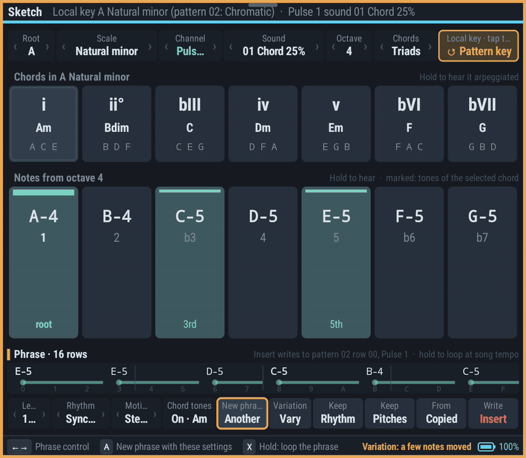

A tonal sketchpad for the current key. Hear chords and scale notes, generate short phrases from rhythm, motion and chord-tone settings (**Another**, **Vary**), then **Insert** one into the pattern as a single undo step.

### Keyboard view

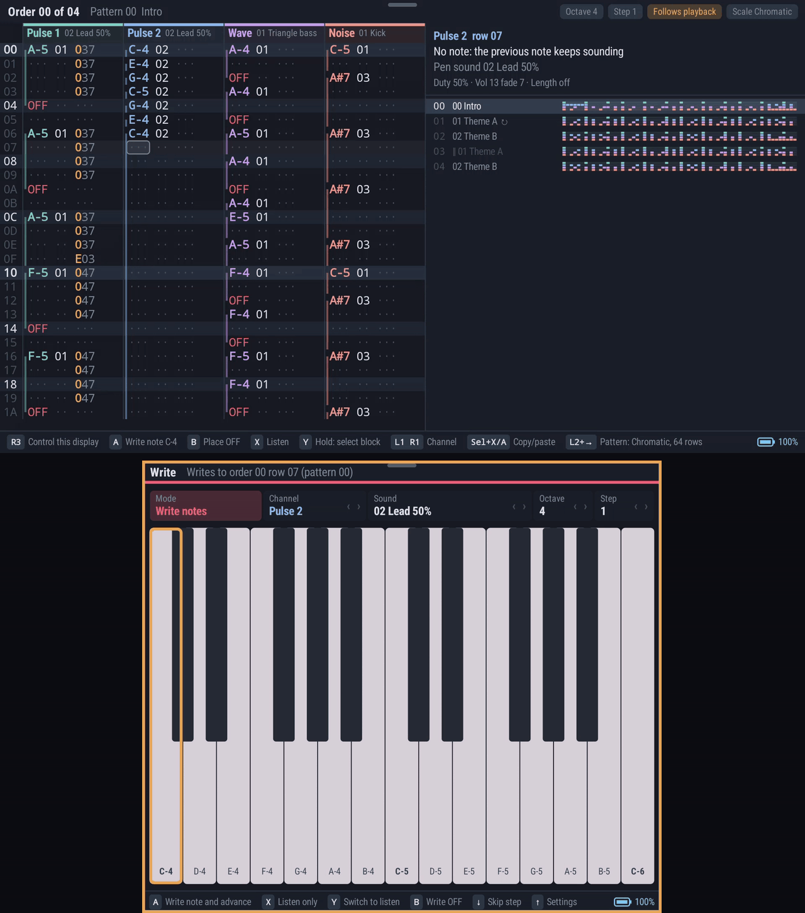

Two octaves of keys. **Listen** mode plays the selected instrument without writing anything. **Write** mode enters notes at the pattern cursor with the chosen step.

### View chords: R2 + A / B / X / Y

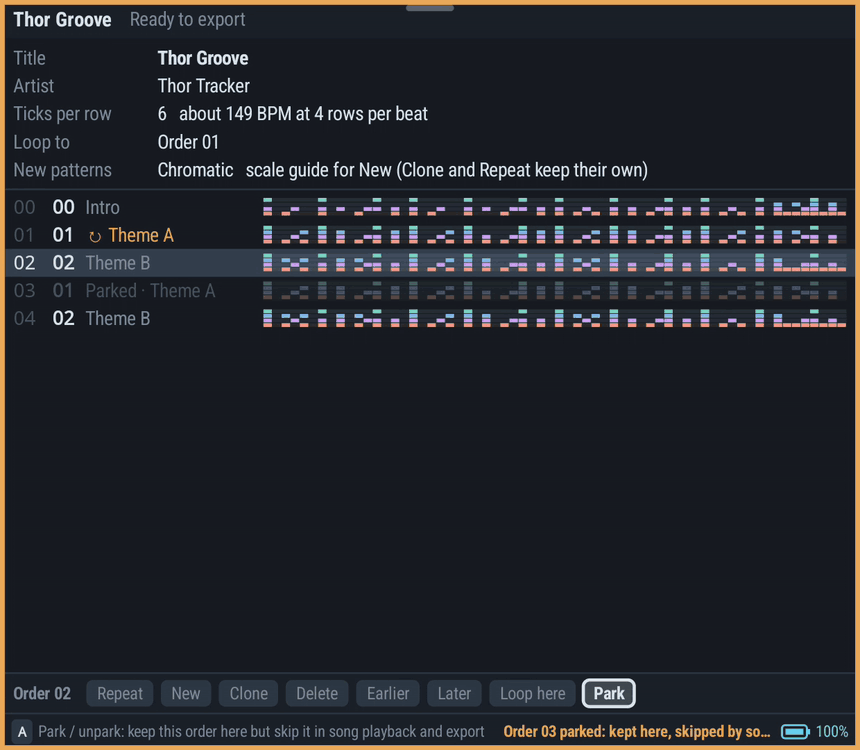

Hold R2 and press A, B, X or Y to show Song, Instrument, Sketch or Keyboard on the focused display. Press the same chord again to go back. R3 moves controller focus between the screens, and the focused screen has an amber border.

Hold **both** L2 and R2 (in either order) and press the same buttons to show that view on the **other** display while the controller stays where it is, e.g. L2 + R2 + Y puts Keyboard on the other screen beside the pattern you are editing. With one display, the view shows on it.

## Instrument workflow

Select the target channel and instrument field in Pattern, then open Instrument (**R2+B**).
Use a slot the channel can play: a mixed FM/PSG/sample system does not make its instrument
types interchangeable. New incompatible note/instrument assignments are refused; the
inspector and **Help → Check** explain existing problems.

**Sound and Advanced are two editors for the same instrument**, not separate presets or
synthesis engines. They share the instrument list and document Undo history. Switching faces
does not convert or normalize a native patch. A Sound control labelled **Custom** means its
native values do not match one of that control's choices; opening the face preserves them.

1. In **Sound**, **Up/Down** chooses the slot and **Left/Right** cycles controls.
   Hold **A+Left/Right** to adjust; **X** auditions. The horizontal cycle also reaches **Name**
   and **Sound/Advanced**; press **A** on the face selector to switch.
2. Use the musical controls for focused changes: Game Boy **Shape/Length** gives a short
   pluck or held sound; SID **Pulse/Color** shapes PWM and filter programs; Mega Drive FM
   **Brightness/Edge** changes modulation and feedback without replacing the whole voice.
   Controls differ by chip and voice type; unavailable controls reflect native limits.
3. Use **Advanced** for exact envelopes, table steps, operator registers, wave/sample data or
   mappings. Its navigation is editor-specific: follow the on-screen hints and **L1/R1**
   bank/page controls. On Sound's Name control, **A+Left/Right** edits the letter and
   **A+Up/Down** moves the letter cursor.
4. Touch **Sound/Advanced** to switch faces; drag musical controls horizontally.
   Hold **X** or **A** while changing a control to hear accepted edits.
   **Select+L1/R1**, or **L2+Left/Right** in sound views, changes the listening octave.
5. Return to Pattern and assign the slot to notes. Editing a shared slot affects all notes
   that use it, including other patterns; hearing a change on an already-sustained voice
   depends on the driver. Audition or retrigger a note to compare the patch.

A continuous adjustment is one Undo step (**L2+A**); **L2+B** redoes. Shared waves, samples,
noise generators, filters and envelopes retain their chip-specific ownership—choosing a
different slot does not necessarily duplicate those resources. See the
[instrument gallery and control mappings](INSTRUMENT_PANELS.md) and
[audio-engine/export contracts](AUDIO_ENGINE.md) for the selected system.

## How playback works

Projects use a versioned `.thor` document. Export formats and playback engines belong to the selected sound system. The Game Boy backend exports hUGETracker `.uge` v6 and plays the pinned hUGEDriver 6.1.3 inside binjgb, rather than an approximate sequencer; other backends have their own drivers/models and explicit export limits. The shared editor prepares playback updates away from the audio callback. See [the audio-engine contracts](AUDIO_ENGINE.md) for each backend.

## Build from source

Requires JDK 17, Android SDK platform 35, build tools, NDK `27.0.12077973`, and CMake `3.22.1`. The Gradle wrapper uses Gradle 8.9.

```sh
./tools/build.sh
# APK: app/build/outputs/apk/debug/app-debug.apk
adb -s YOUR_DEVICE install -r app/build/outputs/apk/debug/app-debug.apk
```

`tools/build.sh` uses the host JDK when available, otherwise the workstation's `ubuntu` Distrobox. It serializes Gradle with the shared workstation build lock, limits Gradle to one worker, and runs Kotlin compilation inside a single-use Gradle process rather than leaving compiler daemons resident across worktrees. The default JVM heap is 1 GiB. Local Linux builds require at least 8 GiB available memory and a working systemd user manager: the actual build runs inside a 4 GiB memory limit, with no swap, reclaim pressure above 3 GiB, and a two-CPU quota. The scope is created **inside** Distrobox, not around its client. GitHub Actions uses the runner's resource policy instead.

Compiler scratch defaults to `$XDG_CACHE_HOME/thortracker/tmp` (or `~/.cache/thortracker/tmp`); `TMPDIR` can select another disk-backed directory. Java receives the same temporary directory. Local Linux builds refuse RAM-backed scratch. Keep audio evidence on disk too: WAV/trace files in a tmpfs `/tmp` consume RAM/swap even after their renderer exits. Avoid running an Android emulator alongside large builds; use the reserved test handhelds where possible. A conventional environment with its own resource limits can instead run `./gradlew :core:jvmTest testDebugUnitTest assembleDebug` with `ANDROID_HOME` set. Both arm64-v8a and x86_64 are included; Android 8 or later is required.

On memory-constrained workstations, leave Kotlin/Native linking (including Linux tests and debug executables) to CI, then download and smoke-test its AppImage locally. A hard memory cap does not prevent file-cache churn: stop only the owned build scope if I/O or memory pressure rises, rather than raising the limits. Android/JVM and native-C checks can run separately.

Android's Ninja build uses a two-slot compiler pool per ABI as well: Gradle's worker limit alone does not bound native compiler parallelism. Desktop native sources already compile sequentially, and AppImage compression uses two workers.

The platform-independent code (document model, hUGE rules, lowering and `.uge` export, editor, keymap, panes and transport, and every view's drawing and touch handling) is the Kotlin Multiplatform module `core/`, built for the JVM (used by the Android app in `app/`) and for Kotlin/Native `linuxX64`. Views draw through a small `Surface` interface (rectangles, lines, circles, polylines, text); the app implements it over Android's `Canvas` in `CanvasSurface`, and `TrackerView` is a thin `View` around the shared `PaneView`. Its unit tests run with `:core:jvmTest`; `testDebugUnitTest` runs only the app's Android-specific tests. `:core:linuxX64Test` builds the Linux target and runs `CrossPlatformGoldenTest` there (it also runs on the JVM): number text, built-in tuning notes and bends, and the example `.uge` export must match the JVM results. The first run downloads the Kotlin/Native toolchain to `~/.konan`.

Every push and pull request runs the GitHub Actions `build` workflow (`.github/workflows/build.yml`): core and app unit tests, the core's Linux build, debug and release builds, the sample export compared byte-for-byte with `examples/thor-groove.uge`, and the native hUGEDriver host test. Each run attaches its debug APK. A push to `main` whose `versionName` (in `app/build.gradle.kts`) has no release yet publishes one: the workflow signs the APK with the release key held in repository secrets and publishes `v<versionName>`, with notes taken from that version's section of `docs/VERIFICATION.md`. To release, bump `versionCode`/`versionName` and add that section.

`tools/release.sh` builds the same signed APK locally into `dist/thor-tracker-<version>.apk` with its `.sha256`. It reads the key from `~/.local/share/thortracker/signing/` (or `$THORTRACKER_SIGNING_DIR`) and refuses any other signer or a debuggable build.

Generate a sample project and export:

```sh
./tools/build.sh exportSamples
# app/build/samples/thor-groove.thor
# app/build/samples/thor-groove.uge
```

`examples/` contains **Thor Groove** and **Controller Study** as editable `.thor` projects and Game Boy `.uge` exports.

## Views and displays

**One screen:** one full-size editor is visible at a time. Switch with the view chords or
the view menu; returning to a view retains its cursor. **Two screens:** each has an independent
editor, and either can show Pattern, Song, Instrument, Keyboard, Sketch, Help or an available
Wave editor. There is no fixed top/bottom role, and both may show the same view.
Available views depend on the sound system.

**Placement is not controller focus.** **R2+A/B/X/Y** shows Song/Instrument/Sketch/Keyboard
on the focused display; **R2+Up/Right/Down** shows Pattern/Wave/Help. Press the same chord
again to return. Add **L2** to place that view on the other display without moving focus;
on one screen, those chords use the visible display. **R3**, the Focus button, or
**Menu → Switch controller focus** changes which display the controller drives.
An amber border/title marker identifies it. Direct editor touch does not move controller focus.

Both editors share **one song, transport, clipboard and Undo history**, but retain pane-local
cursors, scrolling, zoom and display preferences. With **Follow selected item** enabled,
published selection updates the relevant subject—for example Pattern's order/row/channel,
or Instrument's slot. Stop following selection to navigate independently; selecting a sound
still updates the corresponding Pattern entry instrument.
Open **Menu → Views / layout** (or the Android toolbar's **Pinned / Context** button):

- **Pin this view / Allow contextual view changes:** keep the editor kind fixed, or let a
  non-focused view change kind with the selected item.
- **Follow selected item / Stop following selection:** follow published subjects such as
  channel, instrument or wave, or navigate independently.
- **Lock to this item / Unlock subject:** keep the current subject. Changing editor kind
  releases its old subject lock; swapping views preserves it.
- **Swap complete views / L2+X:** exchange view states, including cursor, scroll and zoom.
  Android can also swap to its other saved view with only one display; native single-screen
  frontends have no swap/focus action.
- **Pattern + keyboard / Pattern + instrument:** paired layout presets where available.
- **Follow playhead / Stop following playhead:** choose whether Pattern follows playback.
  This is separate from following editor selection.

Android persists its layout, behavior and controller mappings. Linux handhelds retain their
single view's zoom and controls; musical edits and Undo belong to the document.

**Menus and toolbars differ by frontend:**

- **Android main screen:** the persistent **Menu / Play** header opens a touch drawer for
  views, Files, tuning and editing commands. **Settings, controls and help** opens the full
  application menu. The on-screen controller dock appears when no usable physical controller
  is attached and hides when one connects. Hold its face buttons with arrows for edits;
  tap Select/L2/R2/L3 to latch a modifier, and tap again to release it. Direct cell, key,
  control and drawing gestures remain available with or without the dock.
  Dock input targets the primary display, unlike a direct editor touch on either display.
- **Android toolbar:** **Select+Start** reveals and focuses the overlay on the focused display.
  **Left/Right** chooses a button, **A** activates, and **B/Back** returns to the editor.
  It stays visible while controller-focused. On the secondary display, tap/pull the top-centre
  handle for a touch reveal, which hides after six idle seconds. Narrow toolbars omit
  dedicated Swap, Undo/Redo and File buttons; use **Menu** instead.
- **Steam Deck / Brick:** **Select+Start** opens the application menu directly; there is
  no Android overlay toolbar or touch controller dock.

Throughout this guide, **Menu → Files** means the application menu's Files submenu;
Android's touch drawer also provides **Files — new, open, save, export**.
In in-app menus, **Up/Down** chooses, **A** activates, **B/Back** returns and **L1/R1**
pages long lists. Android's document picker and text keyboard remain system-owned.

The hint bar shows current controls and battery state (cyan while charging, red at 15% or
below on battery). Hold a modifier to see its active chords. See
[View zoom](#view-zoom) for text/cell sizing and [Pattern workflow](#pattern-workflow)
for visual channel compression.

## Controller reference

Controls are rebindable in **Menu → Controls**, grouped by area with their current bindings.
Choose a row, then press a button or hold **Select, L2, R2 or L3** (at most two) before
pressing its chord button. Held controls—D-pad, Edit, Clear, Listen and Select block—need
single buttons. View-scoped actions can share a binding when their views do not overlap.
A conflicting assignment asks before unbinding the old action; D-pad, Edit and Clear must
remain bound. Menu/Back are fixed system keys, and right-stick double-flick gestures are not
rebindable. Hints, menus and Help show the active bindings for the focused view.

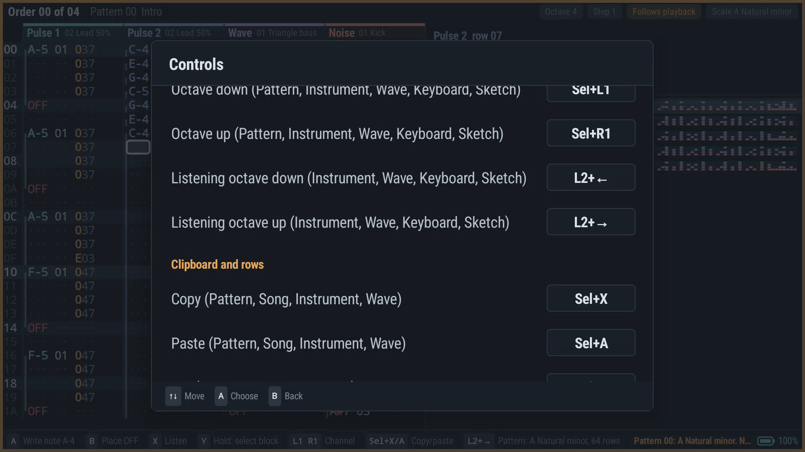

Bindings survive updates. **Export keymap…** saves `thor-tracker-keymap.json`;
**Import keymap…** restores it or transfers it to another handheld. Uninstalling or clearing
app data removes local mappings. Older keymaps migrate automatically: new actions gain their
defaults unless a binding conflicts in the same view, in which case the new action starts
unbound. Unmodified keymaps follow current defaults; customized mappings are retained.
Older app versions may reject newer keymap files. The table below lists the current defaults.

| Input | Action |
| --- | --- |
| D-pad | Move through fields, rows or tools |
| Hold A + D-pad | Change the selected value; horizontal fine, vertical coarse |
| Tap A | Enter the last note/value, or activate a command |
| Tap B | Clear the selected field; on an empty pattern note, place OFF |
| Hold B + D-pad | Move or jump without clearing on release |
| Hold X | Audition without writing |
| Hold Y + D-pad | Mark a pattern block |
| Right stick ↑ ↑ / ↓ ↓ | Pattern (controller-focused, pattern panel closed): two quick flicks the same way, letting the stick return to centre between them, move the cursor to the pattern's first / last row (its last played row for a shortened pattern). One flick, holding the stick, or flicks interrupted by a button press, a popup, the toolbar or a focus change do nothing; the D-pad and left stick are unchanged. Not rebindable |
| Right stick ← ← / → → | Under the same Pattern-only conditions, jump to the first / last channel's note cell, retaining the current row and order. Collapsed channels are included. Not rebindable |
| L1 / R1 | Change channel, instrument bank, wave or help page; NES Instrument view: envelope or DPCM page; C64 Instrument view: envelope, program, vibrato or tables page |
| L2 / R2 alone | No action; chord modifiers only |
| L2 + A / L2 + B | Undo / redo |
| R2 + A / B / X / Y | Show Song / Instrument / Sketch / Keyboard on the focused display; the same chord again returns to the previous view |
| R2 + ↑ / → / ↓ | Show Pattern / Wave / Help on the focused display, likewise; Wave is available only on backends with a Wave view |
| L2 + R2 + A / B / X / Y / ↑ / → / ↓ | Hold both triggers, in either order: show Song / Instrument / Sketch / Keyboard / Pattern / Wave / Help on the **other** display, keeping controller focus here (with one display, on it); again returns to the previous view |
| L2 + X | Android: swap complete views, including cursors, scrolling and zoom; native single-screen frontends: no action |
| Select + X / A / B | Copy / paste / cut, where supported by the current view; Song has no cut binding |
| Select + Y | Duplicate (C64 Instrument view, on a program row: a copy of the row below it) |
| Select + L1 / R1 | Lower / raise the octave (Pattern entry; listening note elsewhere) |
| L2 + Left / Right | Instrument, Wave, Keyboard, Sketch: lower / raise the listening octave; while X is held the sound restarts at the new octave |
| Select + Up / Down | Pattern: insert / delete a row in the channel or selection. Song: insert / delete an order |
| L2 + Left | Pattern: collapse/expand the focused channel to note-cell width. Visual only; hidden sounds and effects still play and export |
| L2 + Right | Pattern: open/close the current pattern's root/scale/length panel |
| Start | Play from row 00 of the current pattern's order, or stop |
| L2 + Start | Play from the current cursor, or stop |
| L2 + Y | Loop the current pattern on / off (header shows **Looping**). Playing, the loop keeps the current row if that pattern is playing, otherwise starts it at row 00; turning it off plays on through the song. While on, Start / L2 + Start loop whichever pattern they play. The loop follows its pattern when orders are inserted, deleted or moved. Editor playback only; the song's own loop and export are unchanged |
| Select + Start | Android: reveal/focus the toolbar or return to the editor. Steam Deck / Brick: open the application menu |
| R3 | Switch controller focus between displays |
| Menu / Back | Application menu; Back closes a popup or focused toolbar first |

A held adjustment or wave-drawing gesture is one undo step. Overlapping gestures on the two displays share a step that commits after both end. Undo during a held controller adjustment ends that step; further changes start a new step. Undo during a touch drag ends its edits until the finger lifts. Touch drags keep their original instrument or wave, and selection/playhead following waits until the gesture ends. Opening a menu or leaving the app ends active gestures and releases audition notes. **Menu → Play from song start** explicitly starts at order 0, row 0; it is not a toggle.

Canceled controller releases end the gesture without triggering a tap or advancing the cursor. Edits already made on press or during a held adjustment remain; cancellation is not Undo.

Window-focus loss or a controller removal/change cancels held edits, Listen notes and modifiers;
it never synthesizes a release tap. Focus-only cancellation leaves song transport playing.
Activity pause also stops transport. These are input/lifecycle rules, not Undo: edits already
made remain in the document.

Hold the modifier **before** pressing its chord button. While Select, L2, R2 or L3 is held, the focused display's hint bar shows only that modifier's chords that act in the focused view; while two are held (L2 + R2, pressed in either order), it shows that pair's own chords, or that no chord applies. With a modifier held, a button without a chord in that view does its ordinary job. With L2 and R2 both held, a button without an L2 + R2 chord does nothing if L2 or R2 alone has a chord for it, so a third-layer press never undoes or switches the view by mistake. An A press that precedes L2/R2 remains an ordinary edit; note entry is not delayed waiting for a possible chord. A button keeps the meaning it had when pressed until it is released, whatever happens to the triggers meanwhile; consumed chords suppress repeats and releases, even if a trigger is released first. Undo/redo and screen swap also work over app popups without choosing their highlighted item. Bare L3 is also unbound.

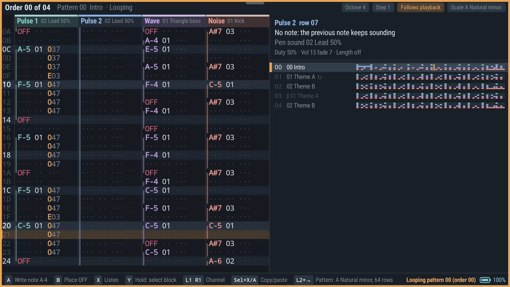

## Pattern workflow

Each lane has note and instrument fields followed by the selected backend's effect columns.
The inspector explains the focused field; **Help → Effects** lists that system's commands
and parameter limits. Effect letters/numbers, OFF behavior and legato are not universal
across sound systems.

Select an effect's **type** field and hold **A+Left/Right** to choose a command, then move
to its value field and adjust the parameter. Read the inspector before reusing a familiar
code: the same code can mean something different on another backend.

### Enter a phrase

1. Choose Pattern (**R2+Up**). **D-pad** moves through rows and fields; **L1/R1** changes
   channel. Hold **A+D-pad** to change a field (horizontal fine, vertical coarse; note
   entry uses scale/tuning steps where applicable). Tap **A** on an empty note cell to
   enter the last note with the current entry instrument; the adjacent sound field edits its assignment.
2. **Menu → Entry step** sets advance after entry to Stay, 1, 2, 4, 8 or 16 rows.
   Set an entry octave with **Select+L1/R1**. **Hold X** to audition without writing.
3. In Keyboard, **Y** toggles **Listen / Write**. Listen only auditions; Write enters
   notes at the shared pattern cursor and advances by the chosen step. This works on
   one screen as well as beside Pattern on two. **B** in Write enters OFF.
4. **Hold Y + D-pad** to mark a rectangular block; tap Y to drop the selection.
   **Select+X / Select+A / Select+B** copies/pastes/cuts the cell or block, including
   its instrument and **all** effect columns. Paste starts at the cursor and clips at
   pattern boundaries. **Select+Y** duplicates below; **Select+Up/Down** inserts/deletes
   a row in the channel or selected channels, shifting played rows rather than the whole song.
5. **B** clears a field (or the marked cells), without changing the clipboard.
   On an empty note cell it enters **OFF**; on Game Boy this consumes the row's effect
   slot, so clear an existing effect first. Other systems implement their own cut/release
   behavior. **L2+A / L2+B** undo/redo.
6. **Start** plays from row 00 of this order or stops; **L2+Start** starts from the cursor.
   **L2+Y** toggles an editor-only loop of the current pattern; turn it off to continue
   through the song. Use **Menu → Play from song start** for the complete arrangement.

New/Open resets remembered note, sound, effect and tuned-pitch entry for the new document; ordinary
edits, Undo/Redo and display swaps retain it. Instrument slot numbers from another song are not reused.
New note/sound assignments that a channel cannot play are refused before changing the song. For example,
PC Engine **noise snares need PSG 5 or PSG 6**; DDA/sample drums can use any PSG channel. Existing imported
data is retained, and clearing/OFF or repairing an invalid note remains possible.

**Collapsing channels.** In Pattern, **L2+Left** toggles the current lane between its full fields and a
note-only strip. Numbered `01+`, `02+`, … headers identify collapsed lanes; hidden effects have an amber
marker and invalid cells retain their warning underline. Navigation and touch selection skip hidden
fields; expanding restores the chosen effect-column count. Full-cell copy/paste still includes sounds
and every effect column. This is a per-pane workspace preference, preserved across restart and display
swaps—not a mute, song edit or export change. The action is rebindable in Controls; migrating an older
custom keymap preserves a conflicting binding and leaves the new action unbound rather than stealing it.

Use [Song view](#song-view-arrangement-loop-point-and-parked-orders) for tempo, order commands,
shared-pattern references, parking and the song loop. Pattern edits change every order that
references that pattern; Clone first when you need an independent variation.

Keyboard's base octave stops at 7; keys above B-8 are unavailable. A backend's smaller
note range or channel restrictions can further limit playable keys.

## Pattern reference

### Multiple effects per row

These are the current **effect-column limits per channel, per row**, not limits on the chip's
number of voices or on how many instrument envelopes can run:

| Columns | Systems |
| --- | --- |
| 1 | Game Boy/hUGEDriver; C64 SID/GoatTracker; Game Boy Advance/Maxmod |
| 2 | VIC-20; C16/Plus/4 TED; Virtual Boy |
| 4 | NES/FamiStudio and all expansion variants, including EPSM; Atari 2600 TIA (NTSC/PAL); OPL3; Mega Drive; Master System/Game Gear and both SMS FM layouts; AY/YM computers; PC Engine; SCC/SCC+; OPM; OPN/OPNA; POKEY; WonderSwan/Color; SAA1099 |


On a multi-column system, open the Pattern panel with **L2+Right** (or tap **Scale**) and choose
**Columns**. Left/Right changes the focused channel's visible count; L1/R1 selects a channel;
B returns to automatic. Automatic shows the columns used by that channel, with at least one.
Hiding a column does **not** disable its effects, and this display preference is independent per pane.
An automatic column stays visible while A is held to edit it, even if its last value becomes empty;
releasing or canceling the hold returns to automatic width without changing another effect.
The row's trailing dot and the lane header's **+n fx** identify hidden effects that still play.
**Help → Controls** explains Columns and the active shortcut bindings; **Help → Effects**
describes the selected backend's commands and their limitations.

**NES:** independent attributes combine left to right; the last duplicate wins. `Axy`/`Cxx` share
volume state, and `Qxx`/`Rxx` share one slide target. The first channel containing `Fxx` sets global
speed, using its last F column. For example, a pulse note can carry `C09 463 P84 F08` together.
FDS I/J combine modulation-speed bytes; 5B/EPSM I/J combine their shared envelope-period bytes,
with conflicting values on different squares reported rather than silently chosen.

Note delay and cut remain row-relative: an engine-lane cut must not precede its delayed note.
The separate MMC5 PCM lane cannot combine G and S on one row; use separate rows there. Existing
chip-specific legality and native-export limits still apply, including MMC5 PCM's NSF/text refusal.
Older Thor Tracker versions explicitly reject NES projects using extra columns; ordinary one-column
projects retain their existing encoding.

Several columns do not promise that every combination stacks. For example, Banjo's Sega backends
share one pitch-effect slot between arpeggio, slides, portamento and vibrato: the last such command
on the row wins. Commands for shared noise, filters, envelopes or LFOs can affect other channels.
Effect legality and note-start versus ongoing behavior remain backend-specific; see its Help.

Conversely, one row command does not stop an instrument's envelopes/tables or an already-running
effect from continuing. The one-column limits above describe the **current player and export
integration**, not a claim that the physical chips could never support a different tracker design.


### Pattern scales

Tap **Scale** in the Pattern header or press **L2+Right**. Up/Down chooses a panel field;
Left/Right changes it; B resets that field and A/Done (or L2+Right again) closes.
On **Notes**, A (or a tap) runs **Fit notes to scale**: played tonal notes outside the guide
move to the nearest scale note, ties downward, as one Undo step. Instruments and effects
stay; non-tonal channels, hidden rows and OFF are untouched. In a tuned song use
**Menu → Tuning → Fit notes** instead. The root strip and arrows are also touchable.

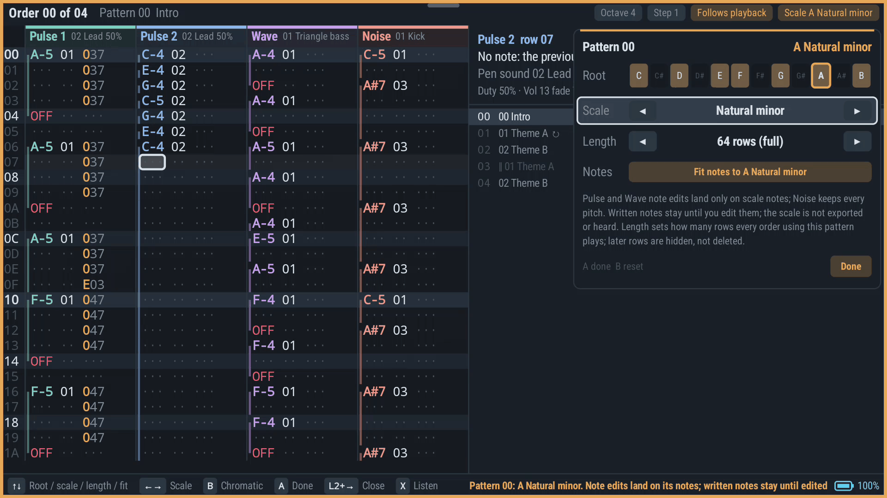

Moved notes are rewritten, and each one is marked in the grid with an amber field and a ▴/▾ tick showing which way it went; the inspector reads e.g. "Note G#5 · fitted from A-5". Fitting again after choosing another scale keeps the marks relative to the notes before the first Fit, so chained Fits show their total drift; a note that lands back on its original pitch loses its mark. A mark stays while its cell holds exactly what the Fit wrote: editing that cell (note, sound or effect) removes just its mark, other marks stay, and undoing the Fit removes them all. Inserting or deleting rows clears the pattern's marks, since the notes no longer sit where they were fitted. Marks are not saved with the project. **Menu → Tuning → Fit notes** marks its moves the same way, including a note whose `40y` bend alone changed (the inspector shows e.g. "fitted from E-5+7").

Chromatic is the default. Other guides constrain tonal D-pad entry to the pattern's root/scale:
Major, Natural/Harmonic/Melodic minor, Dorian, Phrygian, Lydian, Mixolydian, Locrian,
Major/Minor pentatonic, Blues, Whole tone, Phrygian dominant, Double harmonic, Hungarian minor,
Hirajoshi and Miyako-bushi (In). Horizontal edits visit scale notes; vertical edits move an
octave. Changing the guide never transposes written notes. Keyboard remains chromatic
unless a song tuning is active; effect parameters retain their backend meaning.

The guide belongs to the pattern, so repeated orders share it. It is undoable and saved in
`.thor`, and Clone/whole-pattern paste retain it; block paste copies cells only.
The guide itself is editor metadata, not a playback/export transposition.

### Microtuning (song tuning from a Scala `.scl` file)

To use an individual scale:

1. Choose **Menu → Tuning → Load .scl file…** and select a local Scala file in the file picker.
   The scale accepts ascending ratios or cents, with implicit 1/1 and the final degree as
   its repeating period; non-octave periods are supported. Files are limited to 64 KiB,
   256 degrees and an average interval of at least one cent.
2. In **Tuning**, set **1/1 sounds on…** and **Accuracy limit…** (5¢, 10¢ or 20¢).
   The status reports how many degrees the current backend can reach. Applying a scale
   preserves the previous root/limit when replacing another tuning and does not rewrite notes.
3. Enter notes on a supported tonal lane: horizontal note edits step through reachable
   degrees, vertical edits move a period; Keyboard maps keys to reachable degrees.
   To change existing material, explicitly choose **Fit notes in this pattern** or
   **Fit notes in whole song**. Undo restores the pre-fit notes.
4. Audition and run **Help → Check** before export. Save the `.thor` project to retain the
   chosen degrees, root, accuracy and source credit. **Remove tuning (back to 12-note)**
   leaves written cells unchanged; it does not reverse an earlier Fit.

**A Scala import is not a promise of arbitrary accurate pitch on every chip.** The backend's
note range, frequency resolution, fine-pitch commands or retuned tables determine what is
reachable. Error is measured against its own note grid, not necessarily ideal concert tuning;
noise/sample-trigger lanes are not generally tuned. Fine-pitch commands can compete for an
effect slot. Loading `.scl` cannot add fractional-pitch support to a backend that lacks it
(for example the current Sega 8-bit integration). **GBA/Maxmod rejects song microtuning**;
use twelve-tone notes there (pattern-scale guides still work). See the selected system's
Help and [engine contracts](AUDIO_ENGINE.md).

**Menu → Tuning → Tuning library…** contains **500 entries**: the four stock choices (19-TET, 22-EDO, 24-TET and 5-limit just intonation), **424 DaMuSc measured tunings** regenerated from its CC BY 4.0 data, and **1–72 EDO** generated independently. Collections offer categories, search and controller-friendly pages. Details show the actual degrees and period, source/licence credit and original Scala text; non-octave periods are not forced to an octave. Applying a tuning preserves the current root and accuracy limit, does not move written notes, and can be undone. **Tuning source…** retains its credit with the song.

See the [Scala scale-file specification](https://www.huygens-fokker.org/scala/scl_format.html)
for ratio/cents syntax; importing a scale is distinct from installing a catalogue below.

**Import pack…** installs a local UTF-8 `.thorscales` collection through the normal file picker. Same-id replacement requires confirmation; bundled collections cannot be replaced or removed. Removing a user collection leaves any tuning already selected in a song intact. Invalid Scala entries remain visible with their error, rather than disappearing. Packs are loaded only when opening the library, not at app startup.

Create a pack from a local directory without downloading anything:

```sh
python3 tools/tuning_packs.py local --input /path/to/scales \
  --output /path/to/my-scales.thorscales --id my-scales --name "My scales"
```

The optional `--attribution-file` adds a local credit/licence notice. Entry paths and raw Scala text are preserved, including duplicate musical content. A pack is limited to 16 MiB, 10,000 entries and 64 KiB per Scala source. Installed packs live in Android's app-private `files/tuning-packs` or Linux's `~/.local/share/thortracker/tuning-packs`; no automatic remote downloads occur.

Only the licensed DaMuSc subset, independently generated EDO scales and stock choices ship. Other collections from Naren's scale-library are **not redistributed**; optional installation does not grant redistribution rights. Bundled data and notices are in `app/src/main/assets/tunings/`; pinned licensed inputs and attribution are in `third_party/damusc/`. `python3 tools/tuning_packs.py bundled` reproduces the three default packs offline.

**Game Boy-specific realization:** the stock GB driver has no microtuning, so each tuned degree
uses the nearest note plus `40y`, a fixed upward bend of 0–15 driver steps. Degrees coinciding
with a normal note need no effect. Preview and `.uge` export use ordinary hUGE data.

- **Entry stays in tuning.** In a tuned song, hold A + Left/Right on a Pulse/Wave note steps through reachable degrees only; Up/Down moves a whole period. The Keyboard view plays and writes the nearest reachable degree. Noise is never tuned.
- **Reachable means within the accuracy limit**, measured against the driver's own 12-note grid (so plain notes stay plain and a 12-equal `.scl` needs no bends). That grid is itself up to about 25¢ off true 12-TET in the highest octaves, so the inspector's `±x¢` is relative to the driver, and absolute error can be larger there. Bends are tiny in low octaves: with 24-TET at 5¢, octave 5 has all 24 quarter tones, octave 6 has 23, octave 3 only the 12 ordinary notes. The status line after loading reports how many degrees are reachable.
- **The bend needs the row's effect slot.** If another effect is there, the editor refuses to bend that note rather than overwrite it, and Help → Song check warns about tuned notes that will play untuned.
- **Held notes keep their bend** on later rows; a new note sounds for its first tick (~17 ms) at the plain note before the bend applies — a driver limit verified in the native test.
- **Fit notes to tuning** (this pattern or the whole song) snaps existing Pulse/Wave notes to the nearest reachable degree in one undo step; notes whose effect slot is taken are left and counted. Applying or changing a tuning never moves notes by itself.
- The inspector shows each tuned note's degree and error (e.g. `7/24 +1.2¢`). Pattern scale guides and Sketch remain 12-note references in tuned songs.

### Pattern length and polyrhythms

The same panel's **Length** row sets how many rows the pattern plays, 1–64. Press Down to reach it; Left/Right changes it by 1, L1/R1 by 8, B returns to 64, and the ◀ ▶ arrows are touchable. Every order that uses the pattern plays that many rows and then moves to the next order. Rows past the length are hidden, not deleted: lengthening the pattern brings them back, and insert/delete row only shifts the played rows.

Length applies to every channel in the pattern, not to independent lane positions.
For polyrhythms, combine lengths in the arrangement (for example 48 then 20), or write
different phrases inside a common-multiple pattern. Song labels short patterns and shortens
their density strips proportionally.

The backend lowers shortened patterns for playback/export; on Game Boy the last played row
needs a free effect slot for `D01`, unless a `Dxx`/`Bxx` already ends it. Check reports occupied
slots or breaks targeting hidden rows. Clone and whole-pattern copy/paste retain the length.

### Sketch: explore a key, try phrases

Press **R2+X** to show Sketch; press the same chord to return. Android's touch Menu drawer
also offers Sketch. On two displays it can be pinned on either screen, swapped with
**L2+X**, or opened independently on both. On native single-screen frontends use the view
chord; there is no overlay toolbar.

- **Up/Down** chooses settings, chords, notes or phrase; **Left/Right** chooses within that row.
- On settings, **hold A + D-pad** to change root, scale, tonal channel, sound, octave or **Chords** (Triads or Circle). Touch the left/right half of a setting to decrease/increase it.
- **Hold A or X** on a chord to hear a repeating root-position arpeggio; on a note to sustain it. Release to stop. Touch and hold a pad, or slide between pads, for the same preview.
- **L1/R1** chooses among the selected system's tonal channels; non-tonal noise/sample-trigger lanes are excluded.
- **Y** or **Pattern key** returns to the pattern's root/scale. Until you change it, Sketch follows that guide; after a local change, the pattern's guide and all written notes remain untouched.

Seven-note scales show their stacked-third triads; stacks that are not major, minor, diminished or augmented (e.g. double harmonic's V) are left out. Other scales (pentatonics, blues, whole tone, Japanese scales) show only standard triads made entirely of their notes. Chromatic offers twelve note pads and asks you to choose a scale for a chord shortlist. Notes show pitch and interval degree; the selected chord marks its root, third and fifth. Degrees and roman numerals use major-scale-relative intervals (`b3`, `#4`, `bIII`, etc.); pitch names use the tracker's sharp spelling.

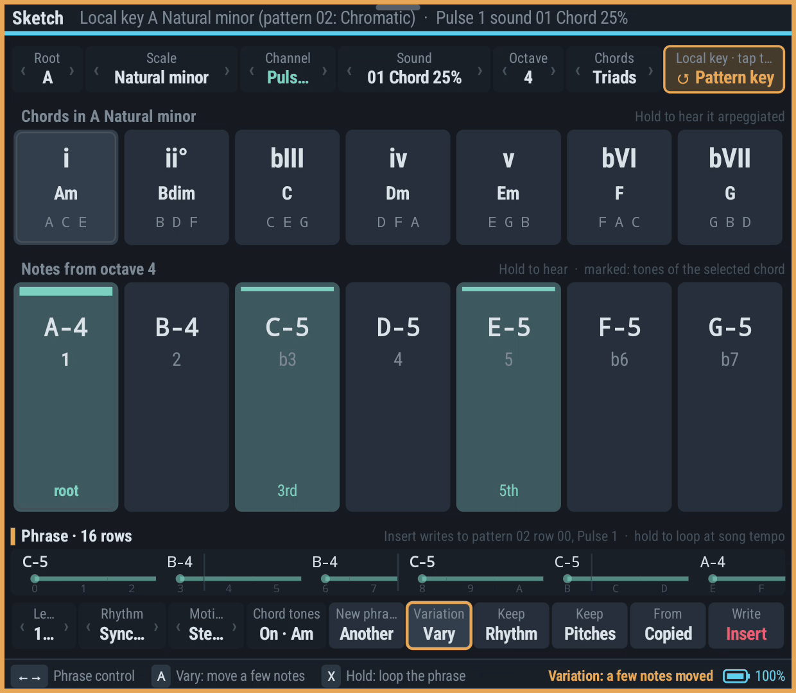

**Circle of fifths.** Set **Chords** to *Circle* and the chords row shows the twelve major keys clockwise by fifths (C at the top), their relative minors on the inner ring. Sketch's current key is filled; its IV and V neighbours on the same ring are marked. **Left/Right** moves the cursor by fifths, **B** switches between the major key and its relative minor, **hold A or X** hears that key's tonic triad, and **tap A** makes it Sketch's local key (Major or Natural minor). Touch works the same: hold a key to hear it, lift without sliding to choose it. A scale sits where its tonic's third puts it (D Dorian with D minor); Chromatic and scales without a major or minor third have no place. Y still returns to the pattern key.

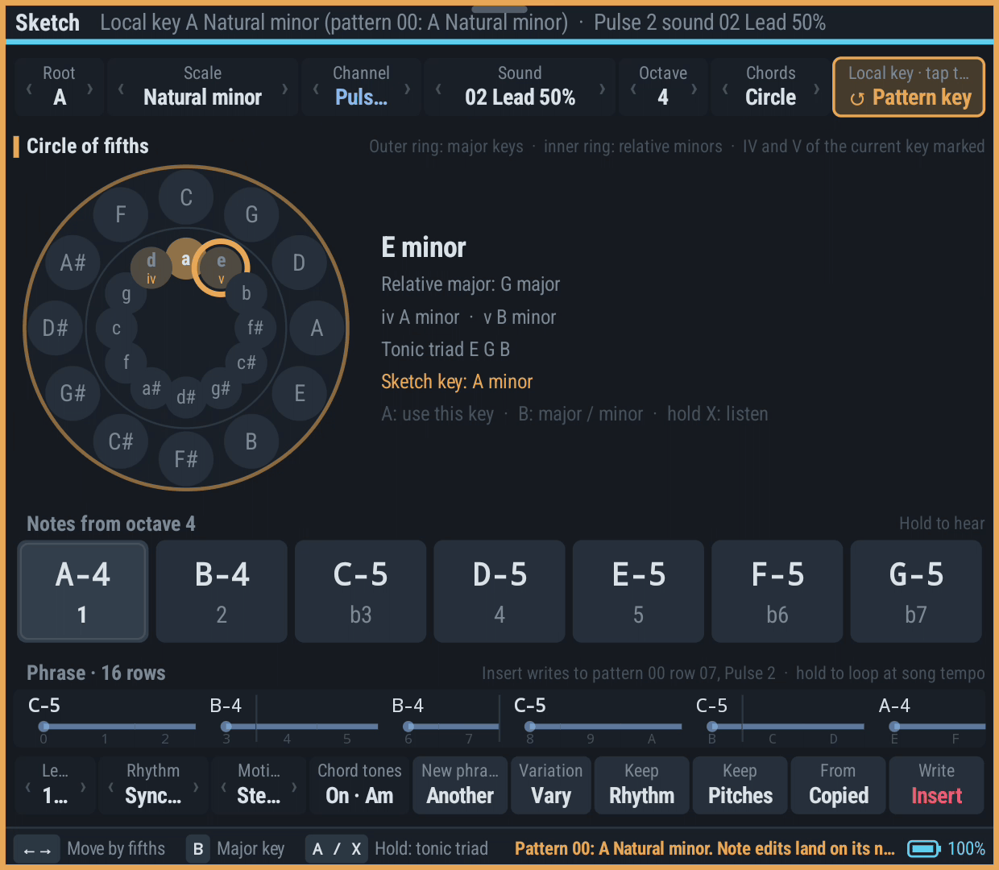

**Phrase.** The bottom row shows a short phrase, one column per row: a note name where a note starts, a held line while it sounds on, row numbers below. Left/Right walks the controls:

- **Length** (4–16 rows), **Rhythm** (Sparse, Even, Syncopated), **Motion** (Steps, Leaps, Rising, Falling) and **Chord tones** (strong rows land on the selected chord's tones): **hold A + Left/Right** changes them and regenerates the phrase from the same seed; tap A steps Rhythm/Motion or toggles Chord tones.
- **Another** draws a new phrase with these settings. **Vary** changes the current one: with **Keep rhythm** on, new pitches on the same rows; with **Keep pitches** on, the same notes on new rows; with neither, one to three notes move a scale step and maybe one note shifts a row. The two Keep toggles exclude each other.
- **From copied** turns the first channel of copied pattern cells (Select+X in the Pattern view) into the phrase.
- **Insert** writes the phrase at the pattern cursor (the shared selection) on Sketch's channel with Sketch's sound, as one undo step, then moves the cursor past it. Rows without a new note have their note and sound cleared so the previous note sounds on; effects stay. The phrase is cut at the pattern's end.
- **Hold X** anywhere on the row (or hold A on the phrase strip) loops the phrase, one row per step at the song's ticks per row. Touch and hold the strip for the same.

Generated notes come only from the key (any semitone for Chromatic), within about an octave and a half from the Sketch octave's root, and always start on row 0. The phrase keeps its notes when you change key or octave; Another and Vary use the current ones.

Apart from Insert, Sketch never writes notes or changes document Undo/export data. Its
key, circle, phrase and cursor are pane-local exploration state; Android retains these in
the workspace. Preview uses the song's selected instrument through the current backend.
Chord notes repeat every 180 ms; high voicings shift down together to fit the system's
note range. Releasing the preview, opening menus or changing views/focus ends held audition.

In a tuned song Sketch stays a 12-note reference (its header says so); Insert moves each note to the nearest reachable tuned pitch and skips, and counts, notes whose bend would need a row's occupied effect slot.

### Arpeggio and OFF

**Game Boy/hUGE:** the effect picker distinguishes no effect from **0 (arpeggio)**.
Selecting 0 shows `000` and its explanation; edit the value to make `0xy` (for example,
`047` alternates the note, +4 and +7 semitones). `000` itself remains no effect.

Game Boy **OFF** immediately silences the channel without a release tail and uses `E00`.
For stutter/retrigger, repeat a note with a nonzero instrument on successive rows.
hUGE has no dedicated retrigger command; other backends have their own effect sets and
OFF/release semantics. Consult **Help → Effects** rather than reusing commands across chips.

## Sound and export rules

Each song uses one backend's actual channel layout, patch types, effect rules and playback
engine. Open **Help → Effects** for commands and **Help → Check** for errors and warnings.
An invalid or unfinished song can still be saved as `.thor`; exports validate the selected
format and refuse content they cannot represent.

If a live edit cannot be lowered, playback retains the last playable version and displays
**Playing the last playable version, not your latest edits: …** until repaired.
Patch-update and audition behavior is driver-specific; do not assume a sustained note
reloads its instrument immediately.

**Game Boy/hUGE specifics:** two pulse channels, wave and noise; up to 64 rows; one effect
per lane/row; fifteen slots per pulse/wave/noise bank and sixteen shared waves.
Instrument 0 means **legato**, not a retrigger; after a cut it may remain silent.
Pattern edits apply from the next row without restarting transport. Instrument and wave
edits load on the next instrument-bearing note. Audition borrows its channel, which resumes
the song at its next note after release. Seeking reconstructs driver state by silent playback
of earlier rows, with the bound documented in the audio-engine contract.

**Menu → Files** lists the selected system's native formats and WAV. Examples include
Game Boy `.uge`, NES `.nsf`/FamiStudio text, SID `.sid`/GoatTracker, Mega Drive XGM2 and
GBA/Maxmod `.xm`; availability and restrictions differ by backend and instrument type.
VGM is a register log, WAV is rendered audio, and neither supplies a game's music driver.
Keep a `.thor` project as the editable source.

- [UGE export format, effects and limits](UGE_EXPORT.md)
- [Audio-engine architecture and export contracts](AUDIO_ENGINE.md)
- [Development roadmap](../PLAN.md)

## Export to WAV

**Menu → Files → Export .wav…** records the song as a 48 kHz 16-bit stereo `.wav`, on every sound system. The song is rendered offline by the same native player and chip emulation you hear while editing, so the file sounds exactly like playback from the song start, a lot faster than real time. A progress popup shows how far it is and can cancel the export; Back (or Hide) closes the popup while the export carries on, and Files → Export .wav shows it again. First choose the length:

- **Once through, then fade out** (the default): from the song start to the loop point (the first row the song plays a second time, wherever the order list or a jump sends it back, including a row that jumps to itself), then a 5-second fade-out while the song plays on into its loop.
- **Once + 1, 2 or 3 loops, then fade out**: as many extra passes of the loop before the fade.
- **Once through, no fade**: ends at the loop boundary. The file includes any intro; seamless looping is not guaranteed because chip phase and envelopes can differ between the beginning and end.

The fade-out is the looping song getting quieter, not a command releasing all notes: the engine interface has no song-wide "stop with release". When the faded song is silent (it ends by looping an empty pattern), the file keeps one second of silence after the last sound rather than the silent loop. The song part stops at 10 minutes if no loop point has been reached yet, or if the requested loop passes would run longer, then fades; the export reports that limit instead of calling the file complete.

The file is written to disk while it renders, so memory use stays small whatever the length. On Android it renders first; then **WAV ready** offers **Save .wav…** (the document picker) or **Discard**, so nothing appears in your storage until the file is complete. On the Steam Deck the file browser asks first (in `~/ThorTracker`), and the file appears there when it is complete. A cancelled or failed export leaves no partial file behind.

## About, diagnostics and bug reports

**Menu → Help**, page **About** (←/→ to the last page) shows the version, each sound system's driver with its version and source pins, and the licence. Press **A** there for:

- **Report a bug…** opens the [bug report form](https://github.com/esko997/thortracker/issues/new/choose) in the browser on Android; the Steam Deck shows the address to open.
- **Copy diagnostics** makes a plain-text report for the issue: version, device and system version, display sizes, the current song's sound system and driver, audio statistics (sample rate, burst/buffer size, underruns, slowest audio callback, driver faults), the keymap version and the last 20 status and error messages. Android copies it to the clipboard; Linux handhelds write `diagnostics.txt` in the projects folder (`~/ThorTracker` on Deck, `/mnt/SDCARD/ThorTunez` on Brick). It contains no song data.

Thor Tracker has no network access and no telemetry: nothing leaves the device unless you paste it somewhere yourself. To report a bug, open the form, fill in the version, device, sound system and the steps that show the problem, and paste the diagnostics. Attaching the `.thor` project (zipped) helps when the problem is in a song.

## Saving and recovery

Use **Menu → Files → Save / Save as…** for editable **`.thor` projects**, and **Open project**
to resume them. Save updates the associated project file or asks for a location when none is
associated; Save as chooses another file. The project retains the selected backend, patterns
(including unused/hidden material), instruments, arrangement and tuning metadata.
Exports are separate deliverables, not the recovery copy or a substitute for the project.

- **Android:** the system document picker chooses project and export locations; no broad
  storage permission is requested.
- **Steam Deck / Linux:** the in-app file browser starts in `~/ThorTracker`.
- **Brick:** projects and exports use `/mnt/SDCARD/ThorTunez`.

**Recovery protects the working document, not a version history.**

- Working changes are automatically written to a recovery file after a short debounce.
  Android also saves on activity pause; Linux handhelds keep the working copy in their data directory.
  These updates do **not** replace explicit Save of your named project.
- Replacing a document retains one previous-project backup, available through
  **Menu → Files → Recover previous project**. Another replacement overwrites that single slot;
  use named `.thor` files for versions you want to keep.
- Android quarantines unreadable recovery files intact and reports their retained location.
  Opening a project validates its version and structure before replacing the working document.

For a deliverable, open **Help → Check**, then choose the system-specific **Export** item
or **Export .wav…** in Files. A backend or format can reject unsupported content even when
the editable project saves successfully. See [Sound and export rules](#sound-and-export-rules)
and [WAV options](#export-to-wav).

Undo/redo is session history, not part of a saved project. Keep external backups; uninstalling
or clearing app storage removes app-private recovery. See [Project compatibility](#project-compatibility)
when exchanging files between versions.

## Project compatibility

- 0.28.0 saves **project format 10**, adding optional `tuning.provenance` for the chosen scale's identity and source credit—not the whole catalogue. **Earlier releases cannot open format 10**, including songs without a tuning. Formats 1–9 still open and migrate. The sound system remains in `backend`, its instruments in `sound`, and notes retain format 9's scientific pitch (0 = C0, A4 = 57 = 440 Hz); displayed names remain each tracker's own (hUGETracker's C-3 is C2). Formats 1–7 are Game Boy projects, development format 8 upgrades its old pitch convention, and legacy Game Boy `.uge` exports remain byte-identical. Missing older fields retain their documented defaults: Chromatic, 64-row, untuned patterns with nothing parked. The backend layouts below are independent of this outer project-format version.
- NES songs with the DPCM channel save NES data version 2 (`backendVersion` 2): a fifth pattern track (DPCM), the song's DPCM samples (`sound.samples`: name, DMC bytes, initial value) and each instrument's note → sample mappings (`dpcm`). NES data version 1 songs (0.9.0) open with an empty DPCM track and keep the whole song budget while they have no samples; releases before DPCM cannot open version 2 files. Game Boy files keep `backendVersion` 1 and are unchanged. NES + VRC6 songs save backend `nes-famistudio-vrc6` (NES data version 2): eight pattern tracks, `sound.expansion` = `"vrc6"`, and on VRC6 sounds `chip` = `"vrc6"` and `sawVolume` (`full`, `quarter`; Half is left out); plain NES files are written exactly as before. Releases before the VRC6 cannot open NES + VRC6 files.
- NES + VRC7 songs save backend `nes-famistudio-vrc7` (NES data version 2): eleven pattern tracks, `sound.expansion` = `"vrc7"`, `sound.vrc7Sustain` (`release`, `stop`; left out when both are off), and on VRC7 sounds `chip` = `"vrc7"` and `fm` (`preset` 0-15, 0 = custom, and the 8 patch `regs`; a built-in patch stores its ROM values, as FamiStudio does). Releases before the VRC7 cannot open these files; plain NES and NES + VRC6 files are unchanged.
- NES + N163 songs save backend `nes-famistudio-n163-<n>` (n = 1-8 channels, NES data version 2): 5 + n pattern tracks, `sound.expansion` = `"n163-<n>"`, and on N163 sounds `chip` = `"n163"` and `wave` (`size`, `position`, `waves` as lists of 0-15 samples, `repeat`, `loop`, `release`; left out at its default); a file whose backend and channel count disagree is refused.
- NES + Sunsoft 5B songs save backend `nes-famistudio-s5b` (NES data version 2): eight pattern tracks, `sound.expansion` = `"s5b"`, and on 5B sounds `chip` = `"s5b"`, `mixer` and `noise` envelopes, plus `s5b` hardware-envelope settings (`shape`, `autoPitch`, `octave`, `period`; omitted at their defaults). Earlier releases cannot open these songs; the existing NES variants retain their file formats.
- NES + FDS songs save backend `nes-famistudio-fds` (NES data version 2): six pattern tracks, `sound.expansion` = `"fds"`, and on FDS sounds `chip` = `"fds"` and `fds` (`waves` as lists of 64 samples 0-63, `repeat`, `loop`, `release`, `masterVolume`, `modulation` as 32 targets −64..63, `modSpeed`, `modDepth`, `modDelay`, `autoMod`, `autoModNumer`, `autoModDenom`; omitted at its default).
- NES + EPSM songs save backend `nes-famistudio-epsm` (NES data version 2): twenty pattern tracks (the 2A03's five, SSG 1-3, FM 1-6, the six rhythm drums), `sound.expansion` = `"epsm"` and `sound.epsmLfo` (register `$22`; left out at 0 = off); EPSM sounds have `chip` = `"epsm"` and, each left out at its default, the `mixer` and `noise` envelopes, `s5b` (`shape` such as `"saw-down"`, `autoPitch`, `octave`, `period`) and `epsm`, the FM patch (`algorithm`, `feedback`, `left`, `right`, `ams`, `pms`, four `operators` with the register fields `dt mul tl ks ar am d1r d2r sl rr ssgEg`). The rhythm ROM is device firmware, never part of a project. Releases before the EPSM cannot open NES + EPSM files; other files are unchanged.
- C64 SID songs save backend `c64-sid`, SID data version 1 (`backendVersion` 1): three pattern tracks; `sound` holds the 63 instruments (ADSR nibbles, `restart` hard/gateOff/legato, gate timer, first wave, `vibrato`, and `wave`/`pulse`/`filter` programs as `[left, right]` GoatTracker table rows plus `at`, the table row the program is placed at so its rows stay put across edits), the `chip` (`8580` or `6581`), `multispeed` (1-16) and the hard-restart envelope. GoatTracker's song-wide tables are not stored: the instruments' programs and the effects' speeds build them when the song plays or exports. Key on is note -3 (SID only). Releases before the SID cannot open these files; Game Boy and NES backend layouts are unchanged.
- OPL3 songs save backend `opl3-fm`, OPL3 data version 1 (`backendVersion` 1): nine pattern tracks whose cells may carry up to four effect columns — a cell is `[note, instrument, effect, param]` followed by `effect, param` for each further column it uses (trailing empty columns are not written, so one-column cells look exactly as before); `sound` holds the 64 instrument slots (`null` = empty; otherwise `name`, `fourOp`, `algorithm`, `feedback`, four `operators` with the chip's register fields `mult tl ar dr sl rr wave ksl am vib sustain ksr`, and the drum `sweep` start/end/speed), the chord-shape table `chords` (`name`, 1-4 `intervals`), `multispeed` (1-8) and the `deepTremolo`/`deepVibrato` depths. Releases before the OPL3 cannot open these files; Game Boy, NES and SID backend layouts are unchanged.
- Mega Drive songs save backend `ym2612-fm`, data version 2 (`backendVersion` 2). The original ten FM/PSG tracks are followed by three PCM tracks. Version 1 songs migrate by appending empty PCM tracks to every pattern, including parked patterns; their notes, effects and tonal data capacity are preserved. `sound` retains the 64 slots, region and LFO, adds `fm3Mode` (`normal`/`special`) and `pcmSamples`, and accepts `"type":"pcm"` kits with a level and note-to-sample mappings. FM instruments add four `ch3` offsets in 1/64 semitones; the existing operator registers, sweep and PSG envelopes are unchanged. Earlier Mega Drive releases cannot open version 2 files. Other systems' backend layouts are unchanged.
- AY-3-8910 / YM2149 songs save backend `ay-zx128`, `ay-msx`, `ay-atari-st` or `ay-cpc`, AY data version 1 (`backendVersion` 1): three pattern tracks whose cells may carry up to four effect columns as OPL3 cells do; `sound` holds `variant` (`"zx128"`, `"msx"`, `"atari-st"` or `"cpc"`, matching the backend) and the 64 instrument slots (`null` = empty; otherwise `name`, the `volume`/`arpeggio`/`pitch`/`mixer`/`noise` envelopes (`values`, `loop`, `release`, as NES envelopes), `pitchRelative`, `envelope` (`shape` 0 or 8-15, `auto`, `octave`, `period`, `sync`) and the drum `sweep`). Earlier releases cannot open these files; other systems' backend layouts are unchanged.
- MSX SCC and SCC+ songs save backend `msx-scc` or `msx-scc-plus`, SCC data version 1 (`backendVersion` 1): five pattern tracks whose cells may carry up to four effect columns as OPL3 cells do; `sound` holds `variant` (`"scc"` or `"scc-plus"`, matching the backend), the 64 instrument slots (`null` = empty; otherwise `name`, the `volume`/`arpeggio`/`pitch`/`wave` envelopes as NES envelopes (`values`, `loop`, `release`), `pitchRelative` and `restart`), the 64 `waves` (`name`, 32 `samples` -128..127) and `multispeed` (1-8). Releases before the SCC cannot open these files; other systems' backend layouts are unchanged.
- PC Engine songs save backend `pce-huc6280`, data version 1: six tracks with up to four effect columns. `sound` stores the 64 instrument slots, 32-step 5-bit waves, DDA sample frames and the shared master balance, LFO and timer settings. Sample copying carries its frame data across documents; earlier releases cannot open PC Engine projects.
- OPM songs save backend `ym2151-opm`, OPM data version 1 (`backendVersion` 1): eight pattern tracks whose cells may carry up to four effect columns as OPL3 cells do; `sound` holds the 64 instrument slots (`null` = empty; otherwise `name`, `algorithm`, `feedback`, `pms`, `ams`, four `operators` with the YM2151's register fields `dt1 mul tl ks ar am d1r dt2 d2r d1l rr`, `noise` and `noiseFrequency`, and the drum `sweep`), `multispeed` (1-8) and the chip's shared state at the song start: `lfoRate`, `lfoWave`, `amd`, `pmd`, `csm`, `timerA`. Releases before the OPM cannot open these files; other systems' backend layouts are unchanged.
- PC-88/98 songs save backend `ym2203-opn` (6 tracks: FM 1-3, SSG 1-3) or `ym2608-opna` (16 tracks: FM 1-6, SSG 1-3, the six rhythm drums, ADPCM), data version 1, in project format 10, cells with up to four effect columns; `sound` holds `chip` (`"ym2203"` / `"ym2608"`), the 64 sound slots (`null` = empty; otherwise `"type":"fm"` with the Mega Drive's FM fields plus `ch3`, four FM 3 operator pitch offsets in 1/64 semitones; `"type":"ssg"` with `volume`/`arpeggio`/`pitch`/`mixer`/`noise` envelopes, `pitchRelative`, the hardware `envelope` and `sweep`; `"type":"rhythm"` with `level`, `left`, `right`; `"type":"adpcm"` with `sample`, `root`, `level`, `left`, `right`, `loop`, `sweep`), the ADPCM-B `samples` (`name`, `rate`, `data` as Base64 ADPCM-B bytes), `timerB`, `fm3Mode`, `timerA`, `lfo` and `rhythmLevel`. The rhythm ROM is device firmware, never part of a project. Releases before these systems cannot open them; other files are unchanged.
- Atari 8-bit (POKEY) songs save backend `atari-pokey`, POKEY data version 1 (`backendVersion` 1), in project format 10: four pattern tracks (POKEY 1-4) whose cells may carry up to four effect columns as OPL3 cells do; `sound` holds the 64 instrument slots (`null` = empty; otherwise `name`, `kind` (`tone`, `joined`, `filtered`, `joined-filtered` or `sample`), `fast`, the `volume`/`arpeggio`/`pitch`/`distortion` envelopes (as NES envelopes), `pitchRelative`, and when not at their defaults `filterOffset`, `difference`, `partnerDistortion`, `partnerVolume`, `sample`, `root`, `rate` and `loop`), the `samples` (`name`, 4-bit `levels`), `machine` (`ntsc` or `pal`), `multispeed` (1-4), `poly9` and `base15` (the noise generator and base clock at the song start). Releases before the POKEY cannot open these files; other systems' files are unchanged byte for byte.
- VIC-20 and C16 / Plus/4 songs save backend `vic20-vic` or `c16-ted`, data version 1 (`backendVersion` 1), in project format 10: four (VIC: Bass, Alto, Soprano, Noise) or three (TED: Voice 1, Voice 2, DAC) pattern tracks with up to two effect columns; `sound` holds `chip` (`VIC`/`TED`), the 64 `instruments` (`null` = empty; otherwise `name`, `kind` `TONE`/`SAMPLE`, `wave` 1 square / 2 noise, the `volume` (master), `arpeggio`, `pitch` and `waves` envelopes (`values`, `loop`, `release`), `pitchRelative`, and for samples `sample`, `root`, `loop`, `loopStart`), the TED's `samples` (`name`, `data` = frames 0-8), `video` (`PAL`/`NTSC`), `multispeed` (1-4), the start `volume` and the TED's `dacTimer`. Older releases cannot open these files.
- Virtual Boy songs save backend `vb-vsu`, VSU data version 1 (`backendVersion` 1), in project format 10: six pattern tracks (Wave 1-5, Noise) whose cells may carry up to two effect columns as OPL3 cells do; `sound` holds the 64 instrument slots (`null` = empty; otherwise `name`, `wave`, `level`, `envelope`, `grow`, `interval`, `repeat`, `autoLength`, `length`, `noiseTap`, `freqMod` and the pitch `sweep`), the five song-wide `waves` (32 values 0-63 each) and the `modulation` table (32 values −128..127). Releases before the Virtual Boy cannot open these files; other systems' files are unchanged byte for byte.
- SAA1099 songs save backend `sam-saa1099` or `cms-saa1099`, SAA1099 data version 1 (`backendVersion` 1), in project format 10: six or twelve pattern tracks whose cells may carry up to four effect columns as OPL3 cells do; `sound` holds `variant` (`"sam"` or `"cms"`, matching the backend), the 64 instrument slots (`null` = empty; otherwise `name`, the `volume`/`arpeggio`/`pitch`/`mixer` envelopes as NES envelopes (`values`, `loop`, `release`), `pitchRelative`, `noise`, `panLeft`, `panRight` and `envelope` (`null` or `shape`, `threeBit`, `invertRight`, `external`, `rate`, `retrigger`)) and `multispeed` (1-8). Releases before the SAA1099 cannot open these files; other systems' files are unchanged.
- Recovery writes use a separate queue from document-provider I/O, so a stalled external save cannot block recovery of newer edits. Both run off the UI thread.
- Saving captures the version selected for that operation. If editing continues, the app reports that newer edits remain unsaved. Completing an older save cannot attach its destination to a different document.
- Android document providers control the durability and atomicity of writes to their own destinations; the app-private recovery copy remains separate.


## Verification commands

```sh
./tools/build.sh :core:jvmTest testDebugUnitTest assembleDebug assembleDebugAndroidTest exportSamples
./tools/audio/run_native_host_test.sh
adb -s YOUR_TEST_DEVICE install -r app/build/outputs/apk/debug/app-debug.apk
adb -s YOUR_TEST_DEVICE install -r app/build/outputs/apk/androidTest/debug/app-debug-androidTest.apk
adb -s YOUR_TEST_DEVICE shell am instrument -w org.thortracker.test/androidx.test.runner.AndroidJUnitRunner
```

CI additionally runs `:core:linuxX64Test` and builds/smoke-tests the optimized desktop AppImage.

Only run device checks on a device reserved for the test; the controller workflow test edits the app's working document. Host playback checks produce a WAV and driver trace under `evidence/audio/`. The sample `.uge` has also been converted with gbc-puzzler's pinned `uge2source`, built into an isolated copy of the game and exercised by its actual-ROM sound smoke; the original game worktree is not modified.

## License

Thor Tracker is free software: you can redistribute it and/or modify it under the terms of the GNU General Public License as published by the Free Software Foundation, either version 3 of the License, or (at your option) any later version. It is distributed in the hope that it will be useful, but WITHOUT ANY WARRANTY; without even the implied warranty of MERCHANTABILITY or FITNESS FOR A PARTICULAR PURPOSE. See [LICENSE](../LICENSE).

The bundled third-party components keep their own licenses, all compatible with the GPL (see Dependencies).

## Dependencies

binjgb is MIT licensed; its full notice is in `app/src/main/cpp/third_party/binjgb/LICENSE` and bundled in the APK's `assets/NOTICE.txt`. hUGEDriver 6.1.3 is public domain and pinned under `third_party/`. The Steam Deck build adds SDL3 (zlib license), stb_truetype (public domain / MIT) and the Noto fonts (SIL Open Font License, `deck/fonts/OFL.txt`); its AppImage carries the same `NOTICE.txt`. See the audio document for exact source revisions and the one-time player-image regeneration procedure.

Maxmod is ISC licensed. The legacy mmutil conversion code retains its ISC notices and
the distribution's BSD-3-Clause licence; all are bundled in `NOTICE.txt`. The GBA starter
samples are original generated waveforms. Imported samples need their own permission
for redistribution with a game.

The NES system (0.9.0) adds the FamiStudio sound engine 4.5.3 (its own all-permissive notice; its note tables, including the VRC6 saw, VRC7 and N163 (1-8 channel) note tables, and the test songs are MIT), pinned under `third_party/famistudio-4.5.3/` and pre-assembled into `app/src/main/cpp/generated/nes_player_image.h` (and, built with its expansion support, `nes_vrc6_player_image.h`, `nes_vrc7_player_image.h` and `nes_n163_<n>_player_image.h` for 1-8 N163 channels); the `m6502.h` 6502 emulator from floooh/chips (zlib license); blip_buf 1.1.0 (LGPL-2.1-or-later); and, for the VRC7's FM channels, emu2413 1.6.4 by Mitsutaka Okazaki (MIT, github.com/digital-sound-antiques/emu2413 commit `a1d51209`), all under `app/src/main/cpp/third_party/`. The 2A03 APU and the VRC6 and Namco 163 audio emulation are Thor Tracker's own code (the N163 written from the NESdev wiki's "Namco 163 audio"). All notices are in `NOTICE.txt`.

The FDS build additionally uses FamiStudio's MIT-licensed FDS note tables and `nes_fds_player_image.h`. Its audio emulation is Thor Tracker's own code, written from the NESdev wiki's "FDS audio"; the DAC levels are the 2C33 measurements by plgDavid and Persune as tabulated in FamiStudio's `Nes_Fds.cpp` (LGPL-2.1-or-later). The packaged notice records the scoped driver corrections.

The C64 SID engine adds the GoatTracker 2.77 playroutine by Lasse Öörni (its own notice: not under the GPL, free for any use), pinned under `third_party/goattracker-2.77/` and pre-assembled into `app/src/main/cpp/generated/sid_player_image.h`, and reSID 1.0 by Dag Lem (GPL-2.0-or-later, github.com/daglem/reSID commit `02c456ab`) under `app/src/main/cpp/third_party/resid-1.0/`, built as C++17 (the app and the Deck link the C++ runtime). GoatTracker's packer and assembler are used offline only (`tools/audio/fetch_goattracker.sh`). Notices are in `NOTICE.txt`.

The OPL3 (YMF262) FM engine is Thor Tracker's own player in C on Nuked-OPL3 1.8 by Nuke.YKT (LGPL-2.1-or-later, github.com/nukeykt/Nuked-OPL3 commit `765ec962`) under `app/src/main/cpp/third_party/nuked-opl3/`, resampled with the same blip_buf; it exports VGM. The notice is in `NOTICE.txt`.

The Mega Drive (YM2612) engine streams Thor Tracker's player through SGDK's unmodified XGM2 Z80 driver (MIT, Stephane Dallongeville; `third_party/sgdk-xgm2/`, SGDK commit `9a78a441`). `tools/audio/prepare_ym.py` assembles `app/src/main/cpp/generated/xgm2_driver_image.h` and checks it byte-for-byte against SGDK's `drv_xgm2`. The driver runs on floooh's `z80.h` (zlib, the `m6502.h` pin), with ymfm (BSD-3-Clause, Aaron Giles, commit `81aec25c`, `app/src/main/cpp/third_party/ymfm/`) and Thor Tracker's SN76489. The stream encoder follows SGDK's XGM2 driver/xgm2tool formats; exports are VGM and unpacked/packed XGM2. The notices are in `NOTICE.txt`.

The OPM (YM2151) engine is Thor Tracker's own player in C (`app/src/main/cpp/opm/`) on ymfm's YM2151 (the same ymfm pin, `81aec25c`; its `ymfm_opm.h/.cpp` fetched unmodified at that commit), clocked at 4 MHz as in the X68000 and resampled with blip_buf; it exports VGM. The notice is in `NOTICE.txt`.

The NES + EPSM variant assembles the same FamiStudio engine with its EPSM support (FamiStudio's EPSM note tables, MIT, under `third_party/famistudio-4.5.3/NoteTables/`, into `nes_epsm_player_image.h`) and emulates the YMF288 with the same ymfm pin (its `ymf288` class). The YM2608 rhythm ROM that its rhythm channels play is Yamaha's data: it is **not** distributed with Thor Tracker in any form (source, APK, AppImage, demos, exports); users import their own copy (see "NES + EPSM" above), which stays in the app's private storage.

The PC-88/98 systems (YM2203 and YM2608) are Thor Tracker's own player in C (`app/src/main/cpp/opn/`) on the same ymfm pin (its `ym2203` and `ym2608` classes), resampled with blip_buf, and export VGM. Their YM2608 rhythm drums play the same user-imported rhythm ROM as the EPSM (one import for both, never distributed); their ADPCM-B samples are the song's own (imported or generated by Thor Tracker's own synthesis code).

The Sega 8-bit systems use the unmodified Banjo sound driver (MIT, joffb/banjo commit `7aaf837ebbe67e567e019b5819b5467bf62253ad`, under `third_party/banjo/`) on the same z80.h, with Thor Tracker's SN76489 and emu2413 in YM2413 mode. WLA-DX is an offline build tool only. Source pins and reproduction commands are in `docs/AUDIO_ENGINE.md`; notices are bundled in `NOTICE.txt`.

The AY-3-8910 / YM2149 systems play Thor Tracker's own player on its own AY/YM emulation (`app/src/main/cpp/ay/`), resampled with blip_buf; the per-level DAC tables are ayumi's measured tables (MIT, Peter Sovietov, github.com/true-grue/ayumi commit `07c08b4`, vendored unmodified in `third_party/ayumi/`, where the native host test also uses it as an independent reference). They export VGM. The notice is in `NOTICE.txt`.

The PC Engine system runs Thor Tracker's own player on Mednafen 1.32.1's HuC6280 PSG (GPL-2.0-or-later, compatible with this project's GPL-3.0-or-later licence). The unmodified PSG source and licence are under `app/src/main/cpp/third_party/mednafen-pce-psg/`; a small compatibility shim connects it to the shared blip_buf. The Mednafen notice is bundled in `NOTICE.txt`.

The MSX SCC and SCC+ engine is Thor Tracker's own player in C on our port of MAME's Konami 051649/052539 sound logic (BSD-3-Clause, Bryan McPhail; `src/devices/sound/k051649.cpp` at MAME commit `20d4667c`, ported in `app/src/main/cpp/scc/scc_k051649.c` with its notice), resampled with the same blip_buf; it exports VGM. The notice is in `NOTICE.txt`.

The Atari 8-bit POKEY engine is Thor Tracker's own player in C on Thor Tracker's own cycle-exact POKEY model, written from the Altirra Hardware Reference Manual (Avery Lee) with Altirra 4.40's generator formulas, mixing table and output filter ported (GPL-2.0-or-later) and MAME's `pokey.cpp` (BSD-3-Clause) consulted, resampled with the same blip_buf; it exports VGM. Demo: **Scanline Cruise**. The notices are in `NOTICE.txt`.

The VIC-20 and C16 / Plus/4 engines are Thor Tracker's own player in C on code adapted from VICE's `vic20sound.c` (Rami Räsänen and Ville-Matias Heikkilä, GPL-2.0-or-later, VICE svn-mirror commit `c60cc7af`) and plus4emu's TED sound (István Varga, GPL-2.0-or-later, commit `939e6523`), in `app/src/main/cpp/cbm/`, resampled with the same blip_buf. The notices are in `NOTICE.txt`.

The Virtual Boy (VSU) engine is Thor Tracker's own player in C on a VSU core ported from Mednafen 1.32.1's `vb/vsu.cpp` (GPL-2.0-or-later, the Mednafen Team), amended to the hardware behaviour documented in Guy Perfect's *Virtual Boy Sacred Tech Scroll*, resampled with the same blip_buf; it exports VGM. The notice is in `NOTICE.txt`.

The SAA1099 engine is Thor Tracker's own player in C on our clock-exact port of SAASound's SAA1099 model (BSD-3-Clause, Dave Hooper and Simon Owen; github.com/stripwax/SAASound commit `3d923220`, ported in `app/src/main/cpp/saa/saa_core.c` with its notice), resampled with the same blip_buf; it exports VGM (one SAA1099 for the SAM Coupé, two for the Creative Music System). The notice is in `NOTICE.txt`.
