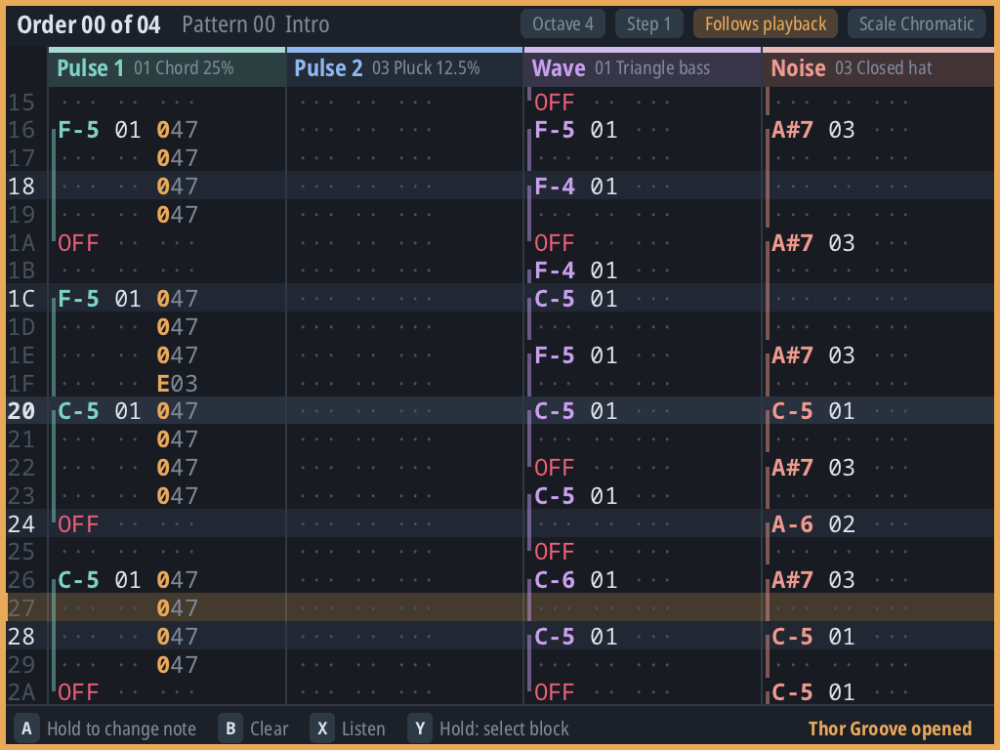
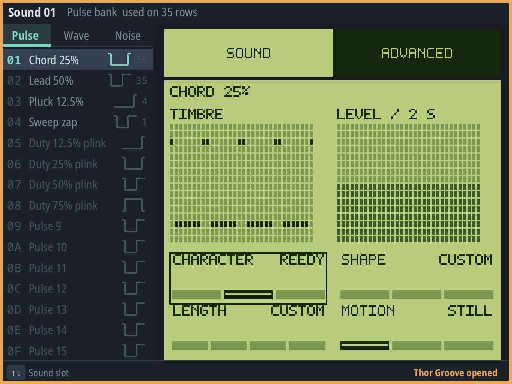
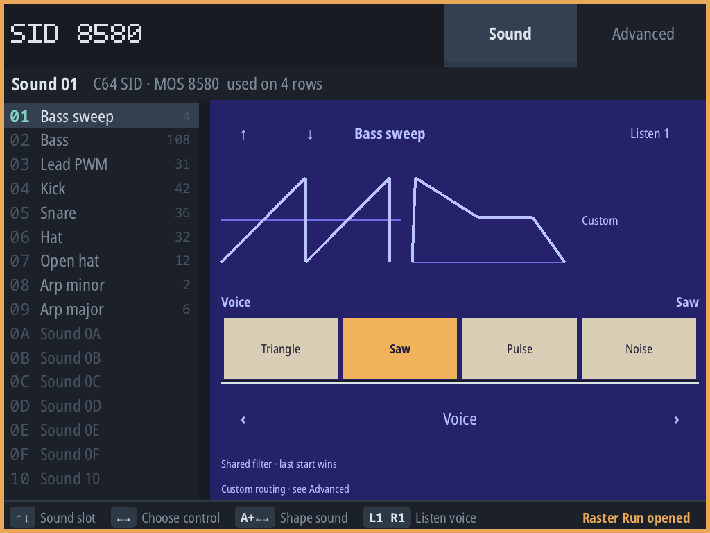
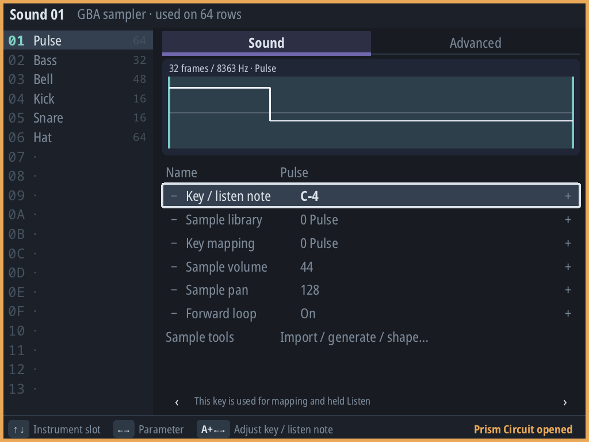

# NextUI Pak Store entry — draft for review

**Not submitted.** Review the wording and experimental visibility before opening a
[New Pak Submission](https://github.com/LoveRetro/nextui-pak-store/issues/new?template=new-pak-submission.yml).

## Listing

- **Display name:** Thor Tracker
- **Repository:** https://github.com/esko997/thortracker
- **Category:** Media
- **Experimental:** recommend **No** for normal store discoverability, with the soft-launch limitations stated clearly. **Yes** hides it until users unlock the experimental category; this choice remains for the submission review.
- **Manifest/install name:** `ThorTracker` / `ThorTracker.pak` (keep the existing upgrade path).
- **Release asset:** [`ThorTracker.pak.zip`](https://github.com/esko997/thortracker/releases/download/v1.0.0/ThorTracker.pak.zip), with its `.sha256` sidecar.
- **Licence:** GPL-3.0-or-later; bundled components retain their notices.

### Suggested blurb

Make chiptunes on your handheld. Thor Tracker is a controller-first music tracker
with classic console and computer sound systems, musical instrument panels, sample
editing and system-specific exports. Compose with the D-pad and buttons, explore
sounds, and keep your songs outside the Pak so updates preserve your work.

### Additional information

The NextUI port is a **soft launch, tested on Brick Hammer**. Other `tg5040` devices
are not yet verified. Physical sleep/wake and prolonged stress remain manual-test
items; this is not an all-workload audio-performance guarantee.

Projects and exports live in `/ThorTunez`, with recovery/settings in hidden
`/ThorTunez/.thortracker`. Preserve both when upgrading. The store ZIP extracts
inside `Tools/tg5040/ThorTracker.pak/`; the separate versioned manual ZIP extracts
at the SD-card root. No account, telemetry, in-app networking or proprietary chip
firmware is included.

[Documentation and first-session guide](https://esko997.github.io/thortracker/)
· [Release and checksums](https://github.com/esko997/thortracker/releases/tag/v1.0.0)
· [Known limits and verification](VERIFICATION.md)

## Screenshots

Actual **1024×768 Brick Hammer display captures**, using bundled/public demo songs,
not personal projects or mockups. Captured with the released 0.45.0 runtime on
2026-11-13; 1.0 changes packaging/version metadata, not these views. Source PNGs are
listed in root `pak.json` and are suitable for the store's screenshot field.

### 1. Compose a phrase

The bundled **Thor Groove** demo playing in the Game Boy pattern editor.

### 2. Explore a Game Boy instrument

Musical Sound controls beside the normal instrument list; Advanced remains available.

### 3. Shape a SID voice

The **Raster Run** demo's bass instrument in the SID 8580 Sound panel.

### 4. Work with samples

The **Prism Circuit** demo's pulse sample in the GBA/Maxmod instrument editor.

## Submission boundary

The GitHub release, root manifest and screenshots can be public before the listing.
Do not submit the store issue or a community announcement until the owner reviews
this draft. Local ZIP installation is verified separately from the Pak Store
application's downloader/database; do not claim a store-install test before acceptance.
