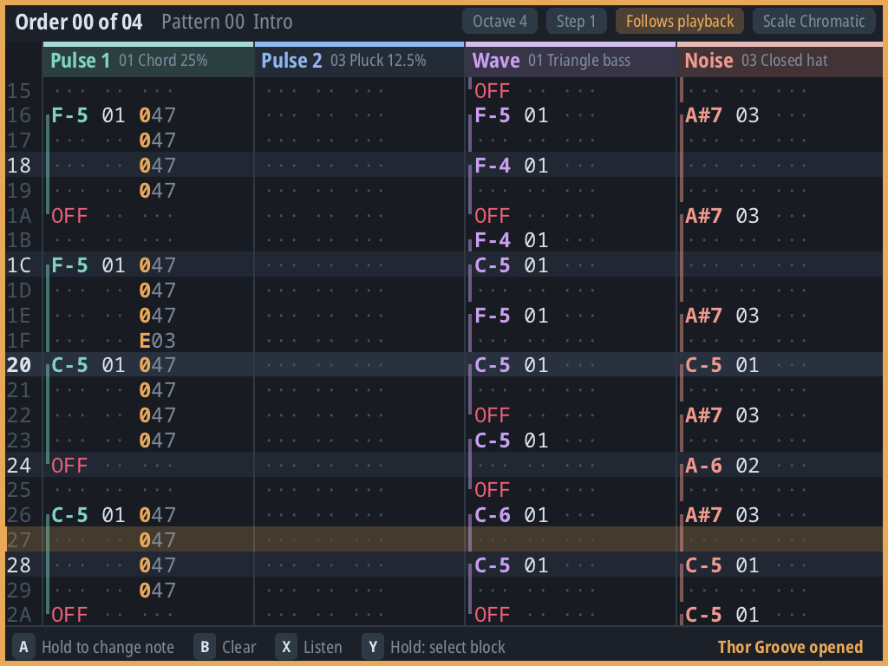
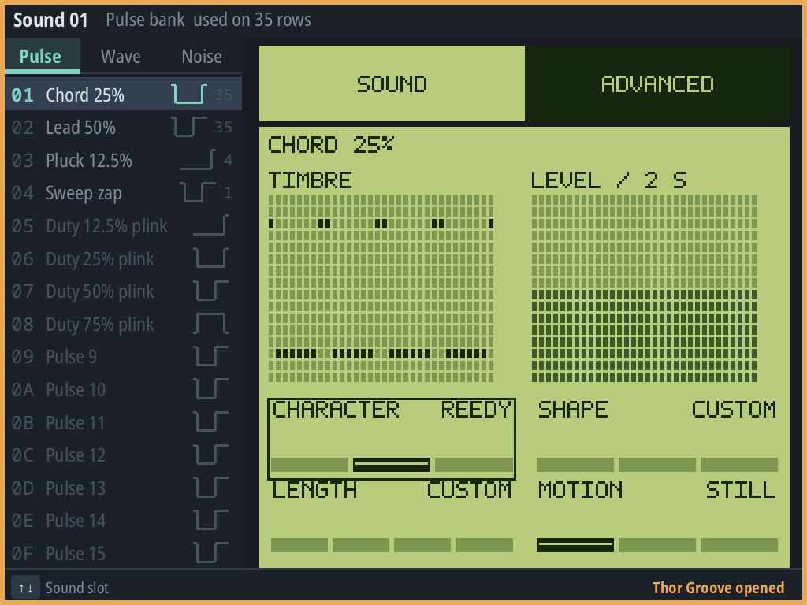

# Make music, one row at a time.

Thor Tracker is a controller-first music tracker for Android handhelds, Steam Deck and Brick Hammer. Write patterns, shape instruments and arrange a song around a sound chip's real capabilities.

<a href="/downloads/">Download & install</a><a href="/getting-started/">Write your first phrase</a>

**Thor Tracker 1.0.0** is available for Android, x86_64 Linux and Brick Hammer with NextUI.

<figure class="hero-shot">

<figcaption>Brick Hammer screenshot.</figcaption>
</figure>

## Choose your instrument bench

<a href="/downloads/#install"><strong>Android handhelds</strong>APK · single or dual screen</a><a href="/downloads/#steam-deck"><strong>Steam Deck / Linux</strong>x86_64 AppImage · one view at a time</a><a href="/downloads/#brick-hammer--nextui"><strong>Brick Hammer</strong>NextUI tg5040 · ARM64 Pak</a>

Use the D-pad to navigate, hold A to edit, and press Start to hear the song. Switch between Pattern, Song, Instrument, Wave, Keyboard, Sketch and Help without leaving the controller. The [controller reference](/controls/) covers the complete default map and rebinding.

## Work with the chip, not around it

Each song targets one [sound system](/systems/). Channel layouts, instruments, effects and export formats follow that system. A Game Boy song is not an unrestricted synthesizer, and a register-log export is not a ready-to-run game driver.

Use [project files](/files/) to keep editable work. Export audio or the formats supported by the selected system. Conversion between systems reports losses before you apply it; it does not promise identical sound.

## Shape the sound

<figure class="hero-shot">

<figcaption>Musical Sound controls and precise Advanced editing work on the same instrument. SID, FM, wavetable and sample instruments have controls suited to their own sound system.</figcaption>
</figure>

See the [Sound systems guide](/systems/) for available voices, effects, export formats and limitations.

## A manual beside the machine

- [Getting started](/getting-started/): enter notes, arrange a phrase and find the views.
- [Projects & exports](/files/): save, recover, convert and deliver music.
- [Troubleshooting](/troubleshooting/): installation, silence, firmware and useful bug reports.
- [Complete manual](/manual/): the repository README, including detailed instrument and tuning instructions.
- [Source & licences](/licenses/): free software, bundled components and source pins.

On Android, the touchscreen controller dock and navigation drawer provide the same editing controls without a gamepad. Connecting a controller hides the dock.
